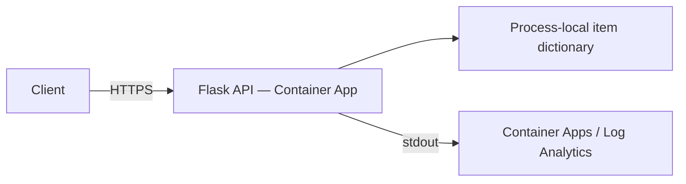

# API Flask đơn giản — Azure Container Apps

**Cấp độ:** Người mới bắt đầu · **Thời gian:** 30–45 phút bao gồm thiết lập

Triển khai một API CRUD Python Flask với Azure Developer CLI (azd). Bao gồm mã nguồn, Dockerfile,
Bicep và các tham số triển khai. Đây là một **ví dụ học tập**, không phải
một API sẵn sàng cho sản xuất.

## Những gì bạn sẽ học

- Xây dựng và xuất bản một container thông qua azd.
- Cấu hình ingress và probe liveness/readiness.
- Xác minh phản hồi CRUD và kiểm tra nhật ký ứng dụng.
- Hiểu tại sao dữ liệu trong bộ nhớ không phù hợp cho các ứng dụng bền vững.



**Quan trọng:** các mục được giữ trong một tiến trình. Mặc định là **một worker Gunicorn,
0–1 bản sao**, tránh cố ý đảm bảo dữ liệu nhất quán giữa các worker/bản sao.
Các mục sẽ mất khi khởi động lại, thay đổi phiên bản, hoặc thu nhỏ về 0. Tăng số bản sao
yêu cầu bộ nhớ lưu trữ bền dùng chung. API không có xác thực hay phân quyền.

## Yêu cầu trước

- [azd ổn định hiện tại](https://learn.microsoft.com/azure/developer/azure-developer-cli/install-azd)
  (phiên bản công bố tại thời điểm xem xét: 1.37.2).
- [Azure CLI](https://learn.microsoft.com/cli/azure/install-azure-cli) để kiểm tra.
- Docker với daemon đang chạy; cần thiết cho việc xây dựng ảnh cục bộ mặc định.
- Tài khoản Azure, quyền tạo tài nguyên và hạn ngạch khu vực Container Apps.
- Bash cho các lệnh dưới đây (hoặc PowerShell tương đương).
- Python 3.11 cho phát triển cục bộ tùy chọn.

```bash
azd version
az version
docker info
azd auth login
az login
```

Các công cụ CLI có phiên đăng nhập riêng biệt. Dùng cùng một subscription ở cả hai.

## Bắt đầu nhanh

Từ thư mục gốc của kho lưu trữ:

```bash
cd examples/container-app/simple-flask-api
azd env new flask-demo
azd up
API_URL=$(azd env get-value API_ENDPOINT)
RG_NAME=$(azd env get-value AZURE_RESOURCE_GROUP)
API_NAME=$(azd env get-value API_NAME)
curl --fail-with-body "${API_URL}/health"
```

Mong đợi: HTTP 200 và JSON với `"status":"healthy"`,
`"service":"simple-flask-api"`, và dấu thời gian UTC hiện tại.
Quá trình cấp phát và xây dựng ảnh thường mất vài phút; thời gian có thể thay đổi.

Cấp phát ban đầu sử dụng ảnh hello-world công khai lắng nghe trên cổng 80.
`azure.yaml` chọn `infra/app/api.bicep` và tệp tham số khớp để
triển khai dịch vụ, chuyển ảnh, ingress và probes thành cổng 8000.
Không xóa các tham số triển khai này.

## Xác minh CRUD

Chạy các lệnh sau theo thứ tự trong khi bản sao cùng hoạt động:

```bash
# Create: HTTP 201; note the returned id (1 for a fresh process).
curl -i -X POST "${API_URL}/api/items" \
  -H "Content-Type: application/json" \
  -d '{"name":"Test Item","description":"My first item"}'

# Read list: HTTP 200, total 1 in a fresh process.
curl --fail-with-body "${API_URL}/api/items"

# Replace 1 if your create response returned another id.
curl --fail-with-body "${API_URL}/api/items/1"
curl -i -X PUT "${API_URL}/api/items/1" \
  -H "Content-Type: application/json" -d '{"name":"Updated Item"}'
curl -i -X DELETE "${API_URL}/api/items/1"
curl -i "${API_URL}/api/items/1"
```

Thành công: POST 201, đọc/PUT 200, DELETE 204 không có nội dung, sau đó 404 cho mục mất.
JSON bị sai định dạng/không phải đối tượng hoặc tên rỗng trả về 400.
Nếu một mục biến mất giữa các yêu cầu, kiểm tra khởi động lại hoặc thu nhỏ về 0;
đây là giới hạn bộ nhớ trong do thiết kế, không phải lưu trữ bền.

| Điểm cuối | Phương thức |
|---|---|
| `/` | GET — thông tin dịch vụ |
| `/health` | GET — liveness/readiness |
| `/api/items` | GET, POST |
| `/api/items/{id}` | GET, PUT, DELETE |

## Nhật ký và cấu hình

```bash
az containerapp logs show --name "$API_NAME" --resource-group "$RG_NAME" --follow
```

Mong đợi: Gunicorn khởi động, nhật ký truy cập yêu cầu, và thông điệp ứng dụng.
`azd monitor --logs` mở một cửa sổ portal; nó không phát trực tiếp ra terminal.
Application Insights đã được cấp phát nhưng **không được cài đặt qua code Flask này**;
sử dụng Container Apps/Log Analytics để xem nhật ký stdout.

Chỉnh sửa `infra/app/api.bicep` cho CPU/bộ nhớ, giới hạn bản sao hoặc quy tắc scale, sau đó
chạy `azd up`. Mặc định là 0.5 vCPU, 1 GiB, tối thiểu 0 / tối đa 1 bản sao, và
ngưỡng HTTP 50 yêu cầu đồng thời. Thu nhỏ về 0 có thể gây độ trễ khởi động lạnh.

Giá trị `azd env set MAX_REPLICAS`, `API_KEY`, `LOG_LEVEL` hoặc
`SCALE_TO_ZERO_TIMEOUT` tự do **không được kết nối với mẫu hoặc ứng dụng này**.
Việc đặt giá trị không tự động biến nó thành biến môi trường khi chạy.
Ảnh bind cổng 8000 rõ ràng; cập nhật Dockerfile, ingress Bicep và probes
cùng nhau nếu thay đổi cổng.

## Tệp

```text
azure.yaml
infra/main.bicep
infra/main.parameters.json
infra/app/container-apps.bicep       # Environment, registry, monitoring
infra/app/api.bicep                  # App, ingress, probes, scale settings
infra/app/api.parameters.json        # Image and resource values for azd deploy
src/app.py
src/Dockerfile
src/requirements.txt
```

## Phát triển cục bộ

Từ thư mục ví dụ này:

```bash
python -m venv .venv
source .venv/bin/activate  # PowerShell: .\.venv\Scripts\Activate.ps1
python -m pip install -r src/requirements.txt
python src/app.py
```

Trong terminal khác, kiểm thử `http://localhost:8000/health` và các điểm cuối CRUD.
Hoặc xây dựng và chạy ảnh thực tế:

```bash
docker build -t flask-api:local ./src
docker run --rm -p 8000:8000 flask-api:local
```

Với các thay đổi chỉ trong code sau khi triển khai lần đầu, chạy `azd deploy api`.
Với thay đổi Bicep, chạy `azd up` để cấp lại và triển khai.

## Bài tập thực hành

### 1. Xác thực từ chối đầu vào không hợp lệ

**Điểm bắt đầu:** API đã triển khai, `API_URL` phía trên.
**Mục tiêu:** xác minh API từ chối các JSON sai định dạng và tên bị thiếu.

```bash
curl -i -X POST "${API_URL}/api/items" \
  -H "Content-Type: application/json" -d '[]'
curl -i -X POST "${API_URL}/api/items" \
  -H "Content-Type: application/json" -d '{"name":""}'
```

**Tiêu chí thành công / giải pháp:** cả hai trả về 400 với lỗi JSON, không phải 500.
**Vấn đề phổ biến:** thiếu header content-type JSON.

### 2. Thêm điểm cuối chỉ đọc

**Điểm bắt đầu:** `src/app.py`. **Mục tiêu:** mở rộng và triển khai lại API.
Thêm đoạn này trước khối `if __name__ == '__main__':`:

```python
@app.route('/version', methods=['GET'])
def version():
    return jsonify({'version': '1.0.0'})
```

Chạy `azd deploy api`, sau đó `curl --fail-with-body "${API_URL}/version"`.
**Tiêu chí thành công:** HTTP 200 và `{"version":"1.0.0"}`.
**Vấn đề phổ biến:** đặt tuyến đường sau câu gọi chặn `app.run()` khi
thử nghiệm với `python src/app.py`.

### Điểm kiểm tra kiến thức

Tại sao một worker không đủ cho dữ liệu bền? Bởi vì ngay cả một tiến trình cũng mất
từ điển của nó khi khởi động lại. Phiên bản sản xuất cần lưu trữ chia sẻ bền bỉ,
xác thực, phân quyền, di cư, kiểm thử, và giám sát vận hành.

## Chi phí và xử lý sự cố

Đây không phải là triển khai $0 đảm bảo: registry Basic và lưu trữ/nhập nhật nhật ký
có thể phát sinh phí ngay cả khi tính toán ứng dụng là 0. Dùng
[máy tính giá](https://azure.microsoft.com/pricing/calculator/) cho khu vực của bạn.

- **Xây dựng Docker thất bại:** xác nhận `docker info`, truy cập mạng, và phụ thuộc.
- **Ứng dụng không khỏe mạnh:** kiểm tra nhật ký bảng điều khiển/hệ thống và xác minh cổng ảnh, ingress,
  và probes đồng nhất. Thứ placeholder không được probe trên cổng Flask.
- **403/quyền:** xác nhận subscription và quyền tạo tài nguyên.
- **Mục mất:** trạng thái trong bộ nhớ bị đặt lại khi khởi động lại/thu nhỏ về 0; thêm cơ sở dữ liệu
  cho hành vi bền bỉ.

## Dọn dẹp và bước tiếp theo

```bash
azd down
```

Xem lại nhắc nhở xóa và xác minh nhóm tài nguyên chuyên dụng đã được gỡ bỏ.
Không dùng dọn dẹp phá hủy trên nhóm tài nguyên có dữ liệu không liên quan.

[Tiếp theo: Ứng dụng cơ sở dữ liệu](../../../../../examples/database-app) · [Microservices](../../../../../examples/container-app/microservices) ·
[Tổng quan về Container](../README.md) · [Trang chủ khóa học](../../../README.md) ·
[Báo lỗi](https://github.com/microsoft/AZD-for-beginners/issues)

---

<!-- CO-OP TRANSLATOR DISCLAIMER START -->
**Tuyên bố miễn trừ trách nhiệm**:
Tài liệu này đã được dịch bằng dịch vụ dịch thuật AI [Co-op Translator](https://github.com/Azure/co-op-translator). Mặc dù chúng tôi cố gắng đảm bảo độ chính xác, xin lưu ý rằng bản dịch tự động có thể chứa lỗi hoặc sai sót. Tài liệu gốc bằng ngôn ngữ gốc nên được coi là nguồn tin chính thức. Đối với thông tin quan trọng, nên sử dụng dịch vụ dịch thuật chuyên nghiệp bởi con người. Chúng tôi không chịu trách nhiệm về bất kỳ hiểu lầm hoặc giải thích sai nào phát sinh từ việc sử dụng bản dịch này.
<!-- CO-OP TRANSLATOR DISCLAIMER END -->