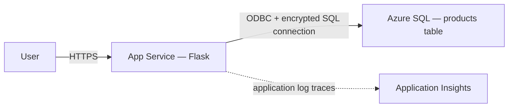

# Flask và Azure SQL trên App Service

**Cấp độ:** Trung cấp · **Thời gian:** 30–60 phút bao gồm các điều kiện tiên quyết

Mẫu này triển khai API đọc Python Flask lên **Linux App Service** và một cơ sở dữ liệu Azure SQL Basic. Mã nguồn, Bicep và cấu hình azd được bao gồm. Đây là một ứng dụng học tập, không phải kiến trúc cơ sở dữ liệu sẵn sàng cho sản xuất.


## Những gì bạn sẽ học

- Cung cấp tài nguyên App Service, SQL và giám sát với Bicep.
- Cấu hình kết nối SQL được mã hóa mà không cần cam kết thông tin đăng nhập.
- Khởi tạo lược đồ trước khi bắt đầu các worker Gunicorn.
- Xác minh dữ liệu đã được tạo, phản hồi không tìm thấy và sức khỏe cơ sở dữ liệu.



Tài nguyên: nhóm tài nguyên dành riêng, kế hoạch dịch vụ ứng dụng Linux B1, ứng dụng Web Python 3.11,
máy chủ SQL và cơ sở dữ liệu Basic 2-GB, Application Insights và Log Analytics.
Ứng dụng Web sử dụng **triển khai mã nguồn/ZIP và cài đặt phụ thuộc Oryx**;
`azd deploy` không xây dựng hoặc triển khai Dockerfile tùy chọn.

## Yêu cầu tiên quyết

- Phiên bản ổn định hiện tại của [azd](https://learn.microsoft.com/azure/developer/azure-developer-cli/install-azd)
  (phiên bản phát hành tại thời điểm đánh giá: 1.37.2).
- [Azure CLI](https://learn.microsoft.com/cli/azure/install-azure-cli) để xác minh.
- Đăng ký Azure, quyền tạo các tài nguyên liệt kê, và hạn mức theo vùng.
- Python **3.11** cho phát triển cục bộ; `pyodbc==5.0.1` đã cam kết có thể yêu cầu
  các công cụ xây dựng bản địa trên các phiên bản Python mới hơn.
- Microsoft ODBC Driver 18 (hoặc 17) cho SQL Server trên máy cục bộ. `pip install
  pyodbc` không cài đặt trình điều khiển hệ thống. Xem
  [cài đặt ODBC](https://learn.microsoft.com/sql/connect/odbc/download-odbc-driver-for-sql-server).
- Docker chỉ khi thử nghiệm container tùy chọn cục bộ.

```bash
azd version
az version
azd auth login
az login
```

Sử dụng cùng một đăng ký trong cả hai công cụ. Các lệnh dưới đây dùng Bash.

## Triển khai

Từ thư mục gốc của kho lưu trữ:

```bash
cd examples/database-app
azd env new sql-demo
azd provision
azd deploy
WEB_URL=$(azd env get-value WEB_APP_URI)
WEB_NAME=$(azd env get-value WEB_APP_NAME)
RG_NAME=$(azd env get-value AZURE_RESOURCE_GROUP)
```

Chọn một vùng hỗ trợ. `sqlAdminLogin` mặc định là `sqladmin`; tham số cần thiết
`sqlAdminPassword` là một tham số bảo mật. Cung cấp mật khẩu mạnh khi được nhắc.
Giữ thông tin đăng nhập triển khai ngoài Git và báo cáo sự cố. Nội suy chuỗi kết nối hiện tại
mong đợi mật khẩu không có dấu phân cách chuỗi kết nối như
`;`; điều chỉnh dấu thoát trước khi sử dụng các giá trị như vậy.

Bicep đặt một lệnh khởi động chạy `init_database()` **trước khi** các worker Gunicorn
bắt đầu. Điều này cần thiết vì việc nhập `app:app` không thực thi
khối `if __name__ == '__main__'` của Python. Trên cơ sở dữ liệu mới, khởi tạo
tạo `products` và chèn năm dòng. Đây là một dữ liệu khởi tạo đơn giản để dạy, không phải là
khung di cư đồng thời; sử dụng di cư thích hợp trước khi mở rộng các phiên bản.

Ứng dụng chọn Microsoft ODBC Driver 18 đã cài đặt, rồi 17, nếu chuỗi kết nối
không chỉ rõ trình điều khiển. Nếu không có trình điều khiển nào, khởi động sẽ thất bại với
lỗi cài đặt có thể thực hiện được. Xác minh sẵn có trình điều khiển trong runtime
App Service bạn chọn thay vì giả định.

## Xác minh

```bash
curl --fail-with-body "${WEB_URL}/"
curl --fail-with-body "${WEB_URL}/health"
curl --fail-with-body "${WEB_URL}/products"
curl --fail-with-body "${WEB_URL}/products/1"
curl -i "${WEB_URL}/products/999"
```

Mong đợi:

- `/` trả về thông tin endpoint.
- `/health` trả về 200 với `{"status":"healthy","database":"connected"}`.
- `/products` trả về năm sản phẩm khởi tạo trên cơ sở dữ liệu mới.
- `/products/1` trả về Laptop với giá 1299.99.
- Một sản phẩm không tồn tại trả về 404 với `{"error":"Product not found"}`.

API chỉ cho phép đọc. Không có route POST/PUT/DELETE hay giao diện trình duyệt.
Lỗi kết nối cơ sở dữ liệu trả về 503 từ `/health`; nó không phải thành công.

## Tệp và cấu hình

```text
azure.yaml                         # Python App Service source deployment
infra/main.bicep
infra/main.parameters.json
infra/abbreviations.json
infra/resources/sql-server.bicep
infra/resources/sql-database.bicep
infra/resources/app-service-plan.bicep
infra/resources/web-app.bicep       # Settings + initialization/startup command
infra/resources/app-insights.bicep
src/web/app.py
src/web/requirements.txt
src/web/Dockerfile                 # Optional local container, not the azd target
.env.sample
```

`SQL_CONNECTION_STRING` được truyền như một tham số Bicep bảo mật đến module Web App
và lưu trong thiết lập App Service, không phải đầu ra triển khai.
`APPLICATIONINSIGHTS_CONNECTION_STRING` cấu hình xuất log.
`SCM_DO_BUILD_DURING_DEPLOYMENT=true` kích hoạt cài đặt phụ thuộc phía máy chủ.
Thiết lập các giá trị `azd env` tùy ý không tự động thay đổi cài đặt ứng dụng.

Quy tắc firewall `0.0.0.0` của SQL cho phép kết nối từ **dịch vụ Azure,
bao gồm cả đăng ký của khách hàng khác**, chịu sự xác thực SQL. Nó
không giới hạn cho ứng dụng hoặc đăng ký này. Truy cập mạng công khai SQL được bật.
Sử dụng mạng có phạm vi và định danh ứng dụng không phải admin trước khi vào sản xuất.

## Phát triển cục bộ

Sử dụng Python 3.11 và trình điều khiển Microsoft SQL ODBC đã cài đặt:

```bash
python -m venv .venv
source .venv/bin/activate  # PowerShell: .\.venv\Scripts\Activate.ps1
python -m pip install -r src/web/requirements.txt
export SQL_CONNECTION_STRING='Server=tcp:YOUR_SERVER.database.windows.net,1433;Database=YOUR_DATABASE;UID=YOUR_USER;PWD=YOUR_PASSWORD;Encrypt=yes;TrustServerCertificate=no;Connection Timeout=30;'
python src/web/app.py
```

Thay thế các chỗ giữ chỗ một cách an toàn. Một tệp `.env` sao chép **không tự động được tải**
bởi ứng dụng này. Xuất biến trong shell hiện tại của bạn thay vào đó.
Đối với Azure SQL từ máy tính xách tay, tạm thời chỉ cho phép IP công khai của bạn:

```bash
SQL_SERVER=$(azd env get-value SQL_SERVER_NAME)
MY_IP=YOUR_PUBLIC_IP
az sql server firewall-rule create -g "$RG_NAME" -s "$SQL_SERVER" \
  -n AllowMyLearningIP --start-ip-address "$MY_IP" --end-ip-address "$MY_IP"
```

Xóa quy tắc sau khi thử nghiệm:

```bash
az sql server firewall-rule delete -g "$RG_NAME" -s "$SQL_SERVER" -n AllowMyLearningIP
```

Thử container tùy chọn từ thư mục ví dụ này:

```bash
docker build -t sql-flask:local src/web
docker run --rm -p 8000:8000 -e SQL_CONNECTION_STRING sql-flask:local
```

Hình ảnh này cài Driver 18 sử dụng kho gói Debian 12 phù hợp với nền tảng
Bookworm của nó, khởi tạo cơ sở dữ liệu một lần, rồi khởi động Gunicorn.

## Giám sát và khắc phục sự cố

Bật / theo dõi nhật ký ứng dụng hệ thống tệp App Service khi chẩn đoán khởi động:

```bash
az webapp log config --name "$WEB_NAME" --resource-group "$RG_NAME" \
  --application-logging filesystem --level information
az webapp log tail --name "$WEB_NAME" --resource-group "$RG_NAME"
```

Mã này xuất các **dấu vết nhật ký** ứng dụng qua trình xử lý OpenCensus cũ.
Nó không cấu hình theo dõi yêu cầu/phụ thuộc Flask tự động, Live Metrics,
kiểm toán SQL, cài đặt chẩn đoán hoặc cảnh báo. Những cái đó yêu cầu cài đặt riêng.
Đối với công cụ mới, ưu tiên dùng Azure Monitor OpenTelemetry.

Trong Application Insights Logs, sau khi thực hiện các yêu cầu API:

```kusto
traces
| where timestamp > ago(1h)
| where message contains "products" or message contains "Health check"
| project timestamp, message, severityLevel
```

Cho phép độ trễ chuyển dữ liệu. Hoạt động bảng yêu cầu hoặc Live Metrics không phải tiêu chí
hoàn thành cho việc chỉ theo dõi nhật ký này.

- **Thiếu trình điều khiển:** kiểm tra `pyodbc.drivers()` trong runtime và cài
  đặt driver Microsoft ODBC được hỗ trợ. Chỉ gói Python là không đủ.
- **Lỗi kết nối:** kiểm tra cài đặt SQL, thông tin đăng nhập, firewall và đăng ký được chọn.
  Không tắt mã hóa để bỏ qua lỗi.
- **Thiếu bảng sản phẩm:** xác nhận lệnh khởi động Bicep đã được triển khai;
  khởi chạy riêng `gunicorn app:app` bỏ qua khởi tạo.
- **Lỗi xây dựng gói:** sử dụng Python 3.11 hoặc cung cấp các yêu cầu xây dựng bản địa.
- **Dữ liệu giá bằng 0:** giá bằng 0 là hợp lệ; nó phải được tuần tự hóa thành 0.0,
  không phải `null`.

## Bài tập thực hành

### Bài tập 1: Xác minh hành vi sản phẩm bị thiếu

**Điểm bắt đầu:** API đã triển khai và `WEB_URL` phía trên.
**Mục tiêu:** phân biệt một dòng bị thiếu với cơ sở dữ liệu bị hỏng.
Yêu cầu `/health` và `/products/999` dùng các lệnh trên.
**Tiêu chí thành công / trả lời:** trạng thái 200 cho sức khỏe, 404 cho sản phẩm không tồn tại (không phải 500 hoặc 503).
**Vấn đề phổ biến:** cho rằng phản hồi không tìm thấy chứng tỏ kết nối SQL bị hỏng.

### Bài tập 2: Thay đổi giá trị đã khởi tạo

**Điểm bắt đầu:** Azure SQL Query Editor, kết nối tới cơ sở dữ liệu mẫu.
**Mục tiêu:** chứng minh dữ liệu API được lưu trong SQL chứ không chỉ trong bộ nhớ xử lý.

```sql
UPDATE products SET price = 0 WHERE id = 1;
SELECT id, name, price FROM products WHERE id = 1;
```

Yêu cầu `${WEB_URL}/products/1`. **Tiêu chí thành công:** giá là `0.0`, không phải `null`.
Khôi phục giá trị:

```sql
UPDATE products SET price = 1299.99 WHERE id = 1;
```

**Vấn đề phổ biến:** chỉnh sửa danh sách Python seed không cập nhật các dòng đã có trong SQL.
Không thực hiện bài tập về schema/dữ liệu trên cơ sở dữ liệu sản xuất.

### Bài tập 3: Thêm endpoint đếm chỉ đọc

**Điểm bắt đầu:** `src/web/app.py`.
**Mục tiêu:** mở rộng API bằng truy vấn tổng hợp không có tham số.
Thêm đoạn này trước khối `if __name__ == '__main__':`:

```python
@app.route('/product-count')
def product_count():
    from contextlib import closing
    with closing(get_db_connection()) as conn, closing(conn.cursor()) as cursor:
        cursor.execute("SELECT COUNT(*) FROM products")
        return jsonify({'count': cursor.fetchone()[0]})
```

Chạy `azd deploy web`, sau đó yêu cầu `${WEB_URL}/product-count`.
**Tiêu chí thành công:** 200 với `{"count":5}` trên cơ sở dữ liệu seed chưa thay đổi.
**Vấn đề phổ biến:** thay đổi route nhưng quên triển khai lại.
Đối với sản xuất, thêm xử lý lỗi/kiểm thử; bài tập ngắn này tập trung vào truy vấn.

## Chi phí, thiếu sót sản xuất và dọn dẹp

B1 App Service và cơ sở dữ liệu Basic tính phí khi còn được cung cấp. Dừng
Web App **không** dừng tính phí App Service plan. Nhật ký và lưu trữ có thể phát sinh chi phí.
Sử dụng [Azure pricing calculator](https://azure.microsoft.com/pricing/calculator/)
để xem giá hiện tại theo vùng. Chuyển sang F1 cũng yêu cầu vô hiệu hóa `alwaysOn`;
nó không phải là một thay thế thay thế đơn giản một dòng lệnh. SQL serverless không tự động miễn phí.

Công việc sản xuất bao gồm định danh ứng dụng quyền hạn thấp nhất (không phải quản trị SQL),
xác thực/ủy quyền, mạng riêng, di cư an toàn, xem xét vòng đời/đóng gói kết nối,
thu thập dữ liệu, kiểm toán, cảnh báo, kiểm thử và quy trình phục hồi.
Bộ nhớ đệm Redis và các bảng bổ sung là ý tưởng phát triển, không phải bài tập đã thực hiện.

Từ thư mục ví dụ này:

```bash
azd down
```

Xem lại lời nhắc xoá và xác minh nhóm tài nguyên chuyên dụng bị xoá.
Không xoá các nhóm chứa dữ liệu không liên quan.

[Container examples](../../../../examples/container-app) ·
[AI development](../../docs/chapter-02-ai-development/README.md) ·
[Course home](../../README.md) · [Report an issue](https://github.com/microsoft/AZD-for-beginners/issues)

---

<!-- CO-OP TRANSLATOR DISCLAIMER START -->
**Tuyên bố miễn trừ trách nhiệm**:
Tài liệu này đã được dịch bằng dịch vụ dịch thuật AI [Co-op Translator](https://github.com/Azure/co-op-translator). Mặc dù chúng tôi cố gắng đảm bảo độ chính xác, xin lưu ý rằng bản dịch tự động có thể chứa lỗi hoặc sai sót. Tài liệu gốc bằng ngôn ngữ gốc nên được coi là nguồn tin chính thức. Đối với thông tin quan trọng, nên sử dụng dịch vụ dịch thuật chuyên nghiệp bởi con người. Chúng tôi không chịu trách nhiệm về bất kỳ hiểu lầm hoặc giải thích sai nào phát sinh từ việc sử dụng bản dịch này.
<!-- CO-OP TRANSLATOR DISCLAIMER END -->