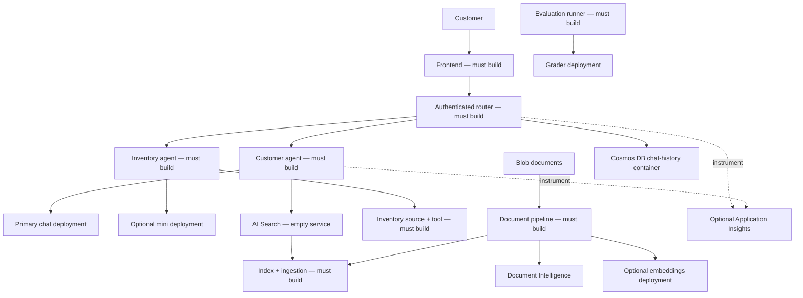

# Hỗ trợ Khách hàng Đa Tác nhân — Bản thiết kế Kiến trúc Bán lẻ

**Chương 5: Giải pháp AI Đa Tác nhân**

- [Trang chủ khóa học](../README.md)
- [Chương 5](../docs/chapter-05-multi-agent/README.md)
- [Tiền đề: Tích hợp AI](../docs/chapter-02-ai-development/microsoft-foundry-integration.md)
- [Tiếp theo: Lập kế hoạch năng lực](../docs/chapter-06-pre-deployment/capacity-planning.md)
- [Khung hạ tầng ARM](retail-multiagent-arm-template/README.md)

> **Hướng dẫn kiến trúc, không phải ứng dụng hoạt động.** Các tập tin triển khai bán lẻ duy nhất
> là `azuredeploy.json`, `azuredeploy.parameters.json`, và `deploy.sh` trong
> `retail-multiagent-arm-template/`. Các container router/frontend chỉ là các chỗ giữ chỗ hello-world.
> Không có tác nhân bán lẻ, giao diện người dùng, pipeline nhập liệu, bộ đánh giá, trình quét,
> hoặc bộ kiểm tra ứng dụng tồn tại cục bộ.

## Tổng quan

**Mục tiêu:** thiết kế hệ thống hỗ trợ khách hàng với một tác nhân khách hàng và một tác nhân
kho hàng, xác định những gì hạ tầng cung cấp, và lên kế hoạch các hợp đồng ứng dụng còn thiếu
cùng xác minh.

**Đối tượng:** các nhà phát triển đã hoàn thành mẫu
[chat mẫu](../../../examples/azure-openai-chat) và [mẫu container hai dịch vụ](../../../examples/container-app/microservices).
Dự kiến dành 2–3 giờ để nghiên cứu kiến trúc. Xây dựng ứng dụng là một dự án riêng biệt:
ước tính lập kế hoạch minh họa là 80–120 giờ phát triển cho các nhà phát triển có kinh nghiệm,
**không phải cam kết bàn giao**; công đoạn hoàn thiện sản xuất, kiểm thử,
đánh giá bảo mật và vận hành cần thêm công việc.

### Kết quả học tập

- Giải thích định tuyến, căn cứ, quyền công cụ và sở hữu cuộc trò chuyện.
- Phân biệt định danh mô hình, tên triển khai, phiên bản API và phiên bản ARM.
- Thiết kế nhập tài liệu và truy xuất với các kích thước vector phù hợp.
- Định nghĩa các yêu cầu chức năng, đánh giá và phục hồi lỗi có thể kiểm chứng.
- Tách biệt các mục tiêu kiến trúc tùy chọn khỏi tài nguyên thực sự được cung cấp.

## Kiến trúc Giải pháp



Đây là **kiến trúc ứng dụng mục tiêu**, không phải sơ đồ các dịch vụ tác nhân đang chạy.
Khung ARM tạo các dịch vụ nền tảng và chỉ hai container chỗ giữ chỗ.
Front Door, registry, danh tính quản lý, phân quyền vai trò,
điểm cuối riêng tư, chuyển đổi dự phòng, đo lường ứng dụng và cảnh báo không được bao gồm.

### Trách nhiệm và hợp đồng

| Thành phần | Hành vi yêu cầu | Bằng chứng trước khi gọi là hoàn thành |
|---|---|---|
| Giao diện người dùng | Xác thực người dùng, hiển thị chat, tải tài liệu an toàn | Kiểm thử giao diện và tải lên, lỗi dễ truy cập |
| Router | Ủy quyền yêu cầu, chọn tác nhân, giới hạn cuộc gọi công cụ / thời gian chờ | Kiểm thử định tuyến, kiểm tra ủy quyền, kiểm thử thất bại |
| Tác nhân khách hàng | Căn cứ chính sách / câu trả lời sản phẩm dựa trên nguồn được phê duyệt | Trích dẫn chính xác, bỏ qua khi dữ liệu thiếu |
| Công cụ kho hàng | Đọc kho có thẩm quyền với quyền giới hạn | Kiểm thử kho dự đoán được; không được sáng tạo dữ liệu tồn kho |
| Pipeline tài liệu | Trích xuất, phân đoạn, nhúng, lập chỉ mục, cập nhật/xóa | Đồ cố định lập chỉ mục và hành vi thử lại / thư chết |
| Lưu trữ cuộc trò chuyện | Cách ly người dùng, thực thi giữ liệu | Kiểm thử ủy quyền chéo người dùng và TTL |
| Bộ chạy đánh giá | So sánh đầu ra với sự thật nền tảng và bảng điểm | Độ phủ, số lần thất bại, báo cáo có thể tái tạo |

Hãy nghĩ về router như bàn tiếp tân và các công cụ như hệ thống nội bộ giới hạn:
chọn chuyên gia không đồng nghĩa với việc được phép truy cập hồ sơ của mọi khách hàng.
Thực thi danh tính và quyền trong mã ứng dụng và dịch vụ dữ liệu, không phải trong câu lệnh nhắc.

## Hạ tầng và Ứng dụng

Đọc [README scaffold](retail-multiagent-arm-template/README.md) trước khi
cung cấp. Nó liệt kê các tài nguyên, chế độ, chi phí và giới hạn chính xác.

| Mục đích sử dụng | Tên triển khai ARM | Mô hình / phiên bản | Vùng mặc định |
|---|---|---|---|
| Chat khách hàng | `gpt-4.1-chat` | `gpt-4.1` / `2025-04-14` | `eastus2` |
| Kho hàng | `gpt-4.1-mini-inventory` | `gpt-4.1-mini` / `2025-04-14` | `westus2`, tùy chọn |
| Nhúng | `text-embedding-ada-002` | `text-embedding-ada-002` / `2` | `francecentral`, tùy chọn |
| Đánh giá | `gpt-4.1-grader` | `gpt-4.1` / `2025-04-14` | Mặc định vùng chính |

Kiểm tra tính khả dụng và hạn mức mô hình/phiên bản/SKU ở **mỗi vùng**. Chat/mini/grader
sử dụng `GlobalStandard`; embeddings sử dụng `Standard`. Bản đồ đơn vị năng lực sang TPM
là riêng theo mô hình. Không thêm các đơn vị năng lực không tương đồng như một hạn mức chung.

Đối số `model` trong yêu cầu Azure OpenAI là **tên triển khai**, không nhất thiết
là định danh mô hình trong danh mục. Phiên bản API data-plane `2024-10-21`
khác với phiên bản mô hình `2025-04-14` và tài nguyên ARM `apiVersion`.
Không thể sửa mô hình không có sẵn chỉ bằng cách thay đổi phiên bản API data-plane.

`--no-multi-region` bỏ qua các tài khoản thứ cấp và embeddings. Còn lại tài khoản chat chính và
tài khoản grader độc lập. Các tài khoản mô hình riêng không cung cấp chuyển đổi dự phòng tự động;
điều đó yêu cầu định tuyến ứng dụng, các triển khai tương thích, kiểm tra sức khỏe,
giới hạn thử lại và đánh giá lưu trú dữ liệu.

## Lộ trình triển khai

### 1. Bắt đầu với một tương tác đã kiểm thử

Trước khi cung cấp khung lớn, sử dụng mẫu chat cục bộ để thiết lập
kết nối suy luận. Định nghĩa một câu hỏi điển hình của khách hàng, nguồn trả lời được phê duyệt,
trích dẫn kỳ vọng và hành vi lỗi khi nguồn đó bị thiếu.

### 2. Định nghĩa định tuyến và ranh giới công cụ

Tạo nguồn router riêng, bản khai phụ thuộc, Dockerfile và các bài kiểm thử. Một
hợp đồng minh họa có thể là `POST /chat` với `{"message":"...","conversation_id":"..."}`.
**Điểm cuối đó là đề xuất thiết kế; không được triển khai bởi mẫu ARM.**

Xác thực kiểu/thống kê thân yêu cầu, suy ra danh tính người dùng từ xác thực,
thực thi sở hữu cuộc trò chuyện, áp dụng timeout yêu cầu, và trả về mã lỗi có ý nghĩa.
Không coi thất bại HTTP hoặc trả lời rỗng là kết quả tác nhân thành công.

### 3. Triển khai căn cứ và nhập liệu

Mẫu ARM không tạo chỉ mục tìm kiếm. Đây là **đoạn JSON tham khảo
để tùy chỉnh trong định nghĩa chỉ mục của bạn**, không phải một tập tin đã có trong repo:

```json
{
  "name": "retail-product-index",
  "fields": [
    {"name": "id", "type": "Edm.String", "key": true},
    {"name": "title", "type": "Edm.String", "searchable": true},
    {"name": "content", "type": "Edm.String", "searchable": true},
    {"name": "category", "type": "Edm.String", "filterable": true},
    {
      "name": "content_vector",
      "type": "Collection(Edm.Single)",
      "searchable": true,
      "dimensions": 1536,
      "vectorSearchProfile": "retail-profile"
    }
  ],
  "vectorSearch": {
    "algorithms": [{"name": "retail-hnsw", "kind": "hnsw"}],
    "profiles": [{"name": "retail-profile", "algorithm": "retail-hnsw"}]
  }
}
```

Hồ sơ liên kết trường vector với thuật toán của nó. Kích thước phải phù hợp với
đầu ra nhúng thực tế (1536 cho triển khai `ada-002` này). Để truy xuất Python,
sử dụng `azure.search.documents.models.VectorizedQuery` thay vì
từ điển thiếu kiểu truy vấn vector:

```python
# Reference function only: supply an authenticated async SearchClient and an embedding.
from azure.search.documents.models import VectorizedQuery

async def retrieve(search_client, embedding):
    results = await search_client.search(
        search_text=None,
        vector_queries=[VectorizedQuery(
            vector=embedding,
            k_nearest_neighbors=5,
            fields="content_vector"
        )],
        select=["id", "title", "content"]
    )
    return [document async for document in results]
```

Tạo một triển khai nhập liệu riêng mà:

1. Ủy quyền truy cập tải lên và xác thực loại và kích thước nội dung.
2. Đọc blob riêng tư bằng các cuộc gọi SDK đã xác thực. Một URL blob riêng
   tự nó **không phải** là đầu vào Document Intelligence có thể đọc được; gửi byte đã tải xuống với
   `AnalyzeDocumentRequest(bytes_source=...)` hoặc dùng SAS giới hạn phạm vi,
   thời hạn ngắn sau khi xem xét yêu cầu truy cập.
3. Trích xuất văn bản, chia nhỏ phù hợp giới hạn nhúng, và tạo embedding.
4. Tạo khóa tài liệu hợp lệ ổn định và tải lên các phân đoạn cùng vector phù hợp.
5. Kiểm tra kết quả lập chỉ mục từng tài liệu, xử lý thử lại, và cập nhật/xóa dữ liệu cũ.

Không chèn tuỳ ý khóa/giá trị người dùng vào bộ lọc OData. Lọc trắng trường,
xác thực kiểu giá trị, và thoát dấu nháy chuỗi. Bộ lọc Boolean và số cần
ký tự kiểu, không phải chuỗi có dấu nháy.

### 4. Căn cứ web

**Bing Search v7 đã ngừng hoạt động vào ngày 11 tháng 8 năm 2025.** `Microsoft.Bing/accounts` cũ
và `api.bing.microsoft.com/v7.0/search` ví dụ không phải là đường dẫn triển khai được hỗ trợ.
Hãy đánh giá một tích hợp nền tảng hiện đang được hỗ trợ trong
Microsoft Foundry cùng SDK, quyền, thanh toán và yêu cầu trích dẫn;
không có cái nào được triển khai tại đây. Nó không phải là một phương án thay thế trực tiếp cho điểm cuối đã nghỉ hưu.

### 5. Thêm thu thập dữ liệu và đánh giá

Việc tạo Application Insights không tự động theo dõi code. Sử dụng công cụ OpenTelemetry của Azure Monitor được hỗ trợ khi xây dựng ứng dụng mới, truyền ngữ cảnh theo dõi giữa các dịch vụ và tránh ghi nhật ký các lời nhắc, tài liệu hoặc bí mật của khách hàng.

Việc cắt bớt truy vấn **không** khiến truy vấn trở nên ẩn danh.


việc sử dụng token và sự kiêng cữ. Lưu trữ các dữ liệu thực/thực tế liên quan đến tồn kho/chính sách
cùng với các trường hợp đánh giá: người chấm không thể xác định độ chính xác thực tế
chỉ dựa trên câu hỏi và câu trả lời.


xác thực đầu ra/cấu trúc/schema, kiểm tra phạm vi điểm số,
đếm số lần thất bại truyền tải và các trường hợp được đánh giá bởi con người.
Báo cáo các trường hợp không hoàn chỉnh/lỗi riêng biệt; không chuyển đổi
thành điểm thành công hoặc âm thầm bao gồm chúng như các phản hồi mô hình chất lượng bằng không.

Tương tự, một vài kiểm tra từ khóa không phải là chứng nhận bảo mật. Một yêu cầu HTTP thất bại,
thiếu chiến lược kiểm thử hoặc phản hồi trống phải khiến một bài kiểm tra **không kết luận được hoặc thất bại**,
không phải cho điểm “100% an toàn”. Thực hiện kiểm thử được ủy quyền với công cụ phù hợp
và đánh giá của con người trước khi có bất kỳ khẳng định nào về khả năng vận hành trong môi trường sản xuất.

### 6. Triển khai ứng dụng của bạn

Tạo thư mục nguồn riêng, manifest, bài kiểm tra, đăng ký, và quyền kéo image.
Thay thế các chỗ giữ chỗ bằng ảnh dựng sẵn và cập nhật ingress/probes
để phù hợp với cổng lắng nghe của từng ứng dụng. Cấu hình biến môi trường tại thời gian chạy trong Bicep
hoặc ánh xạ môi trường azd được hỗ trợ rõ ràng.

Không có `config` chung nào dưới dịch vụ azd tự động
tạo các biến môi trường thời gian chạy. `azd env set` chỉ thay đổi các tài nguyên
trực tiếp sử dụng những giá trị đó. Không có canary, danh sách vùng hay hook tinh chỉnh
nào được triển khai trong scaffold này.

## Bài tập thiết kế thực tế

Đây là **bài tập kiến trúc**, không phải mã khởi động bán lẻ có thể chạy được.

### Bài tập 1: Xác minh ranh giới

**Điểm khởi đầu:** ba tệp trong `retail-multiagent-arm-template/`.
**Mục tiêu:** phân biệt việc cung cấp tài nguyên với chức năng ứng dụng.
Mở `azuredeploy.json`, xác định cả ảnh container và giá trị `targetPort`,
sau đó liệt kê các thành phần ứng dụng còn thiếu trong kho lưu trữ.

**Tiêu chí thành công / câu trả lời:** cả hai ảnh chỉ là chỗ giữ chỗ hello-world nghe trên cổng 80;
các đại lý, giao diện trò chuyện, bộ xử lý định tuyến, chỉ mục/nhập liệu,
bộ đánh giá và bộ quét đều không có mặt. Yêu cầu gốc chỗ giữ chỗ thành công không xác thực `/chat`.
**Vấn đề phổ biến:** hiểu sai tên tài nguyên như `retail-router` là code đang hoạt động.

### Bài tập 2: Theo dõi cấu hình vector

**Điểm khởi đầu:** JSON chỉ mục ở trên.
**Mục tiêu:** hiểu mối quan hệ trường → hồ sơ → thuật toán.
Xác định giá trị nào cần thay đổi khi chuyển sang mô hình embedding có
kích thước đầu ra khác, sau đó kiểm tra hàm `retrieve`.

**Tiêu chí thành công / câu trả lời:** thay đổi trường `dimensions` thành chiều dài vector thực tế;
giữ `vectorSearchProfile` tương thích với hồ sơ được khai báo và thuật toán của nó;
truy vấn `fields` phải đặt tên trường vector. Tái tạo các vector tài liệu hiện có
khi mô hình embedding thay đổi.
**Vấn đề phổ biến:** chỉ thay đổi tên mô hình trong khi giữ các vector không tương thích.

### Bài tập 3: Định nghĩa kiểm thử thất bại

**Điểm khởi đầu:** bảng trách nhiệm.
**Mục tiêu:** tránh thành công giả.
Viết hành vi mong đợi đối với API tồn kho không khả dụng, chỉ mục tìm kiếm không có tài liệu phù hợp,
và yêu cầu đánh giá trả về HTTP 503.

**Tiêu chí thành công / câu trả lời:** không tạo ra các giá trị tồn kho giả; công khai kiêng cữ hoặc
báo cáo khi không có ngữ cảnh; đánh giá báo cáo lỗi truyền tải thay vì được cho phép về chất lượng hoặc bảo mật.
Thêm các bài kiểm tra thực thi khi bạn xây dựng ứng dụng.
**Vấn đề phổ biến:** bắt mọi ngoại lệ và tiếp tục với câu trả lời trống.

## Chi phí, khắc phục sự cố và dọn dẹp

- Hạ tầng có phí duy trì ngay cả khi chỉ mục tìm kiếm trống và ứng dụng giữ chỗ.
  Sử dụng giá theo vùng hiện tại; không có gì gọi là “tối thiểu” hay đa vùng là miễn phí.
- Chi phí token phụ thuộc vào mô hình, đầu vào có cache/không cache, đầu ra, và SKU triển khai.
  Định tuyến chỉ tiết kiệm được tiền nếu khối lượng công việc và kết quả chất lượng đo được chứng minh;
  không có đảm bảo tiết kiệm cố định 60–80%.
- Kiểm tra tính khả dụng mô hình và hạn mức trước khi cung cấp; phân biệt lỗi quyền,
  tên triển khai, vùng, phiên bản mô hình và phiên bản API.
- Không chạy thiếu `setup-data.sh`, các CLI đánh giá hoặc các lệnh `pytest tests/`.
  Việc triển khai của chúng là phần công việc bạn phải làm trong backlog phát triển.
- Scaffold chỉ dành cho ARM: làm theo
  [hướng dẫn xác minh và dọn dẹp](retail-multiagent-arm-template/README.md).
  `azd down` không quản lý những tài nguyên đó.

## Tài nguyên liên quan

- [Mẫu chat cục bộ hoạt động](../../../examples/azure-openai-chat)
- [Mẫu container hai dịch vụ hoạt động](../../../examples/container-app/microservices)
- [Chỉ mục vector AI Search](https://learn.microsoft.com/azure/search/vector-search-how-to-create-index)
- [Tài liệu Container Apps](https://learn.microsoft.com/azure/container-apps/)
- [Khắc phục sự cố](../docs/chapter-07-troubleshooting/common-issues.md)
- [Báo cáo sự cố](https://github.com/microsoft/AZD-for-beginners/issues)

---

<!-- CO-OP TRANSLATOR DISCLAIMER START -->
**Tuyên bố miễn trừ trách nhiệm**:
Tài liệu này đã được dịch bằng dịch vụ dịch thuật AI [Co-op Translator](https://github.com/Azure/co-op-translator). Mặc dù chúng tôi cố gắng đảm bảo độ chính xác, xin lưu ý rằng bản dịch tự động có thể chứa lỗi hoặc sai sót. Tài liệu gốc bằng ngôn ngữ gốc nên được coi là nguồn tin chính thức. Đối với thông tin quan trọng, nên sử dụng dịch vụ dịch thuật chuyên nghiệp bởi con người. Chúng tôi không chịu trách nhiệm về bất kỳ hiểu lầm hoặc giải thích sai nào phát sinh từ việc sử dụng bản dịch này.
<!-- CO-OP TRANSLATOR DISCLAIMER END -->