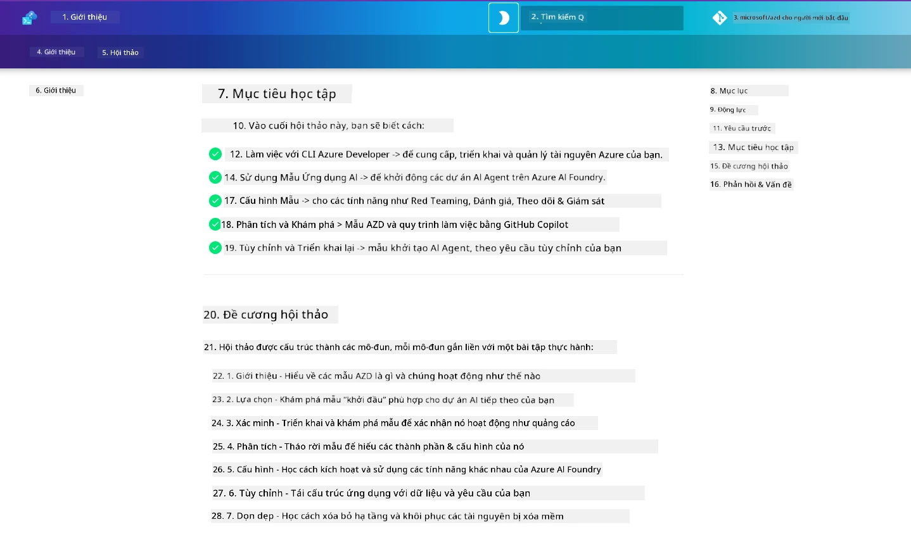

<div align="center">
  <div style="background: linear-gradient(135deg, #0078d4, #106ebe); border-radius: 10px; padding: 20px; margin: 20px 0; box-shadow: 0 4px 15px rgba(0, 120, 212, 0.3); border: 2px solid #005a9e;">
    <h2 style="color: white; margin: 0; font-size: 24px; text-shadow: 1px 1px 2px rgba(0,0,0,0.3);">
      🎯 AZD cho Nhà phát triển AI Workshop
    </h2>
    <p style="color: white; margin: 10px 0 0 0; font-size: 16px; text-shadow: 1px 1px 2px rgba(0,0,0,0.3);">
      <strong>Workshop thực hành xây dựng ứng dụng AI với Azure Developer CLI.</strong><br>
      Hoàn thành 7 mô-đun để thành thạo mẫu AZD và quy trình triển khai AI.
    </p>
    <div style="margin-top: 15px;">
      <span style="background: rgba(255,255,255,0.2); padding: 5px 10px; border-radius: 15px; color: white; font-size: 14px;">
        📅 Hướng dẫn nguồn được xem xét: Tháng 11 năm 2026
      </span>
    </div>
  </div>
</div>

# AZD cho Nhà phát triển AI Workshop

Chào mừng bạn đến với workshop thực hành học Azure Developer CLI (AZD) tập trung vào triển khai ứng dụng AI. Workshop này giúp bạn hiểu và ứng dụng mẫu AZD qua 3 bước:

1. **Khám phá** - tìm mẫu phù hợp với bạn.
1. **Triển khai** - triển khai và xác thực nó hoạt động
1. **Tùy chỉnh** - sửa đổi và lặp lại để biến nó thành của bạn!

Trong suốt khóa học, bạn cũng sẽ được giới thiệu các công cụ và quy trình phát triển cốt lõi, giúp bạn tối ưu hóa hành trình phát triển end-to-end.

<br/>

## Hướng dẫn qua trình duyệt

Các bài học workshop ở định dạng Markdown. Bạn có thể duyệt trực tiếp trên GitHub - hoặc khởi chạy bản xem trước qua trình duyệt như trong ảnh chụp màn hình bên dưới.



Để dùng tùy chọn này - fork repo về profile của bạn, và khởi động GitHub Codespaces. Khi terminal VS Code hoạt động, gõ lệnh sau:

Bản xem trước qua trình duyệt hoạt động trong GitHub Codespaces, dev containers, hoặc bản clone cục bộ với Python và MkDocs đã cài.

```bash title="" linenums="0"
python -m pip install -r requirements-dev.txt
python -m mkdocs serve --config-file workshop/mkdocs.yml
```

Chạy các lệnh này từ **gốc repo khóa học**, không phải mẫu AI đã khởi tạo riêng. Giữ cửa sổ xem trước ở tiền cảnh để lỗi hiển thị; ngừng nó bằng Ctrl+C. Để kiểm tra site mà không phục vụ, chạy `python -m mkdocs build --strict --config-file workshop/mkdocs.yml`.

Trong vài giây, bạn sẽ thấy hộp thoại bật lên. Chọn tùy chọn `Open in browser`. Hướng dẫn trên web sẽ mở tab trình duyệt mới. Một số lợi ích của bản xem trước này:

1. **Tìm kiếm tích hợp** - tìm từ khóa hay bài học nhanh
1. **Icon sao chép** - di chuột lên codeblock để thấy tùy chọn này
1. **Chuyển đổi chủ đề** - chuyển đổi giữa chủ đề tối và sáng
1. **Nhận trợ giúp** - bấm icon Discord ở chân trang để tham gia!

<br/>

## Tổng quan Workshop

**Thời lượng:** 3-4 giờ  
**Trình độ:** Người mới đến Trung cấp  
**Yêu cầu trước:** Hiểu biết về Azure, khái niệm AI, VS Code & công cụ dòng lệnh.

Đây là workshop thực hành học qua làm. Sau khi hoàn thành bài tập, bạn nên xem lại lộ trình AZD For Beginners để tiếp tục hành trình học về các thực hành Security và Productivity tốt nhất.

| Thời gian| Mô-đun  | Mục tiêu |
|:---|:---|:---|
| 15 phút | [Giới thiệu](docs/instructions/0-Introduction.md) | Đặt nền tảng, hiểu mục tiêu |
| 30 phút | [Chọn Mẫu AI](docs/instructions/1-Select-AI-Template.md) | Khám phá lựa chọn và chọn khởi đầu |
| 30 phút | [Xác thực Mẫu AI](docs/instructions/2-Validate-AI-Template.md) | Triển khai giải pháp mặc định lên Azure |
| 30 phút | [Phân tích Mẫu AI](docs/instructions/3-Deconstruct-AI-Template.md) | Khám phá cấu trúc và cấu hình |
| 30 phút | [Cấu hình Mẫu AI](docs/instructions/4-Configure-AI-Template.md) | Kích hoạt và thử tính năng có sẵn |
| 30 phút | [Tùy chỉnh Mẫu AI](docs/instructions/5-Customize-AI-Template.md) | Điều chỉnh mẫu cho phù hợp nhu cầu |
| 30 phút | [Dỡ hạ Hạ tầng](docs/instructions/6-Teardown-Infrastructure.md) | Dọn dẹp và giải phóng tài nguyên |
| 15 phút | [Tổng kết & Bước tiếp theo](docs/instructions/7-Wrap-up.md) | Tài nguyên học tập, thử thách Workshop |

<br/>

## Bạn sẽ học gì

Hãy xem mẫu AZD như một sân chơi học tập để khám phá các khả năng và công cụ phát triển end-to-end trên Microsoft Foundry. Kết thúc workshop, bạn sẽ có cảm nhận trực quan về các công cụ và khái niệm trong ngữ cảnh này.

| Khái niệm  | Mục tiêu |
|:---|:---|
| **Azure Developer CLI** | Hiểu câu lệnh công cụ và quy trình làm việc|
| **Mẫu AZD**| Hiểu cấu trúc dự án và cấu hình|
| **Đại lý AI Azure**| Cấp phép & triển khai dự án Microsoft Foundry |
| **Azure AI Search**| Kích hoạt kỹ thuật ngữ cảnh với đại lý |
| **Quan sát**| Khám phá truy vết, giám sát và đánh giá |
| **Red Teaming**| Khám phá kiểm thử đối kháng và giảm thiểu |

<br/>

## Cấu trúc Workshop

Workshop được thiết kế theo hành trình từ khám phá mẫu, triển khai, phân tích đến tùy chỉnh - sử dụng mẫu khởi đầu chính thức [Getting Started with AI Agents](https://github.com/Azure-Samples/get-started-with-ai-agents).

### [Mô-đun 1: Chọn Mẫu AI](docs/instructions/1-Select-AI-Template.md) (30 phút)

- Mẫu AI là gì?
- Tôi có thể tìm mẫu AI ở đâu?
- Làm sao để bắt đầu xây dựng Đại lý AI?
- **Thực hành**: Bắt đầu nhanh trong Codespaces hoặc dev container

### [Mô-đun 2: Xác thực Mẫu AI](docs/instructions/2-Validate-AI-Template.md) (30 phút)

- Kiến trúc Mẫu AI là gì?
- Quy trình phát triển AZD là gì?
- Tôi có thể nhận trợ giúp phát triển AZD như thế nào?
- **Thực hành**: Triển khai & Xác thực mẫu Đại lý AI

### [Mô-đun 3: Phân tích Mẫu AI](docs/instructions/3-Deconstruct-AI-Template.md) (30 phút)

- Khám phá môi trường trong `.azure/` 
- Khám phá thiết lập tài nguyên trong `infra/` 
- Khám phá cấu hình AZD trong `azure.yaml`s
- **Thực hành**: Sửa biến môi trường & Triển khai lại

### [Mô-đun 4: Cấu hình Mẫu AI](docs/instructions/4-Configure-AI-Template.md) (30 phút)
- Khám phá: Tạo Tăng cường Thu hồi
- Khám phá: Đánh giá Đại lý & Red Teaming
- Khám phá: Truy vết & Giám sát
- **Thực hành**: Khám phá Đại lý AI + Quan sát

### [Mô-đun 5: Tùy chỉnh Mẫu AI](docs/instructions/5-Customize-AI-Template.md) (30 phút)
- Xác định: PRD với Yêu cầu Kịch bản
- Cấu hình: Biến môi trường cho AZD
- Triển khai: Lifecycle Hooks cho tác vụ thêm
- **Thực hành**: Tùy chỉnh mẫu cho kịch bản của tôi

### [Mô-đun 6: Dỡ hạ Hạ tầng](docs/instructions/6-Teardown-Infrastructure.md) (30 phút)
- Tóm tắt: Mẫu AZD là gì?
- Tóm tắt: Tại sao dùng Azure Developer CLI?
- Bước tiếp theo: Thử mẫu khác!
- **Thực hành**: Thu hồi hạ tầng & dọn dẹp

<br/>

## Thách thức Workshop

Muốn thử thách bản thân làm hơn? Dưới đây là một số đề xuất dự án - hoặc chia sẻ ý tưởng cùng chúng tôi!!

| Dự án | Mô tả |
|:---|:---|
|1. **Phân tích Mẫu AI Phức tạp** | Dùng quy trình và công cụ đã học xem bạn có thể triển khai, xác thực và tùy chỉnh một mẫu giải pháp AI khác không. _Bạn học được gì?_|
|2. **Tùy chỉnh Với Kịch bản Của Bạn**  | Thử viết PRD (Tài liệu Yêu cầu Sản phẩm) cho một kịch bản khác. Dùng GitHub Copilot trong repo mẫu Agent Model - và yêu cầu nó tạo quy trình tùy chỉnh cho bạn. _Bạn học được gì? Làm sao cải tiến đề xuất?_|
| | |

## Có phản hồi?

1. Đăng issue trên repo này - gắn thẻ `Workshop` tiện lợi.
1. Tham gia Microsoft Foundry Discord - kết nối với đồng nghiệp!


| | | 
|:---|:---|
| **📚 Trang chủ khóa học**| [AZD For Beginners](../README.md)|
| **📖 Tài liệu** | [Bắt đầu với mẫu AI](https://learn.microsoft.com/en-us/azure/ai-foundry/how-to/develop/ai-template-get-started)|
| **🛠️Mẫu AI** | [Mẫu Microsoft Foundry](https://ai.azure.com/templates) |
|**🚀 Bước tiếp theo** | [Bắt đầu Workshop](#workshop-overview) |
| | |

<br/>

---

**Điều hướng:** [Khóa học chính](../README.md) | [Giới thiệu](docs/instructions/0-Introduction.md) | [Mô-đun 1: Chọn Mẫu](docs/instructions/1-Select-AI-Template.md)

**Sẵn sàng bắt đầu xây dựng ứng dụng AI với AZD?**

[Bắt đầu Workshop: Giới thiệu →](docs/instructions/0-Introduction.md)

---

<!-- CO-OP TRANSLATOR DISCLAIMER START -->
**Tuyên bố miễn trừ trách nhiệm**:
Tài liệu này đã được dịch bằng dịch vụ dịch thuật AI [Co-op Translator](https://github.com/Azure/co-op-translator). Mặc dù chúng tôi cố gắng đảm bảo độ chính xác, xin lưu ý rằng bản dịch tự động có thể chứa lỗi hoặc sai sót. Tài liệu gốc bằng ngôn ngữ gốc nên được coi là nguồn tin chính thức. Đối với thông tin quan trọng, nên sử dụng dịch vụ dịch thuật chuyên nghiệp bởi con người. Chúng tôi không chịu trách nhiệm về bất kỳ hiểu lầm hoặc giải thích sai nào phát sinh từ việc sử dụng bản dịch này.
<!-- CO-OP TRANSLATOR DISCLAIMER END -->