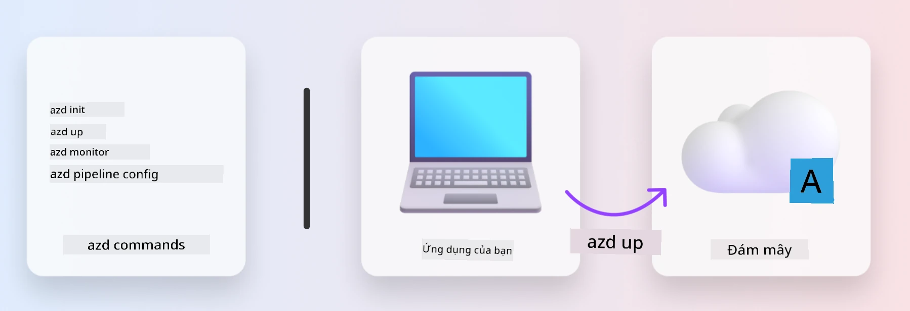
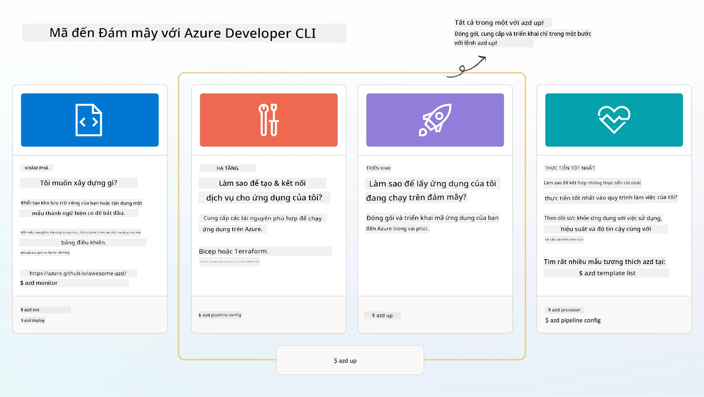

# 1. Chọn Một Mẫu

!!! tip "ĐẾN CUỐI MODULE NÀY BẠN SẼ CÓ THỂ"

    - [ ] Describe what AZD templates are
    - [ ] Discover and use AZD templates for AI
    - [ ] Get started with the AI Agents template
    - [ ] **Lab 1:** AZD Quickstart in Codespaces or a dev container

---

## 1. Một Phép Ẩn Dụ Về Người Xây Dựng

Xây dựng một ứng dụng AI sẵn sàng cho doanh nghiệp hiện đại _từ đầu_ có thể là điều đáng sợ. Nó giống như việc tự xây ngôi nhà mới của bạn, từng viên gạch một. Vâng, điều đó có thể làm được! Nhưng đó không phải là cách hiệu quả nhất để đạt được kết quả cuối cùng mong muốn!

Thay vào đó, chúng ta thường bắt đầu với một _bản thiết kế_ có sẵn, và làm việc với một kiến trúc sư để tùy chỉnh theo yêu cầu cá nhân. Và đó chính xác là cách tiếp cận khi xây dựng các ứng dụng thông minh. Trước tiên, hãy tìm một kiến trúc thiết kế tốt phù hợp với không gian vấn đề của bạn. Sau đó làm việc với một kiến trúc sư giải pháp để tùy chỉnh và phát triển giải pháp cho kịch bản cụ thể của bạn.

Nhưng chúng ta có thể tìm những bản thiết kế này ở đâu? Và làm sao để tìm một kiến trúc sư sẵn lòng dạy chúng ta cách tùy chỉnh và triển khai các bản thiết kế này một cách độc lập? Trong hội thảo này, chúng tôi sẽ trả lời những câu hỏi đó bằng cách giới thiệu với bạn ba công nghệ:

1. [Azure Developer CLI](https://aka.ms/azd) - một công cụ mã nguồn mở giúp tăng tốc lộ trình phát triển từ phát triển cục bộ (xây dựng) đến triển khai trên đám mây (gửi).
1. [Microsoft Foundry Templates](https://ai.azure.com/templates) - các kho lưu trữ mã nguồn mở tiêu chuẩn hóa chứa mã mẫu, tệp cấu trúc hạ tầng và cấu hình để triển khai kiến trúc giải pháp AI.
1. [GitHub Copilot Agent Mode](https://code.visualstudio.com/docs/copilot/chat/chat-agent-mode) - một đại lý lập trình dựa trên kiến thức Azure, có thể hướng dẫn chúng ta điều hướng trong cơ sở mã và thực hiện thay đổi - sử dụng ngôn ngữ tự nhiên.

Với những công cụ này trong tay, giờ chúng ta có thể _khám phá_ mẫu phù hợp, _triển khai_ nó để xác thực nó hoạt động, và _tuỳ chỉnh_ nó cho phù hợp với các kịch bản cụ thể của chúng ta. Hãy cùng khám phá và tìm hiểu cách những công cụ này hoạt động.


---

## 2. Azure Developer CLI

Công cụ dòng lệnh [Azure Developer CLI](https://learn.microsoft.com/en-us/azure/developer/azure-developer-cli/) (hoặc `azd`) là một công cụ mã nguồn mở giúp tăng tốc hành trình từ mã nguồn đến đám mây của bạn với một bộ các lệnh thân thiện với nhà phát triển hoạt động nhất quán trên IDE (phát triển) và môi trường CI/CD (devops) của bạn.

Với `azd`, hành trình triển khai của bạn có thể đơn giản như:

- `azd init` - Khởi tạo một dự án AI mới từ một mẫu AZD hiện có.
- `azd up` - Cung cấp hạ tầng và triển khai ứng dụng của bạn chỉ trong một bước.
- `azd monitor` - Nhận giám sát và chẩn đoán theo thời gian thực cho ứng dụng đã triển khai.
- `azd pipeline config` - Thiết lập các pipeline CI/CD để tự động hóa triển khai lên Azure.

**🎯 | BÀI TẬP**: <br/> Khám phá công cụ dòng lệnh `azd` trong môi trường workshop hiện tại của bạn ngay bây giờ. Đây có thể là GitHub Codespaces, một dev container hoặc một bản sao cục bộ với các yêu cầu tiên quyết đã được cài đặt. Bắt đầu bằng cách gõ lệnh này để xem công cụ có thể làm gì:

```bash title="" linenums="0"
azd help
```



---

## 3. Mẫu AZD

Để `azd` đạt được điều này, nó cần biết hạ tầng cần cung cấp, các thiết lập cấu hình cần thi hành và ứng dụng cần triển khai. Đây là nơi những [mẫu AZD](https://learn.microsoft.com/en-us/azure/developer/azure-developer-cli/azd-templates?tabs=csharp) xuất hiện.

Mẫu AZD là những kho mã nguồn mở kết hợp mã ví dụ với các file cấu hình và hạ tầng cần thiết để triển khai kiến trúc giải pháp.
Bằng cách sử dụng phương pháp _Infrastructure-as-Code_ (IaC), chúng cho phép định nghĩa tài nguyên và cài đặt cấu hình của mẫu được quản lý phiên bản (giống như mã nguồn ứng dụng) - tạo ra các quy trình làm việc có thể tái sử dụng và nhất quán giữa các người dùng của dự án đó.

Khi tạo hoặc tái sử dụng một mẫu AZD cho trường hợp _của bạn_, hãy cân nhắc những câu hỏi sau:

1. Bạn đang xây dựng gì? → Có mẫu nào có mã khởi đầu cho trường hợp đó không?
1. Giải pháp của bạn được kiến trúc thế nào? → Có mẫu nào có các tài nguyên cần thiết không?
1. Giải pháp của bạn được triển khai thế nào? → Nghĩ về `azd deploy` với các hook xử lý trước/sau!
1. Làm thế nào bạn có thể tối ưu nó thêm nữa? → Nghĩ về giám sát tích hợp sẵn và các pipeline tự động hóa!

**🎯 | BÀI TẬP**: <br/> 
Truy cập thư viện [Awesome AZD](https://azure.github.io/awesome-azd/) và sử dụng bộ lọc để khám phá hơn 250 mẫu hiện có. Xem bạn có thể tìm thấy mẫu nào phù hợp với yêu cầu của _bạn_ không.



---

## 4. Mẫu Ứng dụng AI

Đối với các ứng dụng được hỗ trợ bởi AI, Microsoft cung cấp các mẫu chuyên biệt với **Microsoft Foundry** và **Foundry Agents**. Các mẫu này giúp tăng tốc con đường xây dựng các ứng dụng thông minh, sẵn sàng sản xuất.

### Mẫu Microsoft Foundry & Foundry Agents

Chọn một mẫu dưới đây để triển khai. Mỗi mẫu đều có trên [Awesome AZD](https://azure.github.io/awesome-azd/) và có thể được khởi tạo chỉ với một lệnh.

| Mẫu | Mô tả | Lệnh Triển Khai |
|----------|-------------|----------------|
| **[AI Chat với RAG](https://github.com/Azure-Samples/azure-search-openai-demo)** | Ứng dụng chat dựa trên tìm kiếm | `azd init -t Azure-Samples/azure-search-openai-demo .` |
| **[Bắt đầu với AI Agents](https://github.com/Azure-Samples/get-started-with-ai-agents)** | Ứng dụng chat hỗ trợ bởi agent; sử dụng xuyên suốt workshop này | `azd init -t Azure-Samples/get-started-with-ai-agents .` |
| **[Bắt đầu với AI Chat](https://github.com/Azure-Samples/get-started-with-ai-chat)** | Ứng dụng chat AI khởi đầu | `azd init -t Azure-Samples/get-started-with-ai-chat .` |

Đây là các lựa chọn thay thế: khởi tạo **một** mẫu trong thư mục trống riêng của nó. Tham số cuối `.` chọn thư mục đó; nếu bỏ qua trên phiên bản AZD hiện tại sẽ tạo ra thư mục phụ theo tên mẫu. Quá trình khởi tạo tải về dự án; `azd up` thực hiện triển khai tính phí sau khi bạn xem xét các điều kiện tiên quyết, tài nguyên, hỗ trợ khu vực và hạn mức.

### Bắt đầu Nhanh

1. **Duyệt các mẫu**: Truy cập [https://azure.github.io/awesome-azd/](https://azure.github.io/awesome-azd/) và lọc theo `AI`, `Agents`, hoặc `Microsoft Foundry`
2. **Chọn mẫu của bạn**: Chọn một mẫu phù hợp với trường hợp sử dụng của bạn
3. **Khởi tạo**: Chạy lệnh `azd init` cho mẫu bạn đã chọn
4. **Triển khai**: Chạy `azd up` để cung cấp và triển khai

**🎯 | BÀI TẬP**: <br/>
Chọn một trong các mẫu trên dựa trên trường hợp của bạn:

- **Tiếp tục workshop này?** → Chọn **Bắt đầu với AI Agents**
- **Xây dựng chat dựa trên tìm kiếm?** → Khám phá riêng **AI Chat với RAG**
- **Cần kiến trúc khác?** → Tìm kiếm trong thư viện và xác minh kho thực tế, trạng thái triển khai và các điều kiện tiên quyết

```bash title="Initialize the workshop template in an empty directory" linenums="0"
azd init -t Azure-Samples/get-started-with-ai-agents .
azd auth login
azd up
```

!!! info "Khám Phá Thêm Mẫu"
    Thư viện [Awesome AZD Gallery](https://azure.github.io/awesome-azd/) bao gồm hơn 250 mẫu. Sử dụng bộ lọc để tìm các mẫu phù hợp với yêu cầu cụ thể về ngôn ngữ, framework và dịch vụ Azure của bạn.

---

<!-- CO-OP TRANSLATOR DISCLAIMER START -->
**Tuyên bố miễn trừ trách nhiệm**:
Tài liệu này đã được dịch bằng dịch vụ dịch thuật AI [Co-op Translator](https://github.com/Azure/co-op-translator). Mặc dù chúng tôi cố gắng đảm bảo độ chính xác, xin lưu ý rằng bản dịch tự động có thể chứa lỗi hoặc sai sót. Tài liệu gốc bằng ngôn ngữ gốc nên được coi là nguồn tin chính thức. Đối với thông tin quan trọng, nên sử dụng dịch vụ dịch thuật chuyên nghiệp bởi con người. Chúng tôi không chịu trách nhiệm về bất kỳ hiểu lầm hoặc giải thích sai nào phát sinh từ việc sử dụng bản dịch này.
<!-- CO-OP TRANSLATOR DISCLAIMER END -->