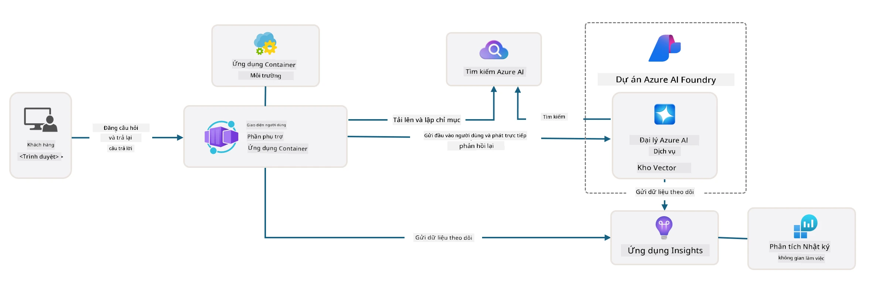
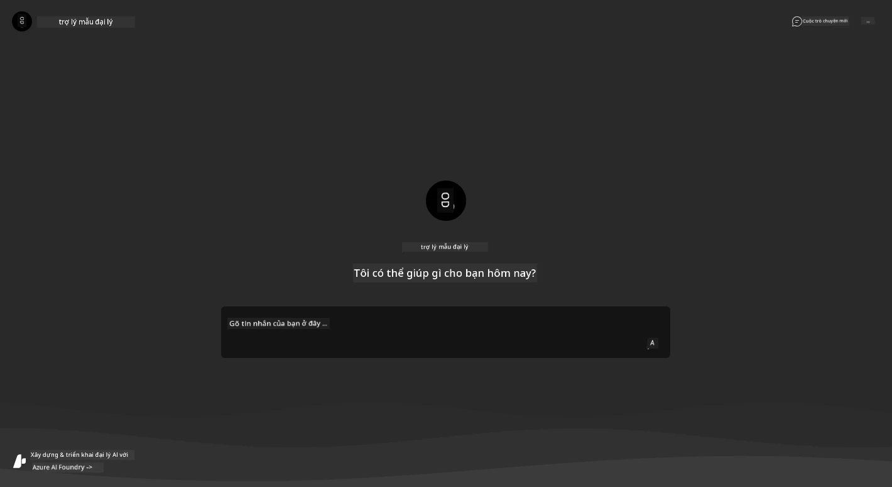

# 2. Xác thực một Mẫu

> Hướng dẫn nguồn được xem xét dựa trên AZD 1.37.2 và mẫu hiện tại vào ngày 4 tháng 11 năm 2026. Ảnh chụp màn hình mang tính minh họa; điều hướng cổng, mặc định mẫu và dịch vụ có thể thay đổi. Đánh giá này không thực hiện triển khai Azure trực tiếp.

!!! tip "CUỐI MODULE NÀY BẠN SẼ CÓ KHẢ NĂNG"

    - [ ] Identify the sample's prerequisites and intended resources
    - [ ] Deploy the selected template into an intentional environment
    - [ ] Verify the application and agent behavior separately from deployment success
    - [ ] **Lab 2:** Record evidence of a working baseline, or an actionable deployment blocker

---

## 1. Kiểm tra điều kiện tiên quyết

Công cụ [Azure Developer CLI](https://learn.microsoft.com/azure/developer/azure-developer-cli/) quản lý việc triển khai ứng dụng sử dụng cấu hình, hạ tầng và mã nguồn của mẫu. Kiểm tra phiên bản đã cài đặt của bạn:

```bash
azd version
```

Sử dụng [hướng dẫn cài đặt/cập nhật hiện tại](https://learn.microsoft.com/azure/developer/azure-developer-cli/install-azd) nếu cần thiết. Mẫu được đánh giá khai báo AZD `>=1.14.0`, nhưng nên sử dụng phiên bản phát hành được hỗ trợ hiện tại. Các phần mở rộng AI tùy chọn có yêu cầu phiên bản riêng; quy trình `azd up` bình thường của mẫu này không yêu cầu phần mở rộng agents.

Trước khi cấp phát, hãy đọc [thiết lập tài khoản Azure](https://github.com/Azure-Samples/get-started-with-ai-agents/blob/main/docs/azure_account_setup.md) và [hướng dẫn triển khai](https://github.com/Azure-Samples/get-started-with-ai-agents/blob/main/docs/deployment.md) của mẫu. Xác nhận thuê bao, quyền, tính khả dụng mô hình, hạn mức khu vực và chi phí dự kiến. Tài khoản Azure miễn phí không đảm bảo truy cập hoặc sử dụng miễn phí cho mọi dịch vụ cần thiết.

## 2. Mở mẫu đã chọn

Sử dụng kho lưu trữ [Bắt đầu với AI Agents](https://github.com/Azure-Samples/get-started-with-ai-agents) đã khởi tạo trong Module 1. Nếu bạn chưa khởi tạo, chọn một trong các lựa chọn sau:

- Mở một [Codespace cho mẫu](https://github.com/codespaces/new/Azure-Samples/get-started-with-ai-agents).
- Sao chép mẫu và làm theo hướng dẫn thiết lập tại chỗ/dev-container.
- Trong một **thư mục trống**, chạy:

```bash
azd init --template Azure-Samples/get-started-with-ai-agents .
```

Không khởi tạo một mẫu thứ hai lên dự án hiện có. Chạy các lệnh tiếp theo từ thư mục gốc của mẫu chứa `azure.yaml`, không phải thư mục gốc kho lưu trữ khóa học.

Mẫu chứa ứng dụng chat hỗ trợ agent chạy trên Container Apps và cấp phát tài nguyên Foundry hỗ trợ. Xem lại kiến trúc hiện tại và các dịch vụ tùy chọn thay vì xem một ảnh chụp màn hình cũ như là danh mục chính xác của tài nguyên.



## 3. Triển khai một cách có chủ ý

```bash
azd auth login
azd up
```

Xem lại các lời nhắc:

1. Chọn một tên môi trường AZD duy nhất.
2. Chọn thuê bao mong muốn, không đơn giản là thuê bao được đề xuất đầu tiên.
3. Chọn một khu vực được hỗ trợ bởi mô hình/phiên bản/SKU yêu cầu và hạn mức của bạn.
4. Đọc đầu ra của quá trình cấp phát, triển khai và hook sau triển khai.

Các giá trị mặc định được đánh giá bao gồm `gpt-5-mini`, phiên bản `2025-08-07` và `GlobalStandard`. Kiểm tra mẫu đã khởi tạo của bạn và [các kết hợp mô hình/khu vực được hỗ trợ](https://learn.microsoft.com/azure/ai-services/agents/concepts/model-region-support). Không có khu vực nào được đảm bảo hoạt động toàn diện.

Thời gian triển khai có thể khác nhau. Nếu cấp phát thất bại, lưu giữ lỗi và sửa nguyên nhân trước khi thử lại. Không xóa triển khai hoặc xóa tài nguyên vĩnh viễn như một bước xử lý sự cố chung.

## 4. Xác thực ứng dụng

```bash
azd show
```

Mở điểm cuối cho `api_and_frontend`, hoặc tìm Container App trong nhóm tài nguyên triển khai trên [cổng Azure](https://portal.azure.com/). Làm theo hướng dẫn truy cập/xác thực của mẫu nếu yêu cầu đăng nhập; không vô hiệu hóa xác thực để làm cho kiểm tra nhanh thành công.



Thử một vài [câu hỏi mẫu](https://github.com/Azure-Samples/get-started-with-ai-agents/blob/main/docs/sample_questions.md):

- Một câu hỏi chung có tính thực tế.
- Một câu hỏi có câu trả lời nên có trong các tài liệu tải lên của mẫu.
- Một câu hỏi không thể trả lời từ các tài liệu đó.

Xác minh rằng giao diện người dùng tải lên, API phản hồi, việc truy xuất sử dụng dữ liệu mong đợi, trích dẫn phù hợp với nội dung nguồn, và các câu hỏi không được hỗ trợ được xử lý đúng cách. Một tin nhắn `azd up` thành công một mình không đảm bảo những kết quả này.

## 5. Kiểm tra đại lý đã triển khai

Mở dự án của bạn trong [cổng Foundry](https://ai.azure.com/). Trong luồng cổng đã xem xét, chọn **Build**, sau đó **Agents**, và tìm đại lý được tạo bởi mẫu. Nhãn điều hướng có thể thay đổi.

Ghi lại:

- Tên đại lý và phiên bản.
- Việc triển khai mô hình được cấu hình.
- Các hướng dẫn thực tế và công cụ được bật.
- Các tệp hoặc chỉ mục tìm kiếm nào được kết nối, và liệu thiết lập có hoàn tất thành công hay không.

Mẫu đã xem xét sử dụng định danh đại lý ở dạng `agent_name:agent_version` cho các bài kiểm tra đánh giá của nó. Không sao chép định danh đại lý/classic thread từ ảnh chụp màn hình cũ vào quy trình làm việc API mới hơn.

So sánh các tài liệu đã tải lên với `src/files/` trong bản sửa đổi bạn đã khởi tạo. Các ảnh chụp màn hình trước đây cho thấy 32 tệp; con số đó không phải là mặc định hiện tại được đảm bảo. Xác minh bất kỳ câu trả lời nào về khách hàng/sản phẩm mẫu với dữ liệu nguồn tổng hợp thực tế, và không tải lên dữ liệu khách hàng thật cho bài tập này.

## 6. So sánh với khu vui chơi

Mở khu vui chơi của đại lý được chọn trong Foundry và đặt cùng câu hỏi truy xuất. So sánh phiên bản đại lý, công cụ, trích dẫn và chất lượng câu trả lời đã cấu hình với ứng dụng đã triển khai.

Các câu trả lời mang tính xác suất; không yêu cầu trùng khớp từng từ một. Nếu kết quả khác biệt đáng kể, kiểm tra xem ứng dụng và khu vui chơi có cùng nhắm tới dự án, đại lý/phiên bản và nguồn kiến thức không.

## 7. Kiểm tra các điều kiện tiên quyết quan sát được

Hướng dẫn [quan sát](https://github.com/Azure-Samples/get-started-with-ai-agents/blob/main/docs/observability.md) của mẫu là nguồn thông tin chính xác cho việc theo dõi, đánh giá và thiết lập red-teaming.

Trong cấu hình cơ sở hạ tầng được xem xét, Application Insights được bật nhưng **theo dõi phía khách hàng bị vô hiệu hóa** (`ENABLE_AZURE_MONITOR_TRACING=false`). Việc tạo tài nguyên giám sát không chứng minh rằng ứng dụng đang xuất bản các dấu vết. Module 5 đề cập đến việc bật theo dõi và tạo yêu cầu thử nghiệm.

Sử dụng nhật ký ứng dụng của Container App để điều tra lỗi khởi động/API. Trong Foundry, kiểm tra các chế độ xem theo dõi và giám sát có sẵn của đại lý. Các mục đánh giá yêu cầu cấu hình liên quan, các trình đánh giá/khu vực được hỗ trợ và các yêu cầu thực tế; chúng không đảm bảo sẽ xuất hiện tự động cho mọi lần chạy.

Giữ chế độ ghi lại nội dung nhắc/lời đáp tắt trừ khi các yêu cầu về quyền riêng tư, lưu giữ, truy cập và chỉnh sửa đã được xem xét.

## 8. Hiểu các giá trị môi trường

AZD lưu trữ môi trường được chọn trong `.azure/<environment-name>/`. Các đầu vào bền vững và đầu ra triển khai có thể được đọc bằng:

```bash
azd env list
azd env get-value AZURE_ENV_NAME
azd env get-value AZURE_LOCATION
```

`azd env get-values` liệt kê tất cả các giá trị, có thể bao gồm cấu hình nhạy cảm. Không dán kết quả đó vào các vấn đề hoặc nhật ký công khai.

AZD sử dụng môi trường được chọn khi chạy các lệnh/hooks của nó, trong khi các biến môi trường của quá trình cũng có thể ảnh hưởng đến các lệnh và mẫu. Điều này **không** xuất các giá trị ra shell cha mẹ của bạn hoặc mọi tiến trình Python được khởi động độc lập. Theo dõi hướng dẫn [phát triển cục bộ](https://github.com/Azure-Samples/get-started-with-ai-agents/blob/main/docs/local_development.md) của mẫu.

Các mặc định mẫu có thể được áp dụng trong `infra/main.parameters.json` mà không xuất hiện như các giá trị cục bộ rõ ràng. Việc đặt một biến bất kỳ không thay đổi cơ sở hạ tầng trừ khi mẫu sử dụng nó.

Ví dụ, để chọn rõ ràng các mặc định mô hình được xem xét:

```bash
azd env set AZURE_AI_AGENT_MODEL_NAME gpt-5-mini
azd env set AZURE_AI_AGENT_MODEL_VERSION 2025-08-07
azd env set AZURE_AI_AGENT_DEPLOYMENT_SKU GlobalStandard
azd provision --preview
azd up
```

Đầu tiên hãy xem xét khả năng tương thích, dung lượng, tính khả dụng và các thay đổi đã lên kế hoạch. Cập nhật cơ sở hạ tầng đòi hỏi phải cung cấp tài nguyên; chỉ dùng `azd deploy` là chưa đủ. Thay đổi mô hình được hỗ trợ thường không cần phải phá hủy toàn bộ ứng dụng.

`azd env refresh` lấy các kết quả triển khai cho một môi trường có thể truy cập; nó không xây dựng lại tất cả các đầu vào tùy chỉnh, đồng bộ hóa bí mật hoặc thay thế quản lý cấu hình.

## 9. Ghi lại điểm chuẩn của bạn

- [ ] Môi trường, đăng ký, khu vực và mô hình đã được xác minh đúng.
- [ ] Cung cấp, triển khai và các hook cài đặt cần thiết đã hoàn tất mà không có lỗi chưa giải quyết.
- [ ] Đã kiểm tra quyền truy cập ứng dụng, trò chuyện, truy xuất và trích dẫn.
- [ ] Đã xác định đại lý/phiên bản và nguồn kiến thức.
- [ ] Các điều kiện tiên quyết quan sát và bất kỳ chướng ngại còn lại đã được ghi chép.

Tiếp tục tới [Phá giải một Mẫu](3-Deconstruct-AI-Template.md).

---

<!-- CO-OP TRANSLATOR DISCLAIMER START -->
**Tuyên bố miễn trừ trách nhiệm**:
Tài liệu này đã được dịch bằng dịch vụ dịch thuật AI [Co-op Translator](https://github.com/Azure/co-op-translator). Mặc dù chúng tôi cố gắng đảm bảo độ chính xác, xin lưu ý rằng bản dịch tự động có thể chứa lỗi hoặc sai sót. Tài liệu gốc bằng ngôn ngữ gốc nên được coi là nguồn tin chính thức. Đối với thông tin quan trọng, nên sử dụng dịch vụ dịch thuật chuyên nghiệp bởi con người. Chúng tôi không chịu trách nhiệm về bất kỳ hiểu lầm hoặc giải thích sai nào phát sinh từ việc sử dụng bản dịch này.
<!-- CO-OP TRANSLATOR DISCLAIMER END -->