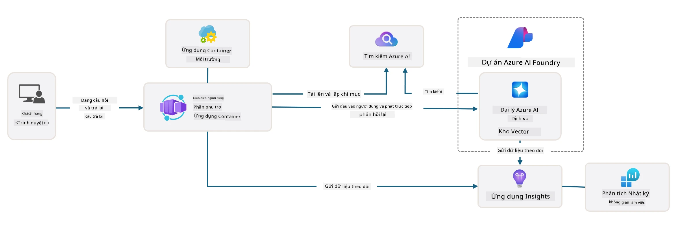

# 3. Phân tích một Mẫu

!!! tip "KHI HOÀN THÀNH MODULE NÀY BẠN SẼ CÓ THỂ"

    - [ ] Use GitHub Copilot and optional MCP tools for Azure documentation and read-only exploration
    - [ ] Identify the template's application, infrastructure, configuration, and test entry points
    - [ ] Verify generated explanations against actual repository files
    - [ ] **Lab 3:** Trace one request and one configuration input through the project

---

## 1. Kích hoạt GitHub Copilot

Mở mẫu AI đã khởi tạo trong VS Code và bật [GitHub Copilot](https://code.visualstudio.com/docs/copilot/chat/chat-agent-mode). Đăng nhập bằng tài khoản có gói dịch vụ phù hợp; giới hạn sử dụng khác nhau. Yêu cầu Copilot giải thích kho lưu trữ trước khi cho phép thay đổi.

### Các máy chủ MCP tùy chọn

Các dịch vụ này có thể cung cấp thêm công cụ:

- [Máy chủ Azure MCP](https://learn.microsoft.com/azure/developer/azure-mcp-server/overview)
- [Máy chủ Microsoft Learn MCP](https://learn.microsoft.com/training/support/mcp)

Trong VS Code, xem lại [hướng dẫn cấu hình MCP](https://code.visualstudio.com/docs/copilot/chat/mcp-servers) và tạo `.vscode/mcp.json` nếu cần:

```json
{
  "servers": {
    "Azure MCP Server": {
      "type": "stdio",
      "command": "npx",
      "args": ["-y", "@azure/mcp@latest", "server", "start"]
    },
    "microsoft.docs.mcp": {
      "type": "http",
      "url": "https://learn.microsoft.com/api/mcp"
    }
  }
}
```

Lệnh `npx` yêu cầu cài đặt Node.js/npm được hỗ trợ và tải xuống mã thực thi. Xem lại gói và khoá một phiên bản đã duyệt để thiết lập nhóm có thể tái tạo. Khởi động các máy chủ bằng các điều khiển MCP của VS Code và kiểm tra các công cụ sẵn có; tên có thể thay đổi giữa các phiên bản.

**Xác thực là riêng biệt.** Sử dụng `azd auth login` cho AZD. Làm theo quy trình xác thực được tài liệu của Azure MCP cho các công cụ của nó; chỉ đăng nhập AZD không thiết lập phiên MCP. Sử dụng `az login` riêng khi bài tập hoặc hook gọi Azure CLI.

Thử các lời nhắc chỉ đọc:

1. “Sử dụng Microsoft Learn MCP để tìm tài liệu cấu hình Azure Developer CLI.”
2. “Giải thích `azure.yaml` trong kho lưu trữ này; trích dẫn các tệp định nghĩa mỗi hook.”
3. “Sử dụng các công cụ Azure MCP có sẵn, liệt kê các tài nguyên tôi đã triển khai mà không thay đổi gì.”

Kiểm tra người thuê/mục đăng ký đã chọn và mọi lời gọi công cụ được đề xuất. Không phê duyệt tạo, xóa hoặc thay đổi quyền truy cập tài nguyên chỉ để khám phá kiến trúc.

## 2. Hiểu kiến trúc

Mẫu chứa backend Python FastAPI và frontend React/TypeScript trong Azure Container Apps. Backend giao tiếp với một đại lý trong dự án Microsoft Foundry. Việc truy xuất và quan sát phụ thuộc vào các tính năng mẫu đã bật và thiết lập thành công; không được đảm bảo chỉ vì ứng dụng đã được triển khai.



So sánh sơ đồ này với [hướng dẫn triển khai nguồn hiện tại](https://github.com/Azure-Samples/get-started-with-ai-agents/blob/main/docs/deployment.md) và các tài nguyên thực tế của bạn. Kiểm tra việc cấu hình triển khai mô hình, công cụ đại lý, danh tính quản lý, phân quyền vai trò và các tài nguyên AI Search/Application Insights tùy chọn.

**Bài tập:** Yêu cầu Copilot truy vết yêu cầu trò chuyện từ frontend qua API đến Foundry, kèm tham chiếu tệp và hàm. Mở các tham chiếu đó và xác minh lời giải thích. Không suy luận xác thực, định tuyến hay ủy quyền đã triển khai chỉ dựa trên sơ đồ.

## 3. Cấu trúc kho lưu trữ

Các đường dẫn được chọn sau đây đã được kiểm tra với mẫu vào ngày 4 tháng 11 năm 2026. Phiên bản khởi tạo của bạn vẫn là nguồn dữ liệu chính xác:

```text
get-started-with-ai-agents/
  azure.yaml
  docker-compose.yaml
  requirements-dev.txt
  .devcontainer/
  infra/
    main.bicep
    main.parameters.json
    api.bicep
    core/
  src/
    Dockerfile
    pyproject.toml
    requirements.txt
    api/
      main.py
      routes.py
      search_index_manager.py
    frontend/
      package.json
      src/
    files/
  scripts/
    validate_env_vars.sh
    validate_env_vars.ps1
    postdeploy.sh
    postdeploy.ps1
  tests/
    test_evaluation.py
    test_red_teaming.py
  docs/
    deployment.md
    deploy_customization.md
    ai_search.md
    observability.md
    local_development.md
    troubleshooting.md
```

### Hạ tầng và cấu hình

`infra/main.bicep` điều phối tài nguyên; `main.parameters.json` kết nối các đầu vào mẫu với giá trị môi trường AZD. `azure.yaml` chọn dịch vụ ứng dụng và các hook vòng đời. Truy vết đầu vào như `USE_AZURE_AI_SEARCH_SERVICE` qua các tệp này để thấy điều gì thực sự thay đổi.

### Ứng dụng và danh tính

Đọc `src/api/` và `src/frontend/` cùng nhau. Xác định nơi tạo hoặc lấy đại lý, nơi cấu hình chỉ dẫn/công cụ, và danh tính nào được sử dụng cho mỗi lệnh gọi Azure. Các tệp mẫu trong `src/files/` là dữ liệu minh họa, không phải danh mục sản xuất hay mô hình ủy quyền.

### Kiểm thử và quan sát

Các điểm nhập đánh giá hiện tại và red-teaming nằm trong `tests/`; các tham chiếu thư mục `evals/` và `airedteaming/` cũ đã hết hạn cho mẫu này. Đọc `docs/observability.md` về các yêu cầu trước và chi phí trước khi chạy kiểm thử trên đám mây. Các kiểm thử Python này tách biệt với tiện ích mở rộng tùy chọn `azure.ai.evaluations` của AZD.

## 4. Xác minh các phát hiện của bạn

- Xác định tuyến API, tương tác đại lý và mã truy xuất cho một câu hỏi mẫu.
- Giải thích danh tính nào truy cập Foundry và cấu hình nào chọn điểm cuối.
- Tìm các script thực thi trước và sau triển khai thực tế cùng hành vi xử lý lỗi.
- Liệt kê các phụ thuộc hoặc tính năng tùy chọn không có trong triển khai của bạn.

Tiếp tục đến [Cấu hình một Mẫu](4-Configure-AI-Template.md).

---

<!-- CO-OP TRANSLATOR DISCLAIMER START -->
**Tuyên bố miễn trừ trách nhiệm**:
Tài liệu này đã được dịch bằng dịch vụ dịch thuật AI [Co-op Translator](https://github.com/Azure/co-op-translator). Mặc dù chúng tôi cố gắng đảm bảo độ chính xác, xin lưu ý rằng bản dịch tự động có thể chứa lỗi hoặc sai sót. Tài liệu gốc bằng ngôn ngữ gốc nên được coi là nguồn tin chính thức. Đối với thông tin quan trọng, nên sử dụng dịch vụ dịch thuật chuyên nghiệp bởi con người. Chúng tôi không chịu trách nhiệm về bất kỳ hiểu lầm hoặc giải thích sai nào phát sinh từ việc sử dụng bản dịch này.
<!-- CO-OP TRANSLATOR DISCLAIMER END -->