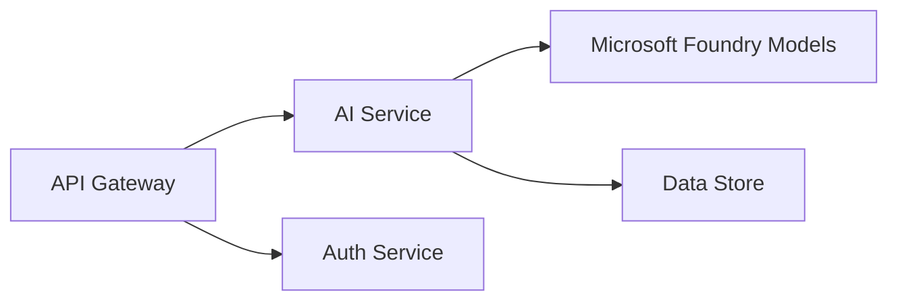
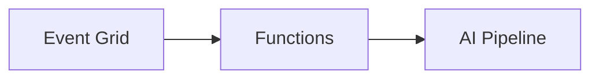

# 第8章：生产与企业模式

**📚 课程**：[AZD 初学者指南](../../README.md) | **⏱️ 时长**：2-3小时 | **⭐ 难度**：高级

---

## 概述

本章介绍面向企业的生产部署模式、安全加固、监控及生产环境 AI 工作负载的成本优化。

这是一个架构参考，而非完整可部署的生产模板。示例省略了必须由您自己的应用程序补充和测试的集成细节；仅阅读检查列表并不代表具备生产准备状态。

> **发布审查 (2026-11-04)：** AI CLI 指南已根据 `azd 1.37.2`、代理 `1.0.0-beta.23` 及评估 `1.0.0-beta.2` 文档/源码进行了检查。有关兼容性要求和迁移详情，请参见[发布变更和修复](production-ai-practices.md#recent-release-changes-and-fixes)；这不是实时部署验证。

## 学习目标

完成本章后，您将能够：
- 部署多区域弹性应用
- 实施企业安全模式
- 配置全面监控
- 实现大规模成本优化
- 使用 AZD 设置 CI/CD 流水线

---

## 📚 课程

| # | 课程 | 描述 | 时间 |
|---|--------|-------------|------|
| 1 | [生产级 AI 实践](production-ai-practices.md) | 企业部署模式 | 90 分钟 |

---

## 🚀 生产检查清单

- [ ] 多区域部署以实现弹性
- [ ] 使用托管身份进行身份验证（无密钥）
- [ ] 使用 Application Insights 进行监控
- [ ] 配置成本预算和警报
- [ ] 启用安全扫描
- [ ] 集成 CI/CD 流水线
- [ ] 灾难恢复计划

---

## 🏗️ 架构模式

### 模式一：微服务 AI



### 模式二：事件驱动 AI



---

## 🔐 安全最佳实践

```bicep
// Illustrative properties from different resources, NOT a standalone Bicep file.
// Attach identity to the application host:
identity: {
  type: 'SystemAssigned'
}

// AI account properties (also require private endpoints, DNS and app connectivity):
properties: {
  publicNetworkAccess: 'Disabled'
  networkAcls: {
    defaultAction: 'Deny'
  }
}
```

---

## 💰 成本优化

| 策略 | 主要限制 |
|----------|---------|
| 零规模自动扩展 (容器应用) | 需要合适的触发器；其他服务仍会产生费用 |
| 开发阶段使用按需计费层 | 比较所选服务价格和工作负载 |
| 计划性自动伸缩 | 通过支持的基础设施/自动化进行伸缩 |
| 预留容量/配额 | 仅支持时使用；承诺可能增加闲置成本 |

使用[完整预算资源模式](production-ai-practices.md#2-cost-monitoring-and-budgets)并配置有效的起始日期、计费范围、接收者和权限。预算可发送警报，但不会限制开支。节省取决于实际使用量，不能保证百分比。

---

## 📊 监控设置

```bash
# Open the Application Insights logs view (requires configured monitoring)
azd monitor --logs

# Check Application Insights
azd monitor --overview

# View metrics
az monitor metrics list --resource <resource-id>
```

---

## 🔗 导航

| 方向 | 章节 |
|-----------|---------|
| <strong>上一章</strong> | [第7章：故障排除](../chapter-07-troubleshooting/README.md) |
| <strong>课程完成</strong> | [课程首页](../../README.md) |

---

## 📖 相关资源

- [AI 代理指南](../chapter-02-ai-development/agents.md)
- [Application Insights](../chapter-06-pre-deployment/application-insights.md)
- [多代理解决方案](../chapter-05-multi-agent/README.md)
- [微服务示例](../../examples/microservices/README.md)

---

<!-- CO-OP TRANSLATOR DISCLAIMER START -->
**免责声明**：
本文件由 AI 翻译服务 [Co-op Translator](https://github.com/Azure/co-op-translator) 翻译完成。尽管我们力求准确，但请注意，自动翻译可能包含错误或不准确之处。原始语言版文件应视为权威来源。对于重要信息，建议使用专业人工翻译。我们对因使用本翻译而产生的任何误解或误释不承担责任。
<!-- CO-OP TRANSLATOR DISCLAIMER END -->