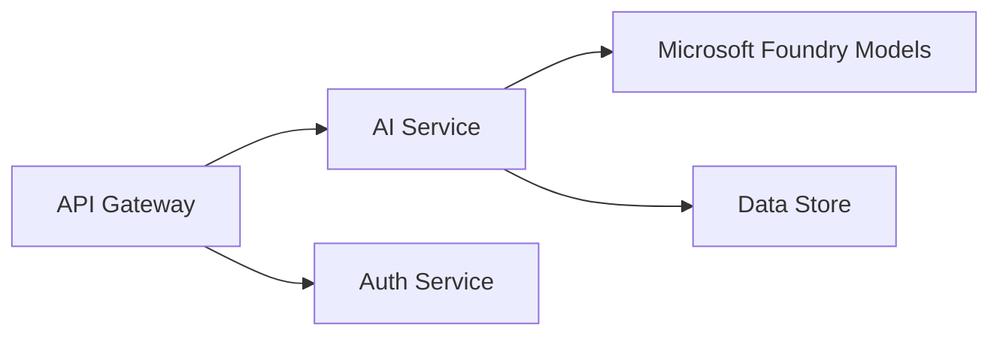
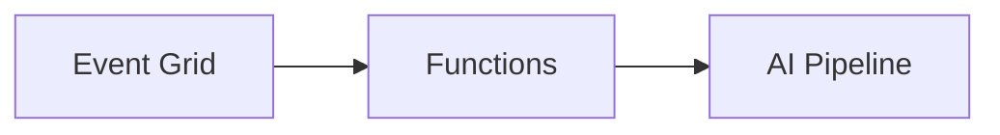

# 第8章：生产与企业模式

**📚 课程**：[AZD初学者](../../README.md) | **⏱️ 时长**：2-3小时 | **⭐ 复杂度**：高级

---

## 概述

本章涵盖企业级部署模式、安全加固、监控以及生产AI工作负载的成本优化。

这是一个架构参考，不是完整的可部署生产模板。示例省略了必须在您自己的应用中提供和测试的集成细节；阅读清单并不意味着具备生产准备状态。

> **Foundry GA 更新 (2026-11-09):** 使用 `azd >= 1.37.0` 和通用可用的 `microsoft.foundry` 1.0 包用于 Foundry 工作流；评估功能单独安装。请参阅 [版本范围和迁移](production-ai-practices.md#recent-release-changes-and-fixes) 以及 [身份验证管道示例](production-ai-practices.md#cicd-pipeline-configuration)。这是文档审核，而非实时部署验证或对可选预览功能的全面 GA 状态声明。

## 学习目标

完成本章内容后，您将能够：
- 部署多区域弹性应用
- 实现企业安全模式
- 配置全面监控
- 实现大规模成本优化
- 使用 AZD 设置 CI/CD 管道

---

## 📚 课程

| # | 课程 | 描述 | 时间 |
|---|--------|-------------|------|
| 1 | [生产级 AI 实践](production-ai-practices.md) | 企业部署模式 | 90 分钟 |

---

## 🚀 生产检查清单

- [ ] 多区域部署以增强弹性
- [ ] 使用托管身份进行认证（无密钥）
- [ ] 使用 Application Insights 进行监控
- [ ] 配置成本预算和警报
- [ ] 启用安全扫描
- [ ] 集成 CI/CD 管道
- [ ] 制定灾难恢复计划

---

## 🏗️ 架构模式

### 模式 1: 微服务 AI



### 模式 2: 事件驱动 AI



---

## 🔐 安全最佳实践

```bicep
// Illustrative properties from different resources, NOT a standalone Bicep file.
// Attach identity to the application host:
identity: {
  type: 'SystemAssigned'
}

// AI account properties (also require private endpoints, DNS and app connectivity):
properties: {
  publicNetworkAccess: 'Disabled'
  networkAcls: {
    defaultAction: 'Deny'
  }
}
```

---

## 💰 成本优化

| 策略 | 主要限制 |
|----------|---------|
| 缩放到零（容器应用） | 需要合适的触发器；其他服务仍会产生费用 |
| 开发使用消费层 | 比较所选服务的定价和工作负载 |
| 计划缩放 | 通过支持的基础设施/自动化进行缩放 |
| 预留/预配容量 | 仅在支持时使用；承诺可能增加空闲成本 |

使用带有有效开始日期、计费范围、接收者和权限的[完整预算资源模式](production-ai-practices.md#2-cost-monitoring-and-budgets)。预算发送警报；它不会限制支出。节省取决于测量的使用情况，并不保证百分比。

---

## 📊 监控设置

```bash
# Open the Application Insights logs view (requires configured monitoring)
azd monitor --logs

# Check Application Insights
azd monitor --overview

# View metrics
az monitor metrics list --resource <resource-id>
```

---

## 🔗 导航

| 方向 | 章节 |
|-----------|---------|
| <strong>上一章</strong> | [第7章：故障排除](../chapter-07-troubleshooting/README.md) |
| <strong>课程完成</strong> | [课程首页](../../README.md) |

---

## 📖 相关资源

- [AI代理指南](../chapter-02-ai-development/agents.md)
- [应用洞察](../chapter-06-pre-deployment/application-insights.md)
- [多代理解决方案](../chapter-05-multi-agent/README.md)
- [微服务示例](../../examples/microservices/README.md)

---

<!-- CO-OP TRANSLATOR DISCLAIMER START -->
**免责声明**：
本文件由 AI 翻译服务 [Co-op Translator](https://github.com/Azure/co-op-translator) 翻译完成。尽管我们力求准确，但请注意，自动翻译可能包含错误或不准确之处。原始语言版文件应视为权威来源。对于重要信息，建议使用专业人工翻译。我们对因使用本翻译而产生的任何误解或误释不承担责任。
<!-- CO-OP TRANSLATOR DISCLAIMER END -->