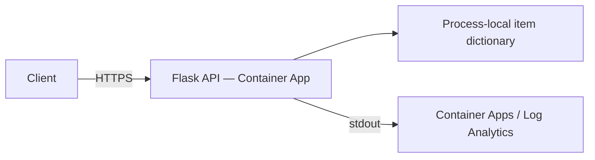

# 简单的 Flask API — Azure Container Apps

**难度等级：** 初学者 · **时间：** 包括设置在内 30–45 分钟

使用 Azure Developer CLI (azd) 部署 Python Flask CRUD API。包含源码、Dockerfile、Bicep 和部署参数。
这是一个<strong>学习示例</strong>，不是生产就绪的 API。


## 你将学到的内容

- 通过 azd 构建并发布容器。
- 配置入口和活动性/就绪探针。
- 验证 CRUD 响应并检查应用程序日志。
- 理解为什么内存数据不适合持久化应用程序。



**重要：** 项目保存在一个进程中。默认设置是**一个 Gunicorn worker，
0–1 个副本**，故意避免了跨 worker/副本的数据不一致问题。
重启、版本更改或缩放为零时，项目会丢失。增加副本
需要共享持久存储。API 无身份验证或授权机制。

## 前提条件

- [当前稳定版 azd](https://learn.microsoft.com/azure/developer/azure-developer-cli/install-azd)
  （审查时发布的版本：1.37.2）。
- 用于验证的 [Azure CLI](https://learn.microsoft.com/cli/azure/install-azure-cli)。
- 具有正在运行守护进程的 Docker；构建默认本地镜像所必需。
- Azure 订阅、资源创建权限及容器应用区域配额。
- 用于以下命令的 Bash（或等效的 PowerShell）。
- 可选本地开发用 Python 3.11。

```bash
azd version
az version
docker info
azd auth login
az login
```

CLI 工具拥有独立的登录会话。两者使用相同订阅。

## 快速开始

在仓库根目录：

```bash
cd examples/container-app/simple-flask-api
azd env new flask-demo
azd up
API_URL=$(azd env get-value API_ENDPOINT)
RG_NAME=$(azd env get-value AZURE_RESOURCE_GROUP)
API_NAME=$(azd env get-value API_NAME)
curl --fail-with-body "${API_URL}/health"
```

预期：HTTP 200 和包含 `"status":"healthy"`、
`"service":"simple-flask-api"` 及当前 UTC 时间戳的 JSON。
预配和镜像构建通常需要几分钟；时长会有变动。

初始预配使用公用 hello-world 镜像，监听端口 80。
`azure.yaml` 选择 `infra/app/api.bicep` 及其匹配的参数文件进行
服务部署，启用镜像、入口和探针端口为 8000。
请勿删除这些部署参数。

## 验证 CRUD

在同一副本保持活动状态时，按顺序运行以下命令：

```bash
# Create: HTTP 201; note the returned id (1 for a fresh process).
curl -i -X POST "${API_URL}/api/items" \
  -H "Content-Type: application/json" \
  -d '{"name":"Test Item","description":"My first item"}'

# Read list: HTTP 200, total 1 in a fresh process.
curl --fail-with-body "${API_URL}/api/items"

# Replace 1 if your create response returned another id.
curl --fail-with-body "${API_URL}/api/items/1"
curl -i -X PUT "${API_URL}/api/items/1" \
  -H "Content-Type: application/json" -d '{"name":"Updated Item"}'
curl -i -X DELETE "${API_URL}/api/items/1"
curl -i "${API_URL}/api/items/1"
```

成功：POST 201，读取/PUT 200，DELETE 204 无正文，然后缺失项目为 404。
格式错误/非对象 JSON 或空名称返回 400。
如果请求间项目消失，检查是否重启或缩放为零；
这是内存中的有意限制，非持久存储。

| 端点 | 方法 |
|---|---|
| `/` | GET — 服务信息 |
| `/health` | GET — 活跃/就绪 |
| `/api/items` | GET, POST |
| `/api/items/{id}` | GET, PUT, DELETE |

## 日志和配置

```bash
az containerapp logs show --name "$API_NAME" --resource-group "$RG_NAME" --follow
```

预期：Gunicorn 启动、请求访问日志和应用消息。
`azd monitor --logs` 打开门户视图；不会实时流式输出到终端。
Application Insights 已预配，但此 Flask 代码<strong>未做监控接入</strong>；
使用容器应用/日志分析查看 stdout 日志。

编辑 `infra/app/api.bicep` 以调整 CPU/内存、复制限制或扩缩规则，然后
运行 `azd up`。默认值为 0.5 vCPU、1 GiB，最小 0 / 最大 1 副本，及
50 个并发请求的 HTTP 阈值。缩放为零可能产生冷启动延迟。

任意 `azd env set MAX_REPLICAS`、`API_KEY`、`LOG_LEVEL` 或
`SCALE_TO_ZERO_TIMEOUT` 值<strong>不映射至本模板或应用</strong>。
设置值不会自动成为运行时环境变量。
镜像明确绑定端口 8000；如更改端口，请同时更新 Dockerfile、Bicep 入口和探针。


## 文件

```text
azure.yaml
infra/main.bicep
infra/main.parameters.json
infra/app/container-apps.bicep       # Environment, registry, monitoring
infra/app/api.bicep                  # App, ingress, probes, scale settings
infra/app/api.parameters.json        # Image and resource values for azd deploy
src/app.py
src/Dockerfile
src/requirements.txt
```

## 本地开发

来自此示例目录：

```bash
python -m venv .venv
source .venv/bin/activate  # PowerShell: .\.venv\Scripts\Activate.ps1
python -m pip install -r src/requirements.txt
python src/app.py
```

在另一个终端，测试 `http://localhost:8000/health` 和 CRUD 端点。
或构建并运行实际镜像：

```bash
docker build -t flask-api:local ./src
docker run --rm -p 8000:8000 flask-api:local
```

第一次部署后的纯代码更改，请运行 `azd deploy api`。
Bicep 更改后，运行 `azd up` 以重新配置并部署。

## 实践练习

### 1. 验证输入拒绝

**起点：** 部署的 API，如上文 `API_URL`。
**目标：** 验证 API 拒绝无效的 JSON 结构和缺失的名称。

```bash
curl -i -X POST "${API_URL}/api/items" \
  -H "Content-Type: application/json" -d '[]'
curl -i -X POST "${API_URL}/api/items" \
  -H "Content-Type: application/json" -d '{"name":""}'
```

**成功标准 / 解决方案：** 两者均返回 400 和 JSON 错误，而非 500。
**常见问题：** 省略 JSON content-type 头。

### 2. 添加只读版本端点

**起点：** `src/app.py`。**目标：** 扩展并重新部署 API。
在 `if __name__ == '__main__':` 块之前添加此内容：

```python
@app.route('/version', methods=['GET'])
def version():
    return jsonify({'version': '1.0.0'})
```

运行 `azd deploy api`，然后 `curl --fail-with-body "${API_URL}/version"`。
**成功标准：** HTTP 200 和 `{"version":"1.0.0"}`。
**常见问题：** 在阻塞的 `app.run()` 调用之后放置路由时
使用 `python src/app.py` 进行测试。

### 知识检查点

为什么一个 worker 对于持久化数据来说不够？因为即使是一个进程在重启时也会丢失
它的字典。生产版本需要持久共享存储、
身份验证、授权、迁移、测试和运维监控。

## 成本与故障排除

这并不是保证 $0 的部署：基础注册表和日志存储/摄取
即使应用计算为零时也可能产生费用。请使用
[定价计算器](https://azure.microsoft.com/pricing/calculator/) 查询您所在区域的费用。

- **Docker 构建失败：** 确认 `docker info`、网络访问和依赖项。
- **应用不健康：** 检查控制台/系统日志并确认镜像端口、入口、
  和探针是否一致。不能在 Flask 端口上探测占位符。
- **403/权限：** 确认订阅和资源创建权限。
- **项目消失：** 内存状态在重启/缩放到零时重置；添加数据库实现持久化行为。


## 清理和下一步

```bash
azd down
```

审查删除提示并确认专用资源组已被删除。
不要对包含无关数据的资源组使用破坏性清理。

[下一步：数据库应用](../../../../../examples/database-app) · [微服务](../../../../../examples/container-app/microservices) ·
[容器概述](../README.md) · [课程首页](../../../README.md) ·
[报告一个问题](https://github.com/microsoft/AZD-for-beginners/issues)

---

<!-- CO-OP TRANSLATOR DISCLAIMER START -->
**免责声明**：
本文件由 AI 翻译服务 [Co-op Translator](https://github.com/Azure/co-op-translator) 翻译完成。尽管我们力求准确，但请注意，自动翻译可能包含错误或不准确之处。原始语言版文件应视为权威来源。对于重要信息，建议使用专业人工翻译。我们对因使用本翻译而产生的任何误解或误释不承担责任。
<!-- CO-OP TRANSLATOR DISCLAIMER END -->