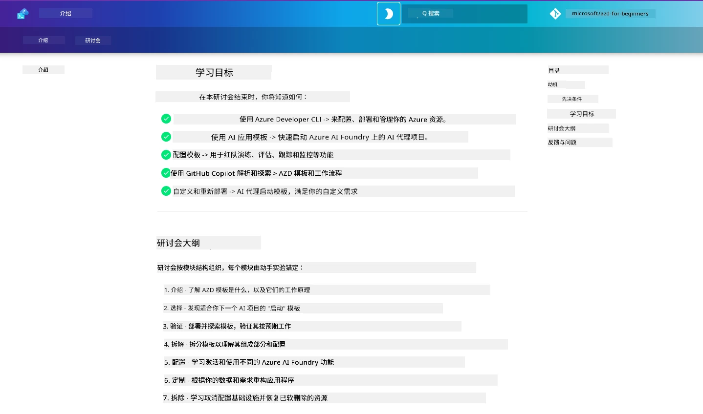

<div align="center">
  <div style="background: linear-gradient(135deg, #0078d4, #106ebe); border-radius: 10px; padding: 20px; margin: 20px 0; box-shadow: 0 4px 15px rgba(0, 120, 212, 0.3); border: 2px solid #005a9e;">
    <h2 style="color: white; margin: 0; font-size: 24px; text-shadow: 1px 1px 2px rgba(0,0,0,0.3);">
      🎯 AZD AI开发者工作坊
    </h2>
    <p style="color: white; margin: 10px 0 0 0; font-size: 16px; text-shadow: 1px 1px 2px rgba(0,0,0,0.3);">
      <strong>一个使用 Azure Developer CLI 构建 AI 应用的动手工作坊。</strong><br>
      完成7个模块，掌握AZD模板和AI部署工作流程。
    </p>
    <div style="margin-top: 15px;">
      <span style="background: rgba(255,255,255,0.2); padding: 5px 10px; border-radius: 15px; color: white; font-size: 14px;">
        📅 指导信息审核时间：2026年11月
      </span>
    </div>
  </div>
</div>

# AZD AI开发者工作坊

欢迎参加着重于AI应用部署的Azure Developer CLI (AZD) 实操工作坊。此工作坊帮助你通过以下3个步骤深入理解AZD模板：

1. <strong>发现</strong> - 找到适合你的模板。
1. <strong>部署</strong> - 部署并验证其功能
1. <strong>定制</strong> - 修改并迭代，使其符合你的需求！

在整个工作坊过程中，你还将接触核心开发工具和工作流程，帮助你简化端到端开发体验。

<br/>

## 基于浏览器的指南

工作坊课程采用Markdown格式。你可以直接在GitHub中浏览，或者如下面截图所示，启动一个基于浏览器的预览。



要使用此选项——将仓库fork到你的个人账户，并启动GitHub Codespaces。一旦VS Code终端激活，输入如下命令：

此浏览器预览适用于GitHub Codespaces、开发容器，或安装了Python和MkDocs的本地克隆环境。

```bash title="" linenums="0"
python -m pip install -r requirements-dev.txt
python -m mkdocs serve --config-file workshop/mkdocs.yml
```

请从<strong>课程仓库根目录</strong>运行这些命令，不要在单独初始化的AI示例中执行。保持预览处于前台，以便能看到错误；用Ctrl+C停止。若要检查站点但不启动服务，运行`python -m mkdocs build --strict --config-file workshop/mkdocs.yml`。

几秒后你将看到弹出对话框。选择`Open in browser`选项。基于Web的指南将会在新的浏览器标签页中打开。此预览的优势包括：

1. <strong>内置搜索</strong> - 快速找到关键词或课程。
1. <strong>复制图标</strong> - 悬停在代码块上即可看到此功能
1. <strong>主题切换</strong> - 在暗色和浅色主题间切换
1. <strong>获取帮助</strong> - 点击页脚的Discord图标加入讨论！

<br/>

## 工作坊概览

**时长：** 3-4 小时  
**水平：** 初级到中级  
**先决条件：** 熟悉Azure、AI概念、VS Code和命令行工具。

这是一个动手的工作坊，通过实操学习。完成练习后，我们建议回顾 AZD 初学者课程，深入学习安全和生产力最佳实践。

| 时间| 模块  | 目标 |
|:---|:---|:---|
| 15分钟 | [介绍](docs/instructions/0-Introduction.md) | 设定背景，理解目标 |
| 30分钟 | [选择AI模板](docs/instructions/1-Select-AI-Template.md) | 探索选项并选择起点 | 
| 30分钟 | [验证AI模板](docs/instructions/2-Validate-AI-Template.md) | 部署默认解决方案到Azure |
| 30分钟 | [拆解AI模板](docs/instructions/3-Deconstruct-AI-Template.md) | 探索结构和配置 |
| 30分钟 | [配置AI模板](docs/instructions/4-Configure-AI-Template.md) | 激活并尝试可用功能 |
| 30分钟 | [定制AI模板](docs/instructions/5-Customize-AI-Template.md) | 根据需求适配模板 |
| 30分钟 | [拆卸基础设施](docs/instructions/6-Teardown-Infrastructure.md) | 清理并释放资源 |
| 15分钟 | [总结和后续](docs/instructions/7-Wrap-up.md) | 学习资源，工作坊挑战 |

<br/>

## 你将学到什么

将AZD模板视为一个学习沙盒，用于探索Microsoft Foundry的端到端开发各种能力和工具。完成本工作坊后，你应对相关工具和概念有直观的理解。

| 概念  | 目标 |
|:---|:---|
| **Azure Developer CLI** | 了解工具命令和工作流程|
| **AZD模板** | 了解项目结构和配置|
| **Azure AI Agent** | 预配和部署Microsoft Foundry项目  |
| **Azure AI Search** | 用代理启用上下文工程 |
| <strong>可观察性</strong> | 探索追踪、监控和评估 |
| <strong>红队测试</strong> | 探索对抗性测试和缓解措施 |

<br/>

## 工作坊结构

本工作坊结构包括模板发现、部署、拆解与定制的过程，基于官方的[AI代理快速入门](https://github.com/Azure-Samples/get-started-with-ai-agents)起始模板。

### [模块 1: 选择AI模板](docs/instructions/1-Select-AI-Template.md) (30分钟)

- 什么是AI模板？
- 我在哪里可以找到AI模板？
- 如何开始构建AI代理？
- <strong>实验</strong>：在Codespaces或开发容器中快速启动

### [模块 2: 验证AI模板](docs/instructions/2-Validate-AI-Template.md) (30分钟)

- AI模板架构是什么？
- AZD开发工作流程是什么？
- 如何获得AZD开发帮助？
- <strong>实验</strong>：部署并验证AI代理模板

### [模块 3: 拆解AI模板](docs/instructions/3-Deconstruct-AI-Template.md) (30分钟)

- 在`.azure/`中探索你的环境
- 在`infra/`中探索你的资源配置
- 探索`azure.yaml`中的AZD配置
- <strong>实验</strong>：修改环境变量并重新部署

### [模块 4: 配置AI模板](docs/instructions/4-Configure-AI-Template.md) (30分钟)
- 探索：检索增强生成
- 探索：代理评估与红队测试
- 探索：追踪与监控
- <strong>实验</strong>：探索AI代理+可观察性

### [模块 5: 定制AI模板](docs/instructions/5-Customize-AI-Template.md) (30分钟)
- 定义：场景需求的产品需求文档（PRD）
- 配置：AZD的环境变量
- 实施：添加任务的生命周期挂钩
- <strong>实验</strong>：为我的场景定制模板

### [模块 6: 拆卸基础设施](docs/instructions/6-Teardown-Infrastructure.md) (30分钟)
- 回顾：什么是AZD模板？
- 回顾：为什么使用Azure Developer CLI？
- 后续步骤：尝试其他模板！
- <strong>实验</strong>：撤销基础设施并清理

<br/>

## 工作坊挑战

想挑战自己做更多吗？这里有一些项目建议——或者和我们分享你的想法！

| 项目 | 描述 |
|:---|:---|
|1. **拆解复杂AI模板** | 使用我们介绍的工作流程和工具，尝试部署、验证及定制一个不同的AI解决方案模板。_你学到了什么？_|
|2. <strong>根据你的场景定制</strong> | 尝试为不同场景编写产品需求文档（PRD）。然后在Agent Model的模板仓库中使用GitHub Copilot，请它为你生成定制工作流程。_你学到了什么？你如何改进这些建议？_|
| | |

## 有反馈吗？

1. 在本仓库发布issue——方便起见请标记为`Workshop`。
1. 加入Microsoft Foundry Discord——与同行交流！


| | | 
|:---|:---|
| **📚 课程首页**| [AZD 初学者](../README.md)|
| **📖 文档** | [AI模板入门](https://learn.microsoft.com/en-us/azure/ai-foundry/how-to/develop/ai-template-get-started)|
| **🛠️ AI模板** | [Microsoft Foundry 模板](https://ai.azure.com/templates) |
|**🚀 下一步** | [开始工作坊](#workshop-overview) |
| | |

<br/>

---

**导航：** [主课程](../README.md) | [介绍](docs/instructions/0-Introduction.md) | [模块 1: 选择模板](docs/instructions/1-Select-AI-Template.md)

**准备好使用AZD开始构建AI应用了吗？**

[开始工作坊：介绍 →](docs/instructions/0-Introduction.md)

---

<!-- CO-OP TRANSLATOR DISCLAIMER START -->
**免责声明**：
本文件由 AI 翻译服务 [Co-op Translator](https://github.com/Azure/co-op-translator) 翻译完成。尽管我们力求准确，但请注意，自动翻译可能包含错误或不准确之处。原始语言版文件应视为权威来源。对于重要信息，建议使用专业人工翻译。我们对因使用本翻译而产生的任何误解或误释不承担责任。
<!-- CO-OP TRANSLATOR DISCLAIMER END -->