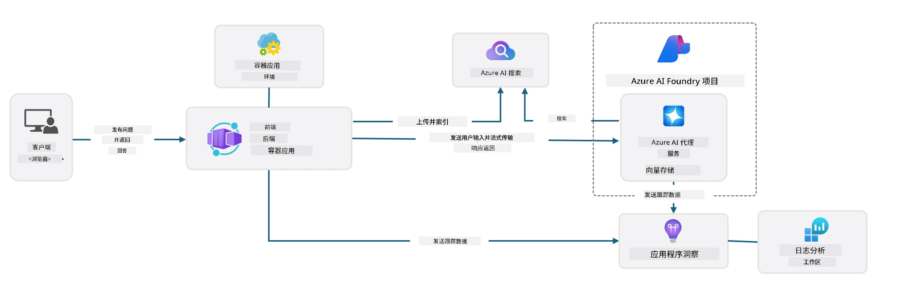

# 3. 解构模板

!!! tip "在本模块结束时，您将能够"

    - [ ] Use GitHub Copilot and optional MCP tools for Azure documentation and read-only exploration
    - [ ] Identify the template's application, infrastructure, configuration, and test entry points
    - [ ] Verify generated explanations against actual repository files
    - [ ] **Lab 3:** Trace one request and one configuration input through the project

---

## 1. 启用 GitHub Copilot

在 VS Code 中打开已初始化的 AI 示例并启用 [GitHub Copilot](https://code.visualstudio.com/docs/copilot/chat/chat-agent-mode)。使用拥有合资格计划的账号登录；使用限制各异。授权更改前，请让 Copilot 解释仓库内容。

### 可选的 MCP 服务器

这些服务可以提供额外工具：

- [Azure MCP Server](https://learn.microsoft.com/azure/developer/azure-mcp-server/overview)
- [Microsoft Learn MCP Server](https://learn.microsoft.com/training/support/mcp)

在 VS Code 中，查看 [MCP 配置指导](https://code.visualstudio.com/docs/copilot/chat/mcp-servers) 并在需要时创建 `.vscode/mcp.json`：

```json
{
  "servers": {
    "Azure MCP Server": {
      "type": "stdio",
      "command": "npx",
      "args": ["-y", "@azure/mcp@latest", "server", "start"]
    },
    "microsoft.docs.mcp": {
      "type": "http",
      "url": "https://learn.microsoft.com/api/mcp"
    }
  }
}
```

`npx` 命令需要已安装支持的 Node.js/npm，并会下载可执行代码。请审核包并锁定经批准的版本以保证团队环境可重现。使用 VS Code 的 MCP 控制启动服务器，并检查其可用工具；工具名称可能随版本变化。

**认证是分开的。** AZD 使用 `azd auth login`。请遵循 Azure MCP 文档中的认证流程；仅登录 AZD 不会建立 MCP 会话。在练习或钩子调用 Azure CLI 时，分别使用 `az login`。

尝试只读提示：

1. “使用 Microsoft Learn MCP 查找 Azure Developer CLI 配置文档。”
2. “解释此仓库的 `azure.yaml`；引用实现每个钩子的文件。”
3. “使用可用的 Azure MCP 工具，列出我部署的资源且不对其进行修改。”

检查所选租户/订阅和每个拟调用工具。不要仅为探索架构而批准资源创建、删除或访问更改。

## 2. 理解架构

示例托管了一个基于 Python FastAPI 的后端和一个 React/TypeScript 前端，运行在 Azure 容器应用中。后端与 Microsoft Foundry 项目中的代理通信。检索和可观察性依赖启用的模板功能和配置成功；它们不会仅因应用已部署而保证存在。



将此图与 [当前的上游部署指南](https://github.com/Azure-Samples/get-started-with-ai-agents/blob/main/docs/deployment.md) 及您的实际资源对比。检查配置的模型部署、代理工具、托管标识、角色分配，以及可选的 AI 搜索/应用洞察资源。

**练习：** 让 Copilot 跟踪一个聊天请求从前端通过 API 到 Foundry 的流程，带上文件和函数引用。打开那些引用并验证说明。不要仅靠图示推测实现的认证、路由或授权。

## 3. 仓库结构

以下选定路径在 2026 年 11 月 4 日已针对示例检查。您的已初始化版本依旧是事实依据：

```text
get-started-with-ai-agents/
  azure.yaml
  docker-compose.yaml
  requirements-dev.txt
  .devcontainer/
  infra/
    main.bicep
    main.parameters.json
    api.bicep
    core/
  src/
    Dockerfile
    pyproject.toml
    requirements.txt
    api/
      main.py
      routes.py
      search_index_manager.py
    frontend/
      package.json
      src/
    files/
  scripts/
    validate_env_vars.sh
    validate_env_vars.ps1
    postdeploy.sh
    postdeploy.ps1
  tests/
    test_evaluation.py
    test_red_teaming.py
  docs/
    deployment.md
    deploy_customization.md
    ai_search.md
    observability.md
    local_development.md
    troubleshooting.md
```

### 基础设施和配置

`infra/main.bicep` 编排资源；`main.parameters.json` 连接模板输入和 AZD 环境变量。`azure.yaml` 选择应用服务和生命周期钩子。追踪类似 `USE_AZURE_AI_SEARCH_SERVICE` 的输入，查找实际影响的文件。

### 应用和身份

一起阅读 `src/api/` 和 `src/frontend/`。识别代理被创建或查询的位置，指令/工具配置位置，以及每个 Azure 调用使用的身份。`src/files/` 下的示例文件是演示数据，不是生产目录或授权模型。

### 测试和可观察性

当前的评估和红队入口点在 `tests/`；旧的 `evals/` 和 `airedteaming/` 目录引用对本示例已过时。运行云测试前请阅读 `docs/observability.md` 了解前提条件和费用。这些 Python 测试独立于可选的 `azure.ai.evaluations` AZD 扩展。

## 4. 验证您的发现

- 确认一个示例问题对应的 API 路由、代理交互和检索代码。
- 说明哪个身份访问 Foundry 和哪个配置选择其端点。
- 查找实际的部署前后脚本及其错误处理行为。
- 列出部署中缺失的依赖或可选功能。

继续进行 [配置模板](4-Configure-AI-Template.md)。

---

<!-- CO-OP TRANSLATOR DISCLAIMER START -->
**免责声明**：
本文件由 AI 翻译服务 [Co-op Translator](https://github.com/Azure/co-op-translator) 翻译完成。尽管我们力求准确，但请注意，自动翻译可能包含错误或不准确之处。原始语言版文件应视为权威来源。对于重要信息，建议使用专业人工翻译。我们对因使用本翻译而产生的任何误解或误释不承担责任。
<!-- CO-OP TRANSLATOR DISCLAIMER END -->