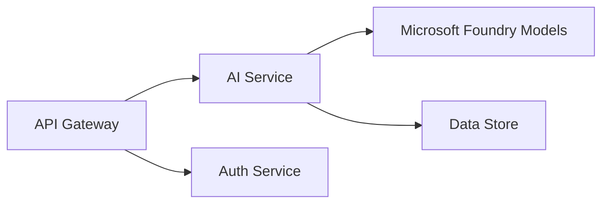
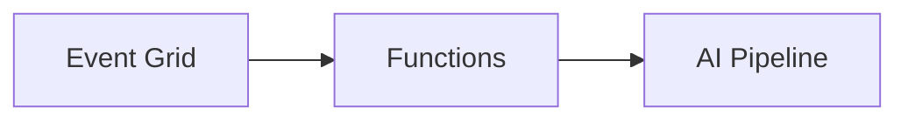

# 第 8 章：生產與企業模式

**📚 課程**: [AZD 初學者指南](../../README.md) | **⏱️ 時長**: 2-3 小時 | **⭐ 複雜度**: 進階

---

## 概覽

本章涵蓋企業級生產部署模式、安全強化、監控以及生產 AI 工作負載的成本優化。

這是架構參考，而非完整可部署的生產範本。範例省略必須在您的應用中補充並測試的整合細節；閱讀清單並不代表具備生產準備。

> **版本審查 (2026-11-04):** 針對 `azd 1.37.2` AI CLI 指南、代理 `1.0.0-beta.23` 以及評估 `1.0.0-beta.2` 文件/來源進行核對。詳見 [版本變更與修正](production-ai-practices.md#recent-release-changes-and-fixes) 了解相容性需求與遷移細節；此非現場部署驗證。

## 學習目標

完成本章你將能：
- 部署多區域高可用應用
- 實踐企業安全模式
- 配置完整監控
- 大規模成本優化
- 使用 AZD 建置 CI/CD 流程

---

## 📚 課程內容

| # | 課程 | 說明 | 時間 |
|---|--------|-------------|------|
| 1 | [生產 AI 實務](production-ai-practices.md) | 企業部署模式 | 90 分鐘 |

---

## 🚀 生產檢查清單

- [ ] 多區域部署以提升韌性
- [ ] 使用託管身份認證（無需金鑰）
- [ ] 配置 Application Insights 監控
- [ ] 設定成本預算與警示
- [ ] 啟用安全掃描
- [ ] 整合 CI/CD 管線
- [ ] 制定災難復原計劃

---

## 🏗️ 架構模式

### 模式 1：微服務 AI



### 模式 2：事件驅動 AI



---

## 🔐 安全最佳實踐

```bicep
// Illustrative properties from different resources, NOT a standalone Bicep file.
// Attach identity to the application host:
identity: {
  type: 'SystemAssigned'
}

// AI account properties (also require private endpoints, DNS and app connectivity):
properties: {
  publicNetworkAccess: 'Disabled'
  networkAcls: {
    defaultAction: 'Deny'
  }
}
```

---

## 💰 成本優化

| 策略 | 主要限制 |
|----------|---------|
| 零延伸規模（Container Apps） | 需合適觸發器；其他服務仍有成本 |
| 開發使用消耗層級 | 比較所選服務價格與工作負載 |
| 排程擴縮 | 透過支援基礎設施/自動化調節 |
| 預留/預配容量 | 僅支援時使用；承諾可能增加閒置成本 |

使用 [完整預算資源模式](production-ai-practices.md#2-cost-monitoring-and-budgets)，具有效起始日、帳單範圍、接收者與權限。預算會發送警示；不會限制支出。節省取決於實際使用率，百分比無保證。

---

## 📊 監控設定

```bash
# Open the Application Insights logs view (requires configured monitoring)
azd monitor --logs

# Check Application Insights
azd monitor --overview

# View metrics
az monitor metrics list --resource <resource-id>
```

---

## 🔗 導航

| 方向 | 章節 |
|-----------|---------|
| <strong>上一章</strong> | [第 7 章：疑難排解](../chapter-07-troubleshooting/README.md) |
| <strong>課程結束</strong> | [課程首頁](../../README.md) |

---

## 📖 相關資源

- [AI 代理指南](../chapter-02-ai-development/agents.md)
- [Application Insights](../chapter-06-pre-deployment/application-insights.md)
- [多代理解決方案](../chapter-05-multi-agent/README.md)
- [微服務範例](../../examples/microservices/README.md)

---

<!-- CO-OP TRANSLATOR DISCLAIMER START -->
**免責聲明**：
本文件由 AI 翻譯服務 [Co-op Translator](https://github.com/Azure/co-op-translator) 翻譯而成。雖然我們致力於確保準確性，但請注意，機器自動翻譯可能包含錯誤或不準確之處。原始文件的母語版本應被視為權威來源。對於重要資訊，建議進行專業人工翻譯。我們不對因使用本翻譯而產生的任何誤解或誤釋承擔責任。
<!-- CO-OP TRANSLATOR DISCLAIMER END -->