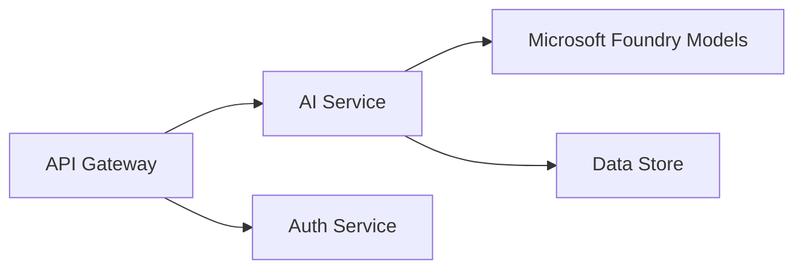

# 第8章：生產及企業模式

**📚 課程**：[初學者的AZD](../../README.md) | **⏱️ 時間長度**：2-3 小時 | **⭐ 複雜度**：進階

---

## 概覽

本章節涵蓋企業級部署模式、安全強化、監控及生產型AI工作負載的成本優化。

這是架構參考，而非完整的可部署生產範本。範例省略了必須由您自己應用中提供及測試的整合細節；閱讀清單不代表生產就緒。

> **Foundry GA 更新 (2026-11-09)：** 請使用 `azd >= 1.37.0` 及已普遍提供的 `microsoft.foundry` 1.0 套件用於 Foundry 工作流程；評估版需另行安裝。詳見 [發行範圍及遷移](production-ai-practices.md#recent-release-changes-and-fixes) 及 [授權管線範例](production-ai-practices.md#cicd-pipeline-configuration)。這是文件審查，非實時部署驗證，亦不代表選用預覽功能的全面GA狀態。

## 學習目標

完成本章後，您將能：
- 部署多區域彈性應用程式
- 實施企業安全模式
- 設定完整監控
- 大規模優化成本
- 使用AZD建立CI/CD管線

---

## 📚 課程內容

| # | 課程 | 說明 | 時間 |
|---|--------|-------------|------|
| 1 | [生產型AI實務](production-ai-practices.md) | 企業部署模式 | 90 分鐘 |

---

## 🚀 生產檢查清單

- [ ] 多區域部署實現彈性
- [ ] 託管身份驗證（無需金鑰）
- [ ] 使用 Application Insights 監控
- [ ] 配置成本預算及警報
- [ ] 啟用安全掃描
- [ ] 整合CI/CD管線
- [ ] 災難復原計劃

---

## 🏗️ 架構模式

### 模式1：微服務AI



### 模式2：事件驅動AI


---

## 🔐 安全最佳實務

```bicep
// Illustrative properties from different resources, NOT a standalone Bicep file.
// Attach identity to the application host:
identity: {
  type: 'SystemAssigned'
}

// AI account properties (also require private endpoints, DNS and app connectivity):
properties: {
  publicNetworkAccess: 'Disabled'
  networkAcls: {
    defaultAction: 'Deny'
  }
}
```

---

## 💰 成本優化

| 策略 | 主要限制 |
|----------|---------|
| 零規模調整 (Container Apps) | 需合適觸發器；其他服務仍會產生成本 |
| 開發用消耗層 | 比較所選服務價格及工作負載 |
| 排程擴展 | 透過支援基礎設施/自動化調整規模 |
| 預留/預配置容量 | 只有支援時；承諾可能增加閒置成本 |

使用帶有效起始日期、計費範圍、收件者和權限的 [完整預算資源模式](production-ai-practices.md#2-cost-monitoring-and-budgets)。預算會發送警報；不會限制開支。節省視實際利用率而定，不保證百分比。

---

## 📊 監控設定

```bash
# Open the Application Insights logs view (requires configured monitoring)
azd monitor --logs

# Check Application Insights
azd monitor --overview

# View metrics
az monitor metrics list --resource <resource-id>
```

---

## 🔗 導航

| 方向 | 章節 |
|-----------|---------|
| <strong>上一章</strong> | [第7章：疑難排解](../chapter-07-troubleshooting/README.md) |
| <strong>完成課程</strong> | [課程首頁](../../README.md) |

---

## 📖 相關資源

- [AI代理指南](../chapter-02-ai-development/agents.md)
- [Application Insights](../chapter-06-pre-deployment/application-insights.md)
- [多代理解決方案](../chapter-05-multi-agent/README.md)
- [微服務範例](../../examples/microservices/README.md)

---

<!-- CO-OP TRANSLATOR DISCLAIMER START -->
**免責聲明**：
本文件由 AI 翻譯服務 [Co-op Translator](https://github.com/Azure/co-op-translator) 翻譯而成。雖然我們致力於確保準確性，但請注意，機器自動翻譯可能包含錯誤或不準確之處。原始文件的母語版本應被視為權威來源。對於重要資訊，建議進行專業人工翻譯。我們不對因使用本翻譯而產生的任何誤解或誤釋承擔責任。
<!-- CO-OP TRANSLATOR DISCLAIMER END -->