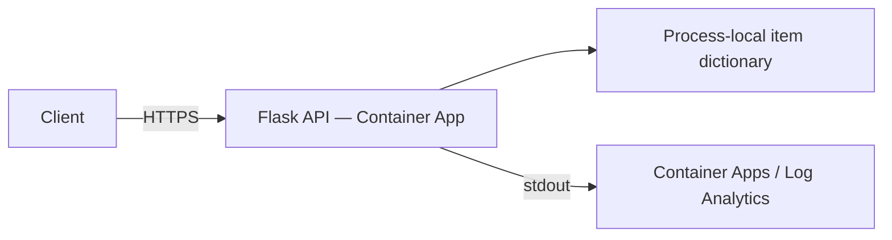

# 簡易 Flask API — Azure Container Apps

**程度：** 初學者 · **時間：** 包括設定約 30–45 分鐘

使用 Azure Developer CLI (azd) 部署 Python Flask CRUD API。包含原始碼、Dockerfile、 
Bicep 和部署參數。這是一個<strong>學習範例</strong>，非生產環境可用的 API。


## 你將會學習

- 使用 azd 建構並發佈容器。
- 設定入口和存活/就緒探針。
- 驗證 CRUD 回應並檢查應用程式日誌。
- 了解為何記憶體內資料不適用於持久性應用程式。



**重要：** 項目保存在同一個進程中。預設為 **一個 Gunicorn worker， 
0–1 複本**，故意避免不同 worker/複本間產生不一致的數據。
重新啟動、版本更新或縮減到零時，項目將會遺失。若要增加複本，
則需要共用的持久性存儲。該 API 沒有身份驗證或授權。

## 預備條件

- [目前穩定版 azd](https://learn.microsoft.com/azure/developer/azure-developer-cli/install-azd)
  (發佈版本於審查時間：1.37.2)。
- 用於驗證的 [Azure CLI](https://learn.microsoft.com/cli/azure/install-azure-cli)。
- 運行中守護程式的 Docker；預設本地鏡像構建所需。
- Azure 訂閱、資源建立權限和 Container Apps 區域配額。
- 用於以下命令的 Bash（或等效的 PowerShell）。
- 用於可選本地開發的 Python 3.11。

```bash
azd version
az version
docker info
azd auth login
az login
```

CLI 工具具有獨立的登入會話。兩者使用相同訂閱。

## 快速開始

從儲存庫根目錄開始：

```bash
cd examples/container-app/simple-flask-api
azd env new flask-demo
azd up
API_URL=$(azd env get-value API_ENDPOINT)
RG_NAME=$(azd env get-value AZURE_RESOURCE_GROUP)
API_NAME=$(azd env get-value API_NAME)
curl --fail-with-body "${API_URL}/health"
```

預期：HTTP 200 且返回包含 `"status":"healthy"`、
`"service":"simple-flask-api"` 及當前 UTC 時間戳的 JSON。
佈建和鏡像構建一般需要數分鐘；時間會有所不同。

初始佈建使用公共 hello-world 鏡像，監聽在 80 端口。
`azure.yaml` 選擇 `infra/app/api.bicep` 及其相應參數檔進行
服務部署，將鏡像、入口和探測切換到 8000 端口。
請勿刪除這些部署參數。

## 驗證 CRUD

在相同副本保持活動狀態期間，依序執行以下操作：

```bash
# Create: HTTP 201; note the returned id (1 for a fresh process).
curl -i -X POST "${API_URL}/api/items" \
  -H "Content-Type: application/json" \
  -d '{"name":"Test Item","description":"My first item"}'

# Read list: HTTP 200, total 1 in a fresh process.
curl --fail-with-body "${API_URL}/api/items"

# Replace 1 if your create response returned another id.
curl --fail-with-body "${API_URL}/api/items/1"
curl -i -X PUT "${API_URL}/api/items/1" \
  -H "Content-Type: application/json" -d '{"name":"Updated Item"}'
curl -i -X DELETE "${API_URL}/api/items/1"
curl -i "${API_URL}/api/items/1"
```

成功：POST 201，讀取/PUT 200，DELETE 204 無主體，之後缺失項目回傳 404。
格式錯誤/非物件 JSON 或空名會回傳 400。
若項目在請求間消失，請檢查是否重新啟動或縮放至零；
這是有意的記憶體限制，非持久化存儲。

| 端點 | 方法 |
|---|---|
| `/` | GET — 服務資訊 |
| `/health` | GET — 存活/就緒狀態 |
| `/api/items` | GET, POST |
| `/api/items/{id}` | GET, PUT, DELETE |

## 日誌與配置

```bash
az containerapp logs show --name "$API_NAME" --resource-group "$RG_NAME" --follow
```

預期：Gunicorn 啟動、請求訪問日誌及應用程式訊息。
`azd monitor --logs` 打開門戶視圖；不會流式輸出到終端機。
Application Insights 已佈建，但<strong>此 Flask 程式碼未插入監控</strong>；
請使用 Container Apps/Log Analytics 取得 stdout 日誌。

編輯 `infra/app/api.bicep` 以設定 CPU/記憶體、副本限制或擴展規則，然後
執行 `azd up`。預設為 0.5 vCPU、1 GiB、最小 0 / 最大 1 副本，以及
同時最大 HTTP 請求數為 50。縮放至零可能會增加冷啟動延遲。

任意的 `azd env set MAX_REPLICAS`、`API_KEY`、`LOG_LEVEL` 或
`SCALE_TO_ZERO_TIMEOUT` 值<strong>未接線到此範本或應用程式</strong>。
設定值並不會自動成為執行時環境變數。
鏡像明確綁定 8000 端口；更改端口時，請同時更新 Dockerfile、Bicep 入口和探測。


```text
azure.yaml
infra/main.bicep
infra/main.parameters.json
infra/app/container-apps.bicep       # Environment, registry, monitoring
infra/app/api.bicep                  # App, ingress, probes, scale settings
infra/app/api.parameters.json        # Image and resource values for azd deploy
src/app.py
src/Dockerfile
src/requirements.txt
```

## 本地開發

從此範例目錄開始：

```bash
python -m venv .venv
source .venv/bin/activate  # PowerShell: .\.venv\Scripts\Activate.ps1
python -m pip install -r src/requirements.txt
python src/app.py
```

在另一個終端機中，測試 `http://localhost:8000/health` 及 CRUD 端點。
或者建置並執行實際映像：

```bash
docker build -t flask-api:local ./src
docker run --rm -p 8000:8000 flask-api:local
```

首次部署後若只是代碼變更，執行 `azd deploy api`。
對 Bicep 變更，執行 `azd up` 以重新配置並部署。

## 實際練習

### 1. 驗證輸入拒絕

**起點：** 部署好的 API，見上方 `API_URL`。
**目標：** 驗證 API 拒絕無效 JSON 結構及遺漏名稱。

```bash
curl -i -X POST "${API_URL}/api/items" \
  -H "Content-Type: application/json" -d '[]'
curl -i -X POST "${API_URL}/api/items" \
  -H "Content-Type: application/json" -d '{"name":""}'
```

**成功標準 / 解決方案：** 兩者皆返回 400 及 JSON 錯誤，而非 500。
**常見問題：** 遺漏 JSON 內容類型標頭。

### 2. 新增唯讀版本端點

**起點：** `src/app.py`。**目標：** 擴充並重新部署 API。
在 `if __name__ == '__main__':` 區塊之前加入此段：

```python
@app.route('/version', methods=['GET'])
def version():
    return jsonify({'version': '1.0.0'})
```

執行 `azd deploy api`，接著 `curl --fail-with-body "${API_URL}/version"`。
**成功標準：** HTTP 200 及 `{"version":"1.0.0"}`。
**常見問題：** 在阻塞的 `app.run()` 呼叫之後放置路由時  
使用 `python src/app.py` 進行測試。

### 知識檢查點

為什麼只用一個 worker 無法確保耐久數據？因為即使只有一個進程，重新啟動時也會丟失它的字典。
生產環境版本需要持久化共享存儲、身份驗證、授權、遷移、測試和操作監控。


## 成本與疑難排解

這並非保證 $0 部署：即使應用計算量為零，Basic 註冊表和日誌存儲/攝取也可能產生費用。
請使用您所在地區的
[價格計算器](https://azure.microsoft.com/pricing/calculator/)。

- **Docker 建置失敗：** 確認 `docker info`、網絡連接和相依性。
- **應用程式不健康：** 檢查主控台/系統日誌，並驗證映像檔端口、入口及探針是否一致。
  佔位符不可在 Flask 端口上被探測。
- **403/權限問題：** 確認訂閱和資源創建權限。
- **項目消失：** 重新啟動/調整為零實例時，記憶體狀態會重置；請新增資料庫以保持持久行為。


## 清理及下一步

```bash
azd down
```

檢查刪除提示，並確認專用資源群組已被移除。
不要對包含無關資料的資源群組使用破壞性清理。

[下一步：資料庫應用程式](../../../../../examples/database-app) · [微服務](../../../../../examples/container-app/microservices) ·
[容器概覽](../README.md) · [課程主頁](../../../README.md) ·
[回報問題](https://github.com/microsoft/AZD-for-beginners/issues)

---

<!-- CO-OP TRANSLATOR DISCLAIMER START -->
**免責聲明**：
本文件由 AI 翻譯服務 [Co-op Translator](https://github.com/Azure/co-op-translator) 翻譯而成。雖然我們致力於確保準確性，但請注意，機器自動翻譯可能包含錯誤或不準確之處。原始文件的母語版本應被視為權威來源。對於重要資訊，建議進行專業人工翻譯。我們不對因使用本翻譯而產生的任何誤解或誤釋承擔責任。
<!-- CO-OP TRANSLATOR DISCLAIMER END -->