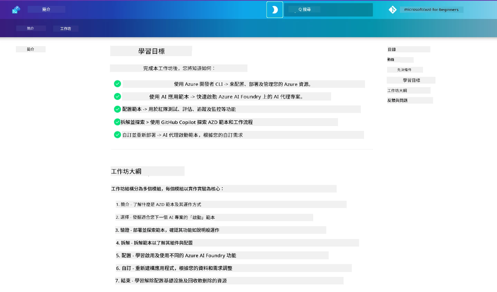

<div align="center">
  <div style="background: linear-gradient(135deg, #0078d4, #106ebe); border-radius: 10px; padding: 20px; margin: 20px 0; box-shadow: 0 4px 15px rgba(0, 120, 212, 0.3); border: 2px solid #005a9e;">
    <h2 style="color: white; margin: 0; font-size: 24px; text-shadow: 1px 1px 2px rgba(0,0,0,0.3);">
      🎯 AZD 人工智能開發者工作坊
    </h2>
    <p style="color: white; margin: 10px 0 0 0; font-size: 16px; text-shadow: 1px 1px 2px rgba(0,0,0,0.3);">
      <strong>一個動手做的工作坊，教你使用 Azure Developer CLI 建構人工智能應用。</strong><br>
      完成 7 個模組，掌握 AZD 範本與人工智能部署工作流程。
    </p>
    <div style="margin-top: 15px;">
      <span style="background: rgba(255,255,255,0.2); padding: 5px 10px; border-radius: 15px; color: white; font-size: 14px;">
        📅 來源指引審閱日期：2026年11月
      </span>
    </div>
  </div>
</div>

# AZD 人工智能開發者工作坊

歡迎參加這個專注於人工智能應用部署的 Azure Developer CLI (AZD) 動手做工作坊。本工作坊將透過 3 步驟幫助你實際理解 AZD 範本：

1. <strong>探索</strong> - 找到適合你的範本。
1. <strong>部署</strong> - 部署並驗證其運行。
1. <strong>自訂</strong> - 修改並迭代使其專屬於你！

在本工作坊過程中，你還將接觸到核心開發工具和工作流程，幫助你優化從頭到尾的開發旅程。

<br/>

## 瀏覽器導覽

工作坊課程以 Markdown 編寫。你可以直接在 GitHub 瀏覽課程內容，或如截圖所示啟動基於瀏覽器的預覽。



若要使用此選項，請將此儲存庫派生到你的個人帳戶，並啟動 GitHub Codespaces。VS Code 終端開啟後，輸入以下指令：

該瀏覽器預覽可在 GitHub Codespaces、開發容器，或本地克隆並已安裝 Python 及 MkDocs 的環境中使用。

```bash title="" linenums="0"
python -m pip install -r requirements-dev.txt
python -m mkdocs serve --config-file workshop/mkdocs.yml
```

請在 <strong>課程儲存庫根目錄</strong> 執行這些命令，而非獨立初始化的 AI 範例。保持預覽在前台以便觀察錯誤，按 Ctrl+C 停止。若要檢查網站但不啟動服務，請執行 `python -m mkdocs build --strict --config-file workshop/mkdocs.yml`。

幾秒後，你會看到跳出對話框。選擇 `Open in browser` 選項。基於瀏覽器的導覽現在將在新分頁開啟。此預覽的優點包括：

1. <strong>內建搜尋</strong> - 快速搜尋關鍵字或課程內容。
1. <strong>複製圖示</strong> - 懸停於程式碼區塊可見此選項。
1. <strong>主題切換</strong> - 在深色與淺色主題間切換。
1. <strong>求助渠道</strong> - 點擊頁腳 Discord 圖示加入討論！

<br/>

## 工作坊概覽

**時長：** 3-4 小時  
**程度：** 初學者到中階  
**先備知識：** 熟悉 Azure、人工智能概念、VS Code 及指令列工具。

這是一個動手做工作坊，讓你透過實作學習。完成練習後，建議瀏覽 AZD 初學者課程，持續探索安全性及生產力最佳實踐。

| 時間| 模組  | 目標 |
|:---|:---|:---|
| 15 分鐘 | [介紹](docs/instructions/0-Introduction.md) | 建立基礎，了解目標 |
| 30 分鐘 | [選擇 AI 範本](docs/instructions/1-Select-AI-Template.md) | 探索選項並挑選入門範本 | 
| 30 分鐘 | [驗證 AI 範本](docs/instructions/2-Validate-AI-Template.md) | 部署預設方案到 Azure |
| 30 分鐘 | [拆解 AI 範本](docs/instructions/3-Deconstruct-AI-Template.md) | 探索結構與配置 |
| 30 分鐘 | [配置 AI 範本](docs/instructions/4-Configure-AI-Template.md) | 啟動並嘗試可用功能 |
| 30 分鐘 | [自訂 AI 範本](docs/instructions/5-Customize-AI-Template.md) | 根據需求調整範本 |
| 30 分鐘 | [拆除基礎架構](docs/instructions/6-Teardown-Infrastructure.md) | 清理並釋放資源 |
| 15 分鐘 | [結業與後續](docs/instructions/7-Wrap-up.md) | 學習資源，工作坊挑戰 |

<br/>

## 你將學到的內容

請將 AZD 範本視為一個學習沙箱，讓你探索微軟 Foundry 平台上的端到端開發各項功能與工具。工作坊結束時，你應該對這些工具與概念有直觀認識。

| 概念  | 目標 |
|:---|:---|
| **Azure Developer CLI** | 了解工具指令與工作流程|
| **AZD 範本**| 了解專案結構與配置|
| **Azure 人工智能代理**| 預配及部署 Microsoft Foundry 專案  |
| **Azure 人工智能搜尋**| 透過代理啟用上下文工程 |
| <strong>可觀察性</strong>| 探索追蹤、監控與評估 |
| <strong>紅隊測試</strong>| 探索對抗性測試與緩解措施 |

<br/>

## 工作坊架構

工作坊設計帶領你從範本探索、部署、拆解到自訂，過程中使用官方的 [與 AI 代理快速入門](https://github.com/Azure-Samples/get-started-with-ai-agents) 起始範本作為基礎。

### [模組 1：選擇 AI 範本](docs/instructions/1-Select-AI-Template.md) (30 分鐘)

- 什麼是 AI 範本？
- 我可以在哪裡找到 AI 範本？
- 如何開始構建 AI 代理？
- <strong>實作</strong>：在 Codespaces 或開發容器中快速開始

### [模組 2：驗證 AI 範本](docs/instructions/2-Validate-AI-Template.md) (30 分鐘)

- 什麼是 AI 範本架構？
- 什麼是 AZD 開發工作流程？
- 如何取得 AZD 開發幫助？
- <strong>實作</strong>：部署並驗證 AI 代理範本

### [模組 3：拆解 AI 範本](docs/instructions/3-Deconstruct-AI-Template.md) (30 分鐘)

- 探索你的 `.azure/` 環境
- 探索你的 `infra/` 資源設定
- 探索 `azure.yaml` 配置
- <strong>實作</strong>：修改環境變數並重新部署

### [模組 4：配置 AI 範本](docs/instructions/4-Configure-AI-Template.md) (30 分鐘)
- 探索：檢索增強生成
- 探索：代理評估與紅隊測試
- 探索：追蹤與監控
- <strong>實作</strong>：探索 AI 代理 + 可觀察性

### [模組 5：自訂 AI 範本](docs/instructions/5-Customize-AI-Template.md) (30 分鐘)
- 定義：情境需求產品需求文件（PRD）
- 配置：AZD 環境變數
- 實作：為額外任務設置生命週期掛鉤
- <strong>實作</strong>：為個人情境自訂範本

### [模組 6：拆除基礎架構](docs/instructions/6-Teardown-Infrastructure.md) (30 分鐘)
- 回顧：什麼是 AZD 範本？
- 回顧：為何使用 Azure Developer CLI？
- 後續步驟：嘗試不同範本！
- <strong>實作</strong>：解除基礎架構配置並清理

<br/>

## 工作坊挑戰

想挑戰更多嗎？這裡有些專案建議，或歡迎分享你的點子給我們！

| 專案 | 描述 |
|:---|:---|
|1. **拆解一個複雜的 AI 範本** | 使用我們介紹的工作流程和工具，試著部署、驗證並自訂不同的 AI 解決方案範本。_你學到了什麼？_|
|2. <strong>根據你的情境自訂</strong>  | 嘗試撰寫一份不同情境的產品需求文件 (PRD)。再利用 GitHub Copilot 在你的範本資源庫的 Agent Model 中，請它為你產生自訂工作流程。_你學到了什麼？如何能改進這些建議？_|
| | |

## 有意見回饋嗎？

1. 在此儲存庫提交 issue - 方便起見請標記 `Workshop`。
1. 加入 Microsoft Foundry Discord，與同儕交流！


| | | 
|:---|:---|
| **📚 課程主頁**| [AZD 初學者](../README.md)|
| **📖 文件** | [開始使用 AI 範本](https://learn.microsoft.com/en-us/azure/ai-foundry/how-to/develop/ai-template-get-started)|
| **🛠️ AI 範本** | [Microsoft Foundry 範本](https://ai.azure.com/templates) |
|**🚀 後續步驟** | [開始工作坊](#workshop-overview) |
| | |

<br/>

---

**導覽：** [主要課程](../README.md) | [介紹](docs/instructions/0-Introduction.md) | [模組 1：選擇範本](docs/instructions/1-Select-AI-Template.md)

**準備好用 AZD 建立人工智能應用嗎？**

[開始工作坊：介紹 →](docs/instructions/0-Introduction.md)

---

<!-- CO-OP TRANSLATOR DISCLAIMER START -->
**免責聲明**：
本文件由 AI 翻譯服務 [Co-op Translator](https://github.com/Azure/co-op-translator) 翻譯而成。雖然我們致力於確保準確性，但請注意，機器自動翻譯可能包含錯誤或不準確之處。原始文件的母語版本應被視為權威來源。對於重要資訊，建議進行專業人工翻譯。我們不對因使用本翻譯而產生的任何誤解或誤釋承擔責任。
<!-- CO-OP TRANSLATOR DISCLAIMER END -->