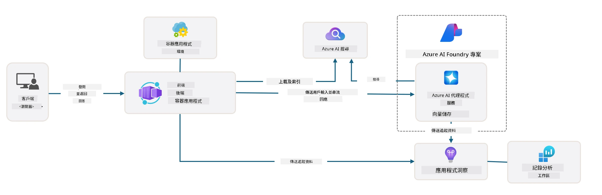

# 3. 拆解範本

!!! tip "完成本單元後，您將能夠"

    - [ ] Use GitHub Copilot and optional MCP tools for Azure documentation and read-only exploration
    - [ ] Identify the template's application, infrastructure, configuration, and test entry points
    - [ ] Verify generated explanations against actual repository files
    - [ ] **Lab 3:** Trace one request and one configuration input through the project

---

## 1. 啟用 GitHub Copilot

打開已初始化的 AI 範例於 VS Code，並啟用 [GitHub Copilot](https://code.visualstudio.com/docs/copilot/chat/chat-agent-mode)。使用具資格方案的帳戶登入；使用限制會有所不同。請 Copilot 解釋本程式庫內容後，再授權變更。

### 選用 MCP 伺服器

這些服務可提供額外工具：

- [Azure MCP 伺服器](https://learn.microsoft.com/azure/developer/azure-mcp-server/overview)
- [Microsoft Learn MCP 伺服器](https://learn.microsoft.com/training/support/mcp)

在 VS Code 中，查閱 [MCP 設定指引](https://code.visualstudio.com/docs/copilot/chat/mcp-servers) 並視需要建立 `.vscode/mcp.json`：

```json
{
  "servers": {
    "Azure MCP Server": {
      "type": "stdio",
      "command": "npx",
      "args": ["-y", "@azure/mcp@latest", "server", "start"]
    },
    "microsoft.docs.mcp": {
      "type": "http",
      "url": "https://learn.microsoft.com/api/mcp"
    }
  }
}
```

`npx` 命令需要支援的 Node.js/npm 安裝，並會下載執行程式碼。請檢視套件並固定核可版本，以利團隊可重複設定。透過 VS Code 的 MCP 控制啟動伺服器，並檢查可用工具；名稱可能隨版本變更。

**認證是獨立的。** AZD 使用 `azd auth login`。Azure MCP 工具的認證流程請遵從文件；單純 AZD 登入不會建立 MCP 連線。當練習或掛勾呼叫 Azure CLI 時，請另外使用 `az login`。

嘗試只讀提示：

1. “使用 Microsoft Learn MCP 尋找 Azure Developer CLI 設定文件。”
2. “解釋本程式庫的 `azure.yaml`；並引用實作每個掛勾的檔案。”
3. “用可用的 Azure MCP 工具列出我部署的資源，且不做任何更動。”

檢查所選租戶/訂閱與每次提出的工具呼叫。不要為了探索架構而批准建立、刪除或存取變更。

## 2. 了解架構

範例中含有 Python FastAPI 後端與 React/TypeScript 前端，皆部署於 Azure Container Apps。後端與 Microsoft Foundry 專案中的代理程式溝通。檢索與可觀察性依賴啟用的範本功能與成功設定；光是部署應用程式不保證可使用。



對照此圖與 [目前上游部署指南](https://github.com/Azure-Samples/get-started-with-ai-agents/blob/main/docs/deployment.md) 和您實際的資源。檢查設定的模型部署、代理工具、受管理身分、角色指派，以及選用 AI 搜尋/應用程式洞察資源。

**練習：** 請 Copilot 追蹤從前端聊天請求經過 API 傳至 Foundry 的流程，並附上檔案與函式參考。打開這些參考並驗證說明。不要只靠架構圖推測實作的認證、路由或授權。

## 3. 程式庫結構

以下列出 2026 年 11 月 4 日核對過之路徑。您初始化的版本仍是正確來源：

```text
get-started-with-ai-agents/
  azure.yaml
  docker-compose.yaml
  requirements-dev.txt
  .devcontainer/
  infra/
    main.bicep
    main.parameters.json
    api.bicep
    core/
  src/
    Dockerfile
    pyproject.toml
    requirements.txt
    api/
      main.py
      routes.py
      search_index_manager.py
    frontend/
      package.json
      src/
    files/
  scripts/
    validate_env_vars.sh
    validate_env_vars.ps1
    postdeploy.sh
    postdeploy.ps1
  tests/
    test_evaluation.py
    test_red_teaming.py
  docs/
    deployment.md
    deploy_customization.md
    ai_search.md
    observability.md
    local_development.md
    troubleshooting.md
```

### 基礎設施與設定

`infra/main.bicep` 編排資源；`main.parameters.json` 將範本輸入連結至 AZD 環境值。`azure.yaml` 選擇應用服務與生命週期掛勾。追蹤類似 `USE_AZURE_AI_SEARCH_SERVICE` 的輸入，深入這些檔案找實際變更。

### 應用與身分

一起閱讀 `src/api/` 與 `src/frontend/`。找出代理是在哪建立或取得、指令／工具在哪設定，以及每個 Azure 呼叫使用哪個身分。`src/files/` 下的範例檔案是示範資料，非生產目錄或授權模型。

### 測試與可觀察性

目前評估與紅隊入口在 `tests/`；舊的 `evals/` 與 `airedteaming/` 目錄參考對本範例已過時。執行雲端測試前請閱讀 `docs/observability.md` 的前置需求與費用說明。這些 Python 測試獨立於選用的 `azure.ai.evaluations` AZD 擴充功能。

## 4. 驗證您的發現

- 找出一個範例問題對應的 API 路由、代理互動及檢索程式碼。
- 解釋存取 Foundry 使用的是哪個身分，以及哪個設定選擇其端點。
- 找出真正的部署前與部署後腳本及其錯誤處理行為。
- 列出部署中缺少的任何依賴或選用功能。

接著觀看 [設定範本](4-Configure-AI-Template.md)。

---

<!-- CO-OP TRANSLATOR DISCLAIMER START -->
**免責聲明**：
本文件由 AI 翻譯服務 [Co-op Translator](https://github.com/Azure/co-op-translator) 翻譯而成。雖然我們致力於確保準確性，但請注意，機器自動翻譯可能包含錯誤或不準確之處。原始文件的母語版本應被視為權威來源。對於重要資訊，建議進行專業人工翻譯。我們不對因使用本翻譯而產生的任何誤解或誤釋承擔責任。
<!-- CO-OP TRANSLATOR DISCLAIMER END -->