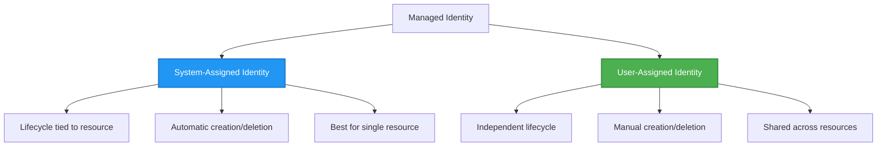

# 認證模式與受管理身份

⏱️ <strong>預計時間</strong>：45-60 分鐘閱讀；整合練習需額外時間 | 💰 <strong>費用影響</strong>：身份識別/RBAC 免費；部署的計算、儲存與 Key Vault 需計費 | ⭐ <strong>複雜度</strong>：中階

> 根據 `azd 1.37.2` (2026年11月) 審核。此課程包含 **示範整合片段，而非完整可下載的 `secure-app` 範本**。請建立參考檔案、提供相符基礎架構，並於部署前替換佔位符。審核期間未配置任何 Azure 資源。

**📚 學習路徑：**
- ← 上一章節：[設定管理](configuration.md) - 管理環境變數與機密
- 🎯 <strong>您正於此章</strong>：驗證與安全性（受控身分、Key Vault、安全範例）
- → 下一章節：[基礎架構即程式碼](../chapter-04-infrastructure/README.md) - 配置與部署資源
- 🏠 [課程首頁](../../README.md)

---

## 您將學習什麼

完成此課程後，您將能：
- 了解 Azure 驗證模式（金鑰、連接字串、受控身分）
- 實作 <strong>受控身分</strong> 以實現無密碼驗證
- 以 **Azure Key Vault** 整合保護機密
- 為 AZD 部署配置 **基於角色存取控制 (RBAC)**
- 在 Container Apps 及 Azure 服務中應用安全最佳實務
- 從基於金鑰的驗證遷移到基於身分的驗證

## 為何受控身分重要

### 問題：傳統的驗證方式

**受控身分出現前：**
```javascript
// ❌ SECURITY RISK: Hardcoded secrets in code
const connectionString = "Server=mydb.database.windows.net;User=admin;Password=P@ssw0rd123";
const storageKey = "xK7mN9pQ2wR5tY8uI0oP3aS6dF1gH4jK...";
const cosmosKey = "C2x7B9n4M1p8Q5w3E6r0T2y5U8i1O4p7...";
```

**問題點：**
- 🔴 程式碼、設定檔案、環境變數中<strong>暴露機密</strong>
- 🔴 <strong>憑證輪換</strong> 需修改程式碼及重新部署
- 🔴 <strong>稽核難題</strong>－誰在何時存取了什麼？
- 🔴 <strong>散布問題</strong>－機密散落多個系統
- 🔴 <strong>合規風險</strong>－無法通過安全稽核

### 解決方案：受控身分

**啟用受控識別後：**
```javascript
// ✅ SECURE: No secrets in code
const credential = new DefaultAzureCredential();
const client = new BlobServiceClient(
  "https://mystorageaccount.blob.core.windows.net",
  credential  // Azure automatically handles authentication
);
```

**優點：**
- ✅ <strong>程式碼或組態中無須管理祕密</strong>
- ✅ <strong>自動輪換</strong> - 由 Azure 處理
- ✅ <strong>完整稽核記錄</strong> - 記錄於 Microsoft Entra ID 日誌
- ✅ <strong>集中式安全</strong> - 在 Azure 入口網站管理
- ✅ <strong>符合合規性</strong> - 達到安全標準

<strong>比喻</strong>：傳統認證就像攜帶多把不同門的實體鑰匙。受控識別則像擁有一個安全徽章，會根據你的身份自動授權—無需丟失、複製或輪換鑰匙。

---

## 架構概述

### 受控識別的認證流程

```mermaid
sequenceDiagram
    participant App as Your Application<br/>(Container App)
    participant MI as Managed Identity<br/>(Microsoft Entra ID)
    participant KV as Key Vault
    participant Storage as Azure Storage
    participant DB as Azure SQL
    
    App->>MI: Request access token<br/>(automatic)
    MI->>MI: Verify identity<br/>(no password needed)
    MI-->>App: Return token for requested audience<br/>(lifetime varies)
    
    App->>KV: Get secret<br/>(using token)
    KV->>KV: Check RBAC permissions
    KV-->>App: Return secret value
    
    App->>Storage: Upload blob<br/>(using token)
    Storage->>Storage: Check RBAC permissions
    Storage-->>App: Success
    
    App->>DB: Query data<br/>(using token)
    DB->>DB: Check SQL permissions
    DB-->>App: Return results
    
    Note over App,DB: Request a separate token for each service audience;<br/>SDK credentials handle caching and renewal
```

### 受控識別類型



| 功能 | 系統指派 | 使用者指派 |
|---------|----------------|---------------|
| <strong>生命週期</strong> | 綁定於資源 | 獨立存在 |
| <strong>建立方式</strong> | 隨資源自動建立 | 手動建立 |
| <strong>刪除方式</strong> | 資源刪除時一併刪除 | 資源刪除後仍保留 |
| <strong>共用方式</strong> | 僅限單一資源使用 | 可由多個資源共用 |
| <strong>適用情境</strong> | 簡單情境 | 複雜多資源情境 |
| <strong>範本選擇</strong> | 由基礎架構定義 | 由基礎架構定義 |

---

## 先決條件

### 所需工具

您應該已於先前課程安裝好以下工具：

```bash
# Verify Azure Developer CLI
azd version
# ✅ Expected: azd version 1.0.0 or higher

# Verify Azure CLI
az --version
# ✅ Expected: azure-cli 2.50.0 or higher
```

### Azure 要求

- 已開通有效的 Azure 訂閱
- 擁有以下權限：
  - 建立受控識別
  - 指派 RBAC 角色
  - 建立 Key Vault 資源
  - 部署容器應用程式

### 知識先備條件

您應已完成：
- [安裝指南](../chapter-01-foundation/installation.md) - AZD 設定
- [AZD 基礎](../chapter-01-foundation/azd-basics.md) - 核心概念
- [設定管理](configuration.md) - 環境變數

---

## 課程 1：了解認證模式

### 模式 1：連線字串（舊版 - 避免使用）

**運作方式：**
```bash
# Connection string contains credentials
STORAGE_CONNECTION_STRING="DefaultEndpointsProtocol=https;AccountName=myaccount;AccountKey=xK7mN9pQ2wR5..."
COSMOS_CONNECTION_STRING="AccountEndpoint=https://myaccount.documents.azure.com:443/;AccountKey=C2x7..."
SQL_CONNECTION_STRING="Server=myserver.database.windows.net;User=admin;Password=P@ssw0rd..."
```

**問題：**
- ❌ 祕密資訊會出現在環境變數中
- ❌ 會被部署系統記錄
- ❌ 不易輪換
- ❌ 無存取審計追蹤

**何時使用：** 當目標服務需要基於金鑰的認證時。在支援身分識別的情況下，優先使用身分識別；否則需安全儲存金鑰並定期輪換，包括在生產環境中。

---

### 模式 2：金鑰保管庫參考（較佳）

**運作方式：**
**部分 Bicep 片段：** 省略了必需的保險庫字段、Container App 身份和其 `configuration.secrets` 入口。`secretRef` 命名一個 Container App 秘密；它<strong>本身不是</strong>Key Vault URI。若要使用 Key Vault，定義該名為秘密的 `keyVaultUrl` 以及授權的 `identity`。

```bicep
// Store secret in Key Vault
resource keyVault 'Microsoft.KeyVault/vaults@2023-02-01' = {
  name: 'mykv'
  properties: {
    enableRbacAuthorization: true
  }
}

// Reference in Container App
env: [
  {
    name: 'STORAGE_KEY'
    secretRef: 'storage-key'  // References Key Vault
  }
]
```

**優點：**
- ✅ 秘密安全儲存在 Key Vault 中
- ✅ 集中式秘密管理
- ✅ 可在不變更程式碼的情況下輪替

**限制：**
- ⚠️ 仍然使用金鑰/密碼
- ⚠️ 需要管理 Key Vault 存取權

**什麼時候使用：** 從連接字串過渡到受管身份的過渡步驟。

---

### 範例 3：受管身份（最佳實務）

**運作方式：**
**部分 Bicep：** 將身份區塊合併到完整 Container App 並提供 `storageAccount` 和角色定義。角色分配亦需要確定的 `name`。

```bicep
// Enable managed identity
resource containerApp 'Microsoft.App/containerApps@2023-05-01' = {
  name: 'myapp'
  identity: {
    type: 'SystemAssigned'  // Automatically creates identity
  }
}

// Grant permissions
resource roleAssignment 'Microsoft.Authorization/roleAssignments@2022-04-01' = {
  name: guid(storageAccount.id, containerApp.id, storageBlobDataContributorRole)
  scope: storageAccount
  properties: {
    roleDefinitionId: storageBlobDataContributorRole
    principalId: containerApp.identity.principalId
    principalType: 'ServicePrincipal'
  }
}
```

**應用程式程式碼：**
```javascript
// No secrets needed!
const { DefaultAzureCredential } = require('@azure/identity');
const { BlobServiceClient } = require('@azure/storage-blob');

const credential = new DefaultAzureCredential();
const blobServiceClient = new BlobServiceClient(
  'https://mystorageaccount.blob.core.windows.net',
  credential
);
```

**優點：**
- ✅ 程式碼/設定中零秘密
- ✅ 自動憑證輪替
- ✅ 完整稽核紀錄
- ✅ 基於 RBAC 的權限
- ✅ 符合合規要求

**什麼時候使用：** 偏好用於 Azure 主機上存取支援 Microsoft Entra 驗證的服務的應用程式。

---

### 範例 4：服務主體（CI/CD 與自動化）

受管身份是<em>針對在 Azure 內運行的資源的黃金標準</em>。但對於在 **Azure 之外** 運行的東西—像是在建置代理上的 CI/CD 管線，或無法使用互動式登入的筆記型電腦上的腳本呢？這時就用到<strong>服務主體</strong>：一個帶有自己憑證由自動化流程簽入的非人類身份。

**運作方式：**

建立一個範圍在資源群組的服務主體（最低權限）：

```bash
az ad sp create-for-rbac \
  --name "myapp-cicd" \
  --role contributor \
  --scopes "/subscriptions/<sub-id>/resourceGroups/<rg-name>"
```

這會輸出一個客戶端 ID、客戶端祕密和租戶 ID。azd 可以非互動地用它們簽入：

```bash
azd auth login \
  --client-id "<appId>" \
  --client-secret "<password>" \
  --tenant-id "<tenant>"
```

**偏好使用聯邦憑證（OIDC）勝過祕密。** 配置聯邦憑證取代長期存在的客戶端祕密，讓管線交換短期憑證—沒有祕密可外洩或輪替：

```bash
azd auth login \
  --client-id "<appId>" \
  --federated-credential-provider "github" \
  --tenant-id "<tenant>"
```

> `azd pipeline config` 會自動為你設定。見[第 8 章](../chapter-08-production/production-ai-practices.md)中的 CI/CD 教學。

**優點：**
- ✅ 在 Azure 外（建置代理、本地、其他雲端）也能運作
- ✅ 可範圍限定到單一資源群組及角色
- ✅ 聯邦 (OIDC) 變體無需儲存祕密

**取捨：**
- ⚠️ 基於祕密的變體需謹慎保存與輪替
- ⚠️ 泄露的祕密可授予 SP 所能執行的一切權限—保持權限範圍嚴格

**何時使用：** CI/CD 管線及無法使用受管身份的自動化。總是偏好 **聯邦/OIDC** 變體勝過客戶端祕密，且只要工作負載在 Azure 內運行就偏好使用受管身份。

**安全儲存憑證：**
- 千萬別將祕密提交到程式碼庫—使用管線的秘密存放（GitHub Actions 秘密，Azure DevOps 變數群組/Key Vault）。
- 將 SP 範圍限制在所需的最小角色與資源群組。
- 設定到期並輪替，或使用 OIDC 完全消除祕密。

---

## 第 2 課：用 AZD 實作受管身份

### 逐步實作

以下片段展示如何將受管身份整合到 Container App 專案中。它們<strong>不是可複製使用的起始範本</strong>：存儲模組、完整的受管環境/註冊表基礎架構、Dockerfile 和參數檔並未全數提供。從可運作的 Container Apps 範本開始，合併這些範例，保留其註冊表設定及服務標籤。

### 專案結構

```
secure-app/
├── azure.yaml                 # AZD configuration
├── infra/
│   ├── main.bicep            # Main infrastructure
│   ├── core/
│   │   ├── identity.bicep    # Managed identity setup
│   │   ├── keyvault.bicep    # Key Vault configuration
│   │   └── storage.bicep     # Storage with RBAC
│   └── app/
│       └── container-app.bicep
└── src/
    ├── app.js                # Application code
    ├── package.json
    └── Dockerfile
```

### 1. 設定 AZD (azure.yaml)

```yaml
name: secure-app
metadata:
  template: secure-app@1.0.0

services:
  api:
    project: ./src
    language: js
    host: containerapp

# Managed identity must be enabled in the infrastructure, not by this YAML.
```

### 2. 基礎架構：啟用受管身份

**檔案：`infra/main.bicep`**

```bicep
targetScope = 'subscription'

param environmentName string
param location string = 'eastus'
param containerAppsEnvironmentId string
param containerImage string

var tags = { 'azd-env-name': environmentName }

// Resource group
resource rg 'Microsoft.Resources/resourceGroups@2021-04-01' = {
  name: 'rg-${environmentName}'
  location: location
  tags: tags
}

// Storage Account
module storage './core/storage.bicep' = {
  name: 'storage'
  scope: rg
  params: {
    name: 'st${uniqueString(rg.id)}'
    location: location
    tags: tags
  }
}

// Key Vault
module keyVault './core/keyvault.bicep' = {
  name: 'keyvault'
  scope: rg
  params: {
    name: 'kv-${uniqueString(rg.id)}'
    location: location
    tags: tags
  }
}

// Container App with Managed Identity
module containerApp './app/container-app.bicep' = {
  name: 'container-app'
  scope: rg
  params: {
    name: 'ca-${environmentName}'
    location: location
    tags: tags
    storageAccountName: storage.outputs.name
    keyVaultName: keyVault.outputs.name
    containerAppsEnvironmentId: containerAppsEnvironmentId
    containerImage: containerImage
  }
}

// Grant Container App access to Storage
module storageRoleAssignment './core/role-assignment.bicep' = {
  name: 'storage-role'
  scope: rg
  params: {
    principalId: containerApp.outputs.identityPrincipalId
    roleDefinitionId: 'ba92f5b4-2d11-453d-a403-e96b0029c9fe'  // Storage Blob Data Contributor
    targetResourceType: 'storage'
    targetResourceName: storage.outputs.name
  }
}

// Grant Container App access to Key Vault
module kvRoleAssignment './core/role-assignment.bicep' = {
  name: 'kv-role'
  scope: rg
  params: {
    principalId: containerApp.outputs.identityPrincipalId
    roleDefinitionId: '4633458b-17de-408a-b874-0445c86b69e6'  // Key Vault Secrets User
    targetResourceType: 'keyvault'
    targetResourceName: keyVault.outputs.name
  }
}

// Outputs
output AZURE_STORAGE_ACCOUNT_NAME string = storage.outputs.name
output AZURE_KEY_VAULT_NAME string = keyVault.outputs.name
output APP_URL string = containerApp.outputs.url
```

### 3. 使用系統指派身份的 Container App

**檔案：`infra/app/container-app.bicep`**

```bicep
param name string
param location string
param tags object = {}
param storageAccountName string
param keyVaultName string
param containerAppsEnvironmentId string
param containerImage string

resource containerApp 'Microsoft.App/containerApps@2023-05-01' = {
  name: name
  location: location
  tags: union(tags, { 'azd-service-name': 'api' })
  identity: {
    type: 'SystemAssigned'  // 🔑 Enable managed identity
  }
  properties: {
    managedEnvironmentId: containerAppsEnvironmentId
    configuration: {
      ingress: {
        external: true
        targetPort: 3000
      }
    }
    template: {
      containers: [
        {
          name: 'api'
          image: containerImage // Must exist; configure registry credentials for private images
          resources: {
            cpu: json('0.5')
            memory: '1Gi'
          }
          env: [
            {
              name: 'AZURE_STORAGE_ACCOUNT_NAME'
              value: storageAccountName
            }
            {
              name: 'AZURE_KEY_VAULT_NAME'
              value: keyVaultName
            }
            // 🔑 No secrets - managed identity handles authentication!
          ]
        }
      ]
    }
  }
}

// Output the identity for RBAC assignments
output identityPrincipalId string = containerApp.identity.principalId
output id string = containerApp.id
output url string = 'https://${containerApp.properties.configuration.ingress.fqdn}'
```

### 4. RBAC 角色分配模組

**檔案：`infra/core/role-assignment.bicep`**

```bicep
param principalId string
param roleDefinitionId string  // Azure built-in role ID
@allowed(['storage', 'keyvault'])
param targetResourceType string
param targetResourceName string

// Typed existing resources give Bicep a valid resource scope, not a string ID.
resource storageTarget 'Microsoft.Storage/storageAccounts@2023-01-01' existing = {
  name: targetResourceName
}
resource vaultTarget 'Microsoft.KeyVault/vaults@2023-02-01' existing = {
  name: targetResourceName
}

resource storageAssignment 'Microsoft.Authorization/roleAssignments@2022-04-01' = if (targetResourceType == 'storage') {
  name: guid(storageTarget.id, principalId, roleDefinitionId)
  scope: storageTarget
  properties: {
    roleDefinitionId: subscriptionResourceId('Microsoft.Authorization/roleDefinitions', roleDefinitionId)
    principalId: principalId
    principalType: 'ServicePrincipal'
  }
}

resource vaultAssignment 'Microsoft.Authorization/roleAssignments@2022-04-01' = if (targetResourceType == 'keyvault') {
  name: guid(vaultTarget.id, principalId, roleDefinitionId)
  scope: vaultTarget
  properties: {
    roleDefinitionId: subscriptionResourceId('Microsoft.Authorization/roleDefinitions', roleDefinitionId)
    principalId: principalId
    principalType: 'ServicePrincipal'
  }
}

// This module assigns at the target resource scope, not the whole resource group.
```

### 5. 受管身份的應用程式程式碼

**檔案：`src/app.js`**

```javascript
const express = require('express');
const { DefaultAzureCredential } = require('@azure/identity');
const { BlobServiceClient } = require('@azure/storage-blob');
const { SecretClient } = require('@azure/keyvault-secrets');

const app = express();
const PORT = process.env.PORT || 3000;

// 🔑 Initialize credential (works automatically with managed identity)
const credential = new DefaultAzureCredential();

// Azure Storage setup
const storageAccountName = process.env.AZURE_STORAGE_ACCOUNT_NAME;
const blobServiceClient = new BlobServiceClient(
  `https://${storageAccountName}.blob.core.windows.net`,
  credential  // No keys needed!
);

// Key Vault setup
const keyVaultName = process.env.AZURE_KEY_VAULT_NAME;
const secretClient = new SecretClient(
  `https://${keyVaultName}.vault.azure.net`,
  credential  // No keys needed!
);

// Health check
app.get('/health', (req, res) => {
  res.json({ status: 'healthy', authentication: 'managed-identity' });
});

// Upload file to blob storage
app.post('/upload', async (req, res) => {
  try {
    const containerClient = blobServiceClient.getContainerClient('uploads');
    await containerClient.createIfNotExists();
    
    const blobName = `file-${Date.now()}.txt`;
    const blockBlobClient = containerClient.getBlockBlobClient(blobName);
    
    const content = 'Hello from managed identity!';
    await blockBlobClient.upload(content, Buffer.byteLength(content));
    
    res.json({
      success: true,
      blobName: blobName,
      message: 'File uploaded using managed identity!'
    });
  } catch (error) {
    console.error('Upload error:', error);
    res.status(500).json({ error: error.message });
  }
});

// Get secret from Key Vault
app.get('/secret/:name', async (req, res) => {
  try {
    const secretName = req.params.name;
    const secret = await secretClient.getSecret(secretName);
    
    res.json({
      name: secretName,
      retrieved: secret.value !== undefined, // Never return the secret value to callers
      message: 'Secret retrieved using managed identity!'
    });
  } catch (error) {
    console.error('Secret error:', error);
    res.status(500).json({ error: error.message });
  }
});

// List blob containers (demonstrates read access)
app.get('/containers', async (req, res) => {
  try {
    const containers = [];
    for await (const container of blobServiceClient.listContainers()) {
      containers.push(container.name);
    }
    
    res.json({
      containers: containers,
      count: containers.length,
      message: 'Containers listed using managed identity!'
    });
  } catch (error) {
    console.error('List error:', error);
    res.status(500).json({ error: error.message });
  }
});

app.listen(PORT, () => {
  console.log(`Secure API listening on port ${PORT}`);
  console.log('Authentication: Managed Identity (passwordless)');
});
```

**檔案：`src/package.json`**

```json
{
  "name": "secure-app",
  "version": "1.0.0",
  "dependencies": {
    "express": "^4.18.2",
    "@azure/identity": "^4.0.0",
    "@azure/storage-blob": "^12.17.0",
    "@azure/keyvault-secrets": "^4.7.0"
  },
  "scripts": {
    "start": "node app.js"
  }
}
```

### 6. 部署與測試

請 <strong>完成</strong> 缺少的基礎設施、Dockerfile，以及您自己專案中相符的 `main.parameters.json` 後，再執行這些指令。用 `azd auth login` 進行 azd 驗證；稍後為了 Azure CLI 的檢查，請分別使用 `az login` 登入。所示的端點是示範用途，公開使用前需具備適當的存取控制。

```bash
# Initialize AZD environment
azd init

# Deploy infrastructure and application
azd up

# Get the app URL
APP_URL=$(azd env get-value APP_URL)

# Test health check
curl $APP_URL/health
```

**✅ 預期輸出：**
```json
{
  "status": "healthy",
  "authentication": "managed-identity"
}
```

**測試 blob 上傳：**
```bash
curl -X POST $APP_URL/upload
```

**✅ 預期輸出：**
```json
{
  "success": true,
  "blobName": "file-1700404800000.txt",
  "message": "File uploaded using managed identity!"
}
```

**測試 container 列表：**
```bash
curl $APP_URL/containers
```

**✅ 預期輸出：**
```json
{
  "containers": ["uploads"],
  "count": 1,
  "message": "Containers listed using managed identity!"
}
```

---

## 常用 Azure RBAC 角色

### 管理身份的內建角色 ID

| 服務 | 角色名稱 | 角色 ID | 權限 |
|---------|-----------|---------|-------------|
| <strong>儲存體</strong> | 儲存體 Blob 資料讀取者 | `2a2b9908-6ea1-4ae2-8e65-a410df84e7d1` | 讀取 blobs 和容器 |
| <strong>儲存體</strong> | 儲存體 Blob 資料貢獻者 | `ba92f5b4-2d11-453d-a403-e96b0029c9fe` | 讀取、寫入、刪除 blobs |
| <strong>儲存體</strong> | 儲存體佇列資料貢獻者 | `974c5e8b-45b9-4653-ba55-5f855dd0fb88` | 讀取、寫入、刪除佇列/訊息 |
| <strong>金鑰保管庫</strong> | 金鑰保管庫秘密使用者 | `4633458b-17de-408a-b874-0445c86b69e6` | 讀取秘密 |
| <strong>金鑰保管庫</strong> | 金鑰保管庫秘密管理員 | `b86a8fe4-44ce-4948-aee5-eccb2c155cd7` | 讀取、寫入、刪除秘密 |
| **Cosmos DB** | Cosmos DB 內建資料讀取者 | `00000000-0000-0000-0000-000000000001` | 讀取 Cosmos DB 資料 |
| **Cosmos DB** | Cosmos DB 內建資料貢獻者 | `00000000-0000-0000-0000-000000000002` | 讀取、寫入 Cosmos DB 資料 |
| **SQL 資料庫** | SQL 資料庫貢獻者 | `9b7fa17d-e63e-47b0-bb0a-15c516ac86ec` | 管理資料庫資源；不授予 SQL 資料存取權限 |
| <strong>服務總線</strong> | Azure 服務總線資料擁有者 | `090c5cfd-751d-490a-894a-3ce6f1109419` | 發送、接收、管理訊息 |

### 如何查找角色 ID

上述 Cosmos DB for NoSQL 的兩個 ID 是 **原生 Cosmos 資料平面角色定義**，不是 Azure RBAC 訂閱角色 ID。使用 `az cosmosdb sql role assignment create` (或 `Microsoft.DocumentDB/databaseAccounts/sqlRoleAssignments`) 指派它們，而不是 `az role assignment create`。SQL 資料存取需要 Entra 資料庫使用者和 SQL 權限。

```bash
# List all built-in roles
az role definition list --query "[].{Name:roleName, ID:name}" --output table

# Search for specific role
az role definition list --query "[?contains(roleName, 'Storage Blob')].{Name:roleName, ID:name}" --output table

# Get role details
az role definition list --name "Storage Blob Data Contributor"
```

---

## 實作練習

**三個練習的整合前置需求：** 您自己專案中一個可用的 Container App 範本、對應的 Bicep 資源、Azure CLI/azd 登入，以及指派所需角色的權限。這些指導性改編，非獨立本機啟動程式；請用您部署的名稱替換範例資源名稱。

### 練習 1：為既有應用程式啟用管理識別 ⭐⭐（中等）

<strong>目標</strong>：為既有 Container App 部署新增管理識別

<strong>情境</strong>：您有一個使用連線字串的 Container App，將它改為使用管理識別。

<strong>起始狀態</strong>：配置如下的 Container App：

```bicep
// ❌ Current: Using connection string
env: [
  {
    name: 'STORAGE_CONNECTION_STRING'
    secretRef: 'storage-connection'
  }
]
```

<strong>步驟</strong>：

1. **在 Bicep 中啟用受控身份識別：**

```bicep
resource containerApp 'Microsoft.App/containerApps@2023-05-01' = {
  name: 'myapp'
  identity: {
    type: 'SystemAssigned'  // Add this
  }
  // ... rest of configuration
}
```

2. **授予存儲存取權限：**

```bicep
// Get storage account reference
resource storageAccount 'Microsoft.Storage/storageAccounts@2023-01-01' existing = {
  name: storageAccountName
}

// Assign role
resource roleAssignment 'Microsoft.Authorization/roleAssignments@2022-04-01' = {
  name: guid(containerApp.id, 'ba92f5b4-2d11-453d-a403-e96b0029c9fe', storageAccount.id)
  scope: storageAccount
  properties: {
    roleDefinitionId: subscriptionResourceId('Microsoft.Authorization/roleDefinitions', 'ba92f5b4-2d11-453d-a403-e96b0029c9fe')
    principalId: containerApp.identity.principalId
    principalType: 'ServicePrincipal'
  }
}
```

3. **更新應用程式程式碼：**

**之前（連接字串）：**
```javascript
const { BlobServiceClient } = require('@azure/storage-blob');

const blobServiceClient = BlobServiceClient.fromConnectionString(
  process.env.STORAGE_CONNECTION_STRING
);
```

**之後（受控身份識別）：**
```javascript
const { DefaultAzureCredential } = require('@azure/identity');
const { BlobServiceClient } = require('@azure/storage-blob');

const credential = new DefaultAzureCredential();
const blobServiceClient = new BlobServiceClient(
  `https://${process.env.STORAGE_ACCOUNT_NAME}.blob.core.windows.net`,
  credential
);
```

4. **更新環境變數：**

```bicep
env: [
  {
    name: 'STORAGE_ACCOUNT_NAME'
    value: storageAccountName  // Just the name, no secrets!
  }
  // Remove STORAGE_CONNECTION_STRING
]
```

5. **部署並測試：**

```bash
# Redeploy
azd up

# Test that it still works
APP_URL=$(azd show --output json | jq -er '.services.api.ingressUrl')
curl --fail -X POST "$APP_URL/upload"
```

**✅ 成功標準：**
- ✅ 應用程式部署無錯誤
- ✅ 存儲操作正常（上傳、列出、下載）
- ✅ 環境變數中無連接字串
- ✅ 身份識別可在 Azure 入口網站的「身份識別」頁籤中看到

**驗證：**

```bash
# Check managed identity is enabled
az containerapp show \
  --name myapp \
  --resource-group rg-myapp \
  --query "identity.type"
# ✅ Expected: "SystemAssigned"

# Check role assignment
az role assignment list \
  --assignee $(az containerapp show --name myapp --resource-group rg-myapp --query "identity.principalId" -o tsv) \
  --scope /subscriptions/{sub-id}/resourceGroups/rg-myapp/providers/Microsoft.Storage/storageAccounts/mystorageaccount
# ✅ Expected: Shows "Storage Blob Data Contributor" role
```

<strong>時間</strong>：20-30 分鐘

---

### 演練 2：多服務使用者指派身份識別存取 ⭐⭐⭐（進階）

<strong>目標</strong>：建立一個可由多個 Container Apps 共享的使用者指派身份識別

<strong>情境</strong>：您有 3 個微服務，都需要存取相同的儲存帳戶和金鑰保管庫。

<strong>步驟</strong>：

1. **建立使用者指派身份識別：**

**檔案：`infra/core/identity.bicep`**

```bicep
param name string
param location string
param tags object = {}

resource userAssignedIdentity 'Microsoft.ManagedIdentity/userAssignedIdentities@2023-01-31' = {
  name: name
  location: location
  tags: tags
}

output id string = userAssignedIdentity.id
output principalId string = userAssignedIdentity.properties.principalId
output clientId string = userAssignedIdentity.properties.clientId
```

2. **為使用者指派身份識別分配角色：**

```bicep
// In main.bicep
module userIdentity './core/identity.bicep' = {
  name: 'user-identity'
  scope: rg
  params: {
    name: 'id-${environmentName}'
    location: location
    tags: tags
  }
}

// Grant Storage access
resource storageRoleAssignment 'Microsoft.Authorization/roleAssignments@2022-04-01' = {
  name: guid(storageAccount.id, environmentName, 'storage-contributor')
  scope: storageAccount
  properties: {
    roleDefinitionId: subscriptionResourceId('Microsoft.Authorization/roleDefinitions', 'ba92f5b4-2d11-453d-a403-e96b0029c9fe')
    principalId: userIdentity.outputs.principalId
    principalType: 'ServicePrincipal'
  }
}

// Grant Key Vault access
resource kvRoleAssignment 'Microsoft.Authorization/roleAssignments@2022-04-01' = {
  name: guid(keyVault.id, environmentName, 'kv-secrets-user')
  scope: keyVault
  properties: {
    roleDefinitionId: subscriptionResourceId('Microsoft.Authorization/roleDefinitions', '4633458b-17de-408a-b874-0445c86b69e6')
    principalId: userIdentity.outputs.principalId
    principalType: 'ServicePrincipal'
  }
}
```

3. **為多個 Container Apps 指派身份：**

```bicep
resource apiGateway 'Microsoft.App/containerApps@2023-05-01' = {
  name: 'api-gateway'
  identity: {
    type: 'UserAssigned'
    userAssignedIdentities: {
      '${userIdentity.outputs.id}': {}
    }
  }
  // ... rest of config
}

resource productService 'Microsoft.App/containerApps@2023-05-01' = {
  name: 'product-service'
  identity: {
    type: 'UserAssigned'
    userAssignedIdentities: {
      '${userIdentity.outputs.id}': {}
    }
  }
  // ... rest of config
}

resource orderService 'Microsoft.App/containerApps@2023-05-01' = {
  name: 'order-service'
  identity: {
    type: 'UserAssigned'
    userAssignedIdentities: {
      '${userIdentity.outputs.id}': {}
    }
  }
  // ... rest of config
}
```

4. **應用程式代碼（所有服務使用相同模式）：**

```javascript
const { ManagedIdentityCredential } = require('@azure/identity');
const { BlobServiceClient } = require('@azure/storage-blob');

// For user-assigned identity, specify the client ID
const credential = new ManagedIdentityCredential(
  process.env.AZURE_CLIENT_ID  // User-assigned identity client ID
);

// Alternative (choose ONE credential declaration):
// const { DefaultAzureCredential } = require('@azure/identity');
// const credential = new DefaultAzureCredential({
//   managedIdentityClientId: process.env.AZURE_CLIENT_ID
// });

const blobServiceClient = new BlobServiceClient(
  `https://${process.env.STORAGE_ACCOUNT_NAME}.blob.core.windows.net`,
  credential
);
```

在 Bicep 中將每個 Container App 的運行時 `AZURE_CLIENT_ID` 設定為 `userIdentity.outputs.clientId`，並將 `STORAGE_ACCOUNT_NAME` 設定為您的儲存名稱。僅分配身份或執行 `azd env set` 不會配置這些運行時值。

5. **部署並驗證：**

```bash
azd up

# Test all services can access storage
# Replace with the actual ingress URLs reported for your three services
curl --fail -X POST "$API_GATEWAY_URL/upload"
curl --fail -X POST "$PRODUCT_SERVICE_URL/upload"
curl --fail -X POST "$ORDER_SERVICE_URL/upload"
```

**✅ 成功標準：**
- ✅ 一個身份在三個服務間共用
- ✅ 所有服務都能訪問儲存與 Key Vault
- ✅ 即使刪除其中一個服務，身份依然存在
- ✅ 集中式權限管理

**使用者指派身份的好處：**
- 單一身份管理
- 服務間權限一致
- 服務刪除後身份依然存活
- 更適合複雜架構

<strong>時間</strong>：30-40 分鐘

---

### 練習 3：實作 Key Vault 秘密輪替 ⭐⭐⭐（進階）

<strong>目標</strong>：將第三方 API 密鑰存放在 Key Vault 中，並使用管理身份訪問

<strong>情境</strong>：您的應用程式需要呼叫外部 API（OpenAI、Stripe、SendGrid），該 API 需要 API 金鑰。

<strong>步驟</strong>：

1. **建立帶有 RBAC 的 Key Vault：**

**檔案：`infra/core/keyvault.bicep`**

```bicep
param name string
param location string
param tags object = {}

resource keyVault 'Microsoft.KeyVault/vaults@2023-02-01' = {
  name: name
  location: location
  tags: tags
  properties: {
    enableRbacAuthorization: true  // Use RBAC instead of access policies
    sku: {
      family: 'A'
      name: 'standard'
    }
    tenantId: subscription().tenantId
    enableSoftDelete: true
    softDeleteRetentionInDays: 90
  }
}

// Allow Container App to read secrets
output id string = keyVault.id
output name string = keyVault.name
output uri string = keyVault.properties.vaultUri
```

2. **將秘密儲存在 Key Vault：**

```bash
# Get Key Vault name
KV_NAME=$(azd env get-value AZURE_KEY_VAULT_NAME)

# Store third-party API keys
az keyvault secret set \
  --vault-name $KV_NAME \
  --name "OpenAI-ApiKey" \
  --value "sk-proj-xxxxxxxxxxxxx"

az keyvault secret set \
  --vault-name $KV_NAME \
  --name "Stripe-ApiKey" \
  --value "sk_live_xxxxxxxxxxxxx"

az keyvault secret set \
  --vault-name $KV_NAME \
  --name "SendGrid-ApiKey" \
  --value "SG.xxxxxxxxxxxxx"
```

3. **應用程式代碼以取得秘密：**

**檔案：`src/config.js`**

```javascript
const { DefaultAzureCredential } = require('@azure/identity');
const { SecretClient } = require('@azure/keyvault-secrets');

class Config {
  constructor() {
    this.credential = new DefaultAzureCredential();
    this.secretClient = new SecretClient(
      `https://${process.env.AZURE_KEY_VAULT_NAME}.vault.azure.net`,
      this.credential
    );
    this.cache = {};
  }

  async getSecret(secretName) {
    // Check cache first
    if (this.cache[secretName]) {
      return this.cache[secretName];
    }

    try {
      const secret = await this.secretClient.getSecret(secretName);
      this.cache[secretName] = secret.value;
      console.log(`✅ Retrieved secret: ${secretName}`);
      return secret.value;
    } catch (error) {
      console.error(`❌ Failed to get secret ${secretName}:`, error.message);
      throw error;
    }
  }

  async getOpenAIKey() {
    return this.getSecret('OpenAI-ApiKey');
  }

  async getStripeKey() {
    return this.getSecret('Stripe-ApiKey');
  }

  async getSendGridKey() {
    return this.getSecret('SendGrid-ApiKey');
  }
}

module.exports = new Config();
```

4. **在應用程式中使用秘密：**

**檔案：`src/app.js`**

此 <strong>替換的應用程式程式碼片段</strong> 需要 `npm install openai`、一個真實的第三方金鑰、可存取的模型，以及來自您的工作專案的基礎設施。它直接呼叫 OpenAI，而非 Azure OpenAI 部署。下面的佔位符金鑰無法授權請求。

```javascript
const express = require('express');
const config = require('./config');
const { OpenAI } = require('openai');

const app = express();

// Initialize OpenAI with key from Key Vault
let openaiClient;

async function initializeServices() {
  const openaiKey = await config.getOpenAIKey();
  openaiClient = new OpenAI({ apiKey: openaiKey });
  console.log('✅ Services initialized with secrets from Key Vault');
}

app.post('/chat', async (req, res) => {
  try {
    const completion = await openaiClient.chat.completions.create({
      model: 'gpt-4.1',
      messages: [{ role: 'user', content: 'Hello!' }]
    });
    
    res.json({
      response: completion.choices[0].message.content,
      authentication: 'Key from Key Vault via Managed Identity'
    });
  } catch (error) {
    res.status(500).json({ error: error.message });
  }
});

// Start listening only after initialization succeeds.
initializeServices().then(() => {
  app.listen(3000, () => console.log('Key Vault demo running'));
}).catch(error => {
  console.error('Initialization failed:', error.message);
  process.exitCode = 1;
});
```

5. **部署並測試：**

```bash
azd up

# Test that API keys work
curl -X POST https://myapp.azurecontainerapps.io/chat \
  -H "Content-Type: application/json" \
  -d '{"message":"Hello AI"}'
```

**✅ 成功標準：**
- ✅ 代碼或環境變數中沒有 API 金鑰
- ✅ 應用程式從 Key Vault 獲取金鑰
- ✅ 第三方 API 正常運作
- ✅ 可在不更改代碼情況下輪替金鑰

**輪替秘密：**

```bash
# Update secret in Key Vault
az keyvault secret set \
  --vault-name $KV_NAME \
  --name "OpenAI-ApiKey" \
  --value "sk-proj-NEW_KEY_HERE"

# Find the active revision name, then restart it to clear the in-process cache
az containerapp revision list --name myapp --resource-group rg-myapp --output table
az containerapp revision restart \
  --name myapp \
  --resource-group rg-myapp \
  --revision "<active-revision-name>"
```

<strong>時間</strong>：25-35 分鐘

---

## 知識檢測點

### 1. 身份驗證模式 ✓

測試您的理解：

- [ ] **Q1**：三個主要的身份驗證模式是什麼？
  - <strong>答</strong>：連接字串（舊式）、Key Vault 參考（過渡），管理身份（最佳）

- [ ] **Q2**：為什麼管理身份比連接字串更好？
  - <strong>答</strong>：代碼中無秘密，自動輪替，完整稽核軌跡，RBAC 權限管理

- [ ] **Q3**：什麼時候會使用使用者指派身份而非系統指派身份？
  - <strong>答</strong>：當跨多個資源共用身份，或身份生命週期獨立於資源生命週期時

**實作驗證：**
```bash
# Check what type of identity your app uses
az containerapp show \
  --name myapp \
  --resource-group rg-myapp \
  --query "identity.type"

# List all role assignments for the identity
az role assignment list \
  --assignee $(az containerapp show --name myapp --resource-group rg-myapp --query "identity.principalId" -o tsv)
```

---

### 2. RBAC 與權限 ✓

測試您的理解：

- [ ] **Q1**：Storage Blob Data Contributor 的角色 ID 是多少？
  - <strong>答</strong>：`ba92f5b4-2d11-453d-a403-e96b0029c9fe`

- [ ] **Q2**：Key Vault Secrets User 角色有哪些權限？
  - <strong>答</strong>：只能讀取秘密（無法建立、更新或刪除）

- [ ] **Q3**：如何授權 Container App 訪問 Azure SQL？
  - <strong>答</strong>：設定 Microsoft Entra 身份驗證，將身份建立為資料庫用戶，並給予所需 SQL 權限。「SQL DB Contributor」只管理 Azure 資源，無法授權查詢。

**實作驗證：**
```bash
# Find specific role
az role definition list --name "Storage Blob Data Contributor"

# Check what roles are assigned to your identity
PRINCIPAL_ID=$(az containerapp show --name myapp --resource-group rg-myapp --query "identity.principalId" -o tsv)
az role assignment list --assignee $PRINCIPAL_ID --output table
```

---

### 3. Key Vault 整合 ✓

測試您的理解：

- [ ] **Q1**：如何在 Key Vault 啟用 RBAC 取代存取政策？
  - <strong>答</strong>：在 Bicep 中設定 `enableRbacAuthorization: true`

- [ ] **Q2**：哪個 Azure SDK 程式庫處理管理身份驗證？
  - <strong>答</strong>：`@azure/identity` 搭配 `DefaultAzureCredential` 類別

- [ ] **Q3**：Key Vault 秘密在快取中存留多久？
  - <strong>答</strong>：依應用程式而定；要實作自己的快取策略

**實作驗證：**
```bash
# Test Key Vault access
az keyvault secret show \
  --vault-name $KV_NAME \
  --name "OpenAI-ApiKey" \
  --query "{name:name,enabled:attributes.enabled}"

# Check RBAC is enabled
az keyvault show \
  --name $KV_NAME \
  --query "properties.enableRbacAuthorization"
# ✅ Expected: true
```

---

## 安全最佳實踐

### ✅ 應該做：

1. <strong>在生產環境中始終使用管理身份</strong>
   ```bicep
   identity: {
     type: 'SystemAssigned'
   }
   ```

2. **使用最低權限的 RBAC 角色**
   - 儘量使用「讀者」角色
   - 除非必要，避免使用「擁有者」或「參與者」

3. **將第三方金鑰存放在 Key Vault**
   ```javascript
   const apiKey = await secretClient.getSecret('ThirdPartyApiKey');
   ```

4. <strong>啟用稽核日誌</strong>（部分資源片段；與您的金庫與工作區宣告合併）
   ```bicep
   resource vaultDiagnostics 'Microsoft.Insights/diagnosticSettings@2021-05-01-preview' = {
     name: 'vault-audit'
     scope: keyVault
     properties: {
       workspaceId: logAnalytics.id
       logs: [{ category: 'AuditEvent', enabled: true }]
     }
   }
   ```

5. **為開發、測試與生產環境使用不同身份**
   ```bash
   azd env new dev
   azd env new staging
   azd env new prod
   ```

6. <strong>定期輪替秘密</strong>
   - 為 Key Vault 秘密設定過期日
   - 用 Azure Functions 自動輪替

### ❌ 不應該做：

1. <strong>絕不硬編碼秘密</strong>
   ```javascript
   // ❌ BAD
   const apiKey = "sk-proj-xxxxxxxxxxxxx";
   ```

2. <strong>生產環境避免使用連接字串</strong>
   ```javascript
   // ❌ BAD
   BlobServiceClient.fromConnectionString(process.env.STORAGE_CONNECTION_STRING)
   ```

3. <strong>避免授予過度權限</strong>
   ```bicep
   // ❌ BAD - too much access
   roleDefinitionId: subscriptionResourceId('Microsoft.Authorization/roleDefinitions', '8e3af657-a8ff-443c-a75c-2fe8c4bcb635')
   
   // ✅ GOOD - least privilege
   roleDefinitionId: subscriptionResourceId('Microsoft.Authorization/roleDefinitions', '2a2b9908-6ea1-4ae2-8e65-a410df84e7d1')
   ```

4. <strong>不要記錄秘密</strong>
   ```javascript
   // ❌ BAD
   console.log('API Key:', apiKey);
   
   // ✅ GOOD
   console.log('API Key retrieved successfully');
   ```

5. <strong>不要跨環境共享生產身份</strong>
   ```bicep
   // ❌ BAD - same identity for dev and prod
   // ✅ GOOD - separate identities per environment
   ```

---

## 疑難排解指南

### 問題：「未經授權」存取 Azure Storage

**症狀：**
```
Error: Unauthorized (403)
AuthorizationPermissionMismatch: This request is not authorized to perform this operation
```

**診斷：**

```bash
# Check if managed identity is enabled
az containerapp show \
  --name myapp \
  --resource-group rg-myapp \
  --query "identity.type"
# ✅ Expected: "SystemAssigned" or "UserAssigned"

# Check role assignments
PRINCIPAL_ID=$(az containerapp show --name myapp --resource-group rg-myapp --query "identity.principalId" -o tsv)
az role assignment list --assignee $PRINCIPAL_ID

# Expected: Should see "Storage Blob Data Contributor" or similar role
```

**解決方案：**

1. **授予正確的 RBAC 角色：**
```bash
STORAGE_ID=$(az storage account show --name mystorageaccount --resource-group rg-myapp --query "id" -o tsv)
az role assignment create \
  --assignee $PRINCIPAL_ID \
  --role "Storage Blob Data Contributor" \
  --scope $STORAGE_ID
```

2. **等待角色生效（可能需 5-10 分鐘）：**
```bash
# Check role assignment status
az role assignment list --assignee $PRINCIPAL_ID --scope $STORAGE_ID
```

3. **確認應用程式代碼使用正確的憑證：**
```javascript
// Make sure you're using DefaultAzureCredential
const credential = new DefaultAzureCredential();
```

---

### 問題：Key Vault 存取被拒

**症狀：**
```
Error: Forbidden (403)
The user, group or application does not have secrets get permission
```

**診斷：**

```bash
# Check Key Vault RBAC is enabled
az keyvault show \
  --name $KV_NAME \
  --query "properties.enableRbacAuthorization"
# ✅ Expected: true

# Check role assignments
az role assignment list \
  --assignee $PRINCIPAL_ID \
  --scope /subscriptions/{sub-id}/resourceGroups/rg-myapp/providers/Microsoft.KeyVault/vaults/$KV_NAME
```

**解決方案：**

1. **為 Key Vault 啟用 RBAC：**
```bash
az keyvault update \
  --name $KV_NAME \
  --enable-rbac-authorization true
```

2. **授予 Key Vault Secrets User 角色：**
```bash
KV_ID=$(az keyvault show --name $KV_NAME --query "id" -o tsv)
az role assignment create \
  --assignee $PRINCIPAL_ID \
  --role "Key Vault Secrets User" \
  --scope $KV_ID
```

---

### 問題：DefaultAzureCredential 在本地失敗

**症狀：**
```
Error: DefaultAzureCredential failed to retrieve a token
CredentialUnavailableError: No credential available
```

**診斷：**

```bash
# Check if you're logged in
az account show

# Check Azure CLI authentication
az ad signed-in-user show
```

**解決方案：**

1. **登入 Azure CLI：**
```bash
az login
```

2. **設定 Azure 訂閱：**
```bash
az account set --subscription "Your Subscription Name"
```

3. **本地開發使用環境變數：**
```bash
export AZURE_TENANT_ID="your-tenant-id"
export AZURE_CLIENT_ID="your-client-id"
export AZURE_CLIENT_SECRET="your-client-secret"
```

4. **或本地使用其他憑證：**
```javascript
const { DefaultAzureCredential, AzureCliCredential } = require('@azure/identity');

// Use AzureCliCredential for local dev
const credential = process.env.NODE_ENV === 'production' 
  ? new DefaultAzureCredential()
  : new AzureCliCredential();
```

---

### 問題：角色指派傳播太慢

**症狀：**
- 角色已成功指派
- 仍收到 403 錯誤
- 斷續性存取（有時有效，有時無效）

**說明：**
Azure RBAC 變更需 5-10 分鐘全球傳播。

**解決方案：**

```bash
# Wait and retry
echo "Waiting for RBAC propagation..."
sleep 300  # Wait 5 minutes

# Test access
curl --fail -X POST "$APP_URL/upload"

# If still failing, restart the app
az containerapp revision restart \
  --name myapp \
  --resource-group rg-myapp \
  --revision "<active-revision-name>"
```

---

## 成本考量

### 管理身份成本

| 資源       | 成本                   |
|----------|------------------------|
| <strong>管理身份</strong>    | 🆓 <strong>免費</strong> - 無收費         |
| **RBAC 角色指派** | 🆓 <strong>免費</strong> - 無收費         |
| **Microsoft Entra ID 令牌請求** | 🆓 <strong>免費</strong> - 包含在內      |
| **Key Vault 操作**  | 每 10,000 次操作收費 $0.03   |
| **Key Vault 秘密儲存** | 請查詢最新價格；不要假設每個秘密有月租費 |

**管理身份可以節省開支因為：**
- ✅ 消除服務間身份驗證的 Key Vault 操作次數
- ✅ 降低安全事件（無憑證外洩）
- ✅ 減少操作負擔（無需手動輪替）

應用請求次數不等於 Key Vault 操作次數：快取與輪替模式會影響秘密讀取成本。身份不會移除運算/儲存費用。請查閱 [Key Vault 價格](https://azure.microsoft.com/pricing/details/key-vault/) 與所屬地區 Azure 價格計算器，切勿僅依請求數推估月度節省。

---

## 進一步學習

### 官方文件
- [Azure 管理身份](https://learn.microsoft.com/entra/identity/managed-identities-azure-resources/overview)
- [Azure RBAC](https://learn.microsoft.com/azure/role-based-access-control/overview)
- [Azure Key Vault](https://learn.microsoft.com/azure/key-vault/general/overview)
- [DefaultAzureCredential](https://learn.microsoft.com/dotnet/api/azure.identity.defaultazurecredential)

### SDK 文件
- [@azure/identity (Node.js)](https://www.npmjs.com/package/@azure/identity)
- [Azure.Identity (C#)](https://www.nuget.org/packages/Azure.Identity/)
- [azure-identity (Python)](https://pypi.org/project/azure-identity/)

### 本課程後續步驟
- ← 上一章： [設定管理](configuration.md)
- → 下一章： [基礎設施即代碼](../chapter-04-infrastructure/README.md)
- 🏠 [課程首頁](../../README.md)

### 相關範例
- [Microsoft Foundry 模型聊天範例](../../../../examples/azure-openai-chat) - 使用管理身份連接 Microsoft Foundry 模型
- [微服務範例](../../../../examples/microservices) - 多服務身份驗證模式

---

## 總結

**您已學會：**
- ✅ 三種身份驗證模式（連接字串、Key Vault、管理身份）
- ✅ 如何在 AZD 啟用與配置管理身份
- ✅ Azure 服務的 RBAC 角色指派
- ✅ Key Vault 第三方秘密整合
- ✅ 使用者指派與系統指派身份
- ✅ 安全最佳實踐與疑難排解

**重點摘要：**
1. <strong>生產環境始終使用管理身份</strong> - 零秘密、自動輪替
2. **使用最低權限的 RBAC 角色** - 只授必要權限
3. **將第三方金鑰存放於 Key Vault** - 集中管理秘密
4. <strong>各環境分開身份</strong> - 開發、測試、生產隔離
5. <strong>啟用稽核日誌</strong> - 追蹤誰訪問了什麼

**後續步驟：**
1. 完成上述實作練習
2. 將現有應用從連接字串移轉到管理身份
3. 重溫初學部署流程：[第一個專案](../chapter-01-foundation/first-project.md)

---

<!-- CO-OP TRANSLATOR DISCLAIMER START -->
**免責聲明**：
本文件使用 AI 翻譯服務 [Co-op Translator](https://github.com/Azure/co-op-translator) 進行翻譯。雖然我們力求準確，但請注意，自動翻譯可能包含錯誤或不準確之處。原始文件的母語版本應被視為權威來源。對於重要資訊，建議尋求專業人工翻譯。我們不對因使用本翻譯而引起的任何誤解或曲解承擔責任。
<!-- CO-OP TRANSLATOR DISCLAIMER END -->