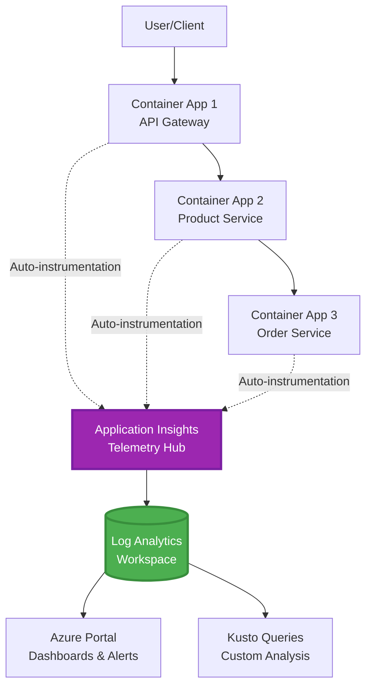
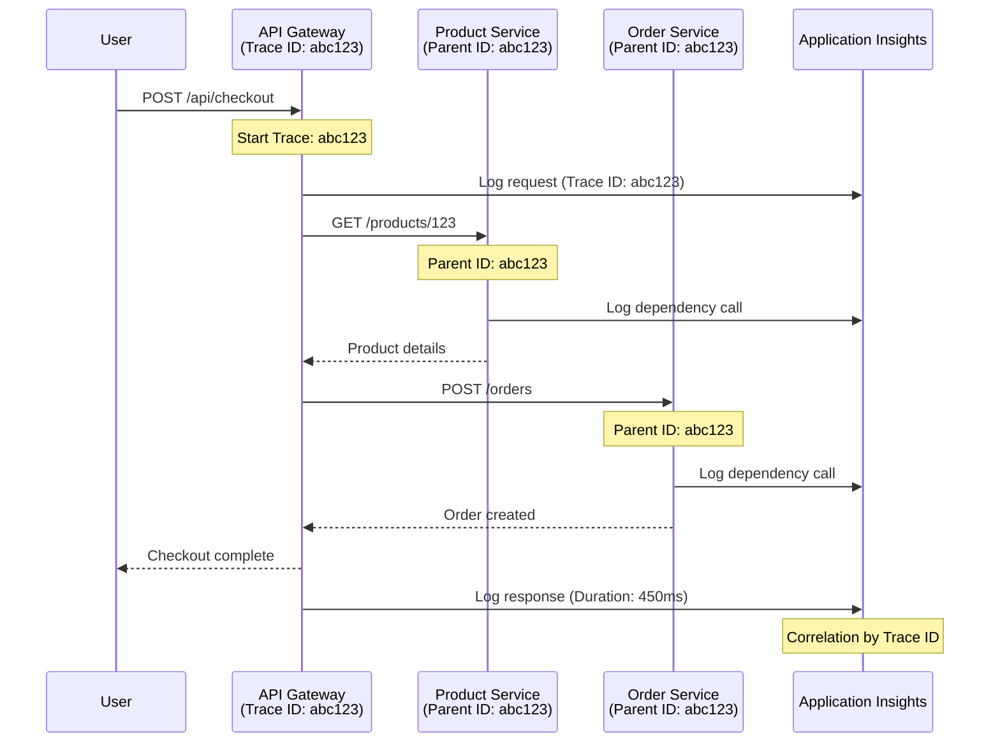

# 使用 AZD 整合 Application Insights

⏱️ <strong>預計時間</strong>：40-50 分鐘 | 💰 <strong>成本影響</strong>：約 $5-15/月 | ⭐ <strong>複雜度</strong>：中階

**📚 學習路徑：**
- ← 上一步：[預檢查](preflight-checks.md) - 部署前驗證
- 🎯 <strong>您現在的位置</strong>：Application Insights 整合（監控、遙測、除錯）
- → 下一步：[部署指南](../chapter-04-infrastructure/deployment-guide.md) - 部署至 Azure
- 🏠 [課程首頁](../../README.md)

---

## 您將學到什麼

完成本課程後，您將能：
- 在 AZD 基礎設施中宣告 **Application Insights** 並配置 SDK 檢測
- 配置微服務的 <strong>分散式追蹤</strong>
- 實作 <strong>自訂遙測</strong>（指標、事件、依賴）
- 設置 <strong>即時指標</strong> 用於即時監控
- 針對 AZD 部署建立 <strong>警示與儀表板</strong>
- 使用 <strong>遙測查詢</strong> 除錯生產問題
- 優化 <strong>成本與抽樣</strong> 策略
- 監控 **AI/LLM 應用程式**（代幣、延遲、成本）

## 為什麼 Application Insights 與 AZD 重要

### 挑戰：生產環境可觀察性

**沒有 Application Insights：**
```
❌ No visibility into production behavior
❌ Manual log aggregation across services
❌ Reactive debugging (wait for customer complaints)
❌ No performance metrics
❌ Cannot trace requests across services
❌ Unknown failure rates and bottlenecks
```

**有 Application Insights 與 AZD：**
```
✅ Automatic telemetry collection
✅ Centralized logs from all services
✅ Proactive issue detection
✅ End-to-end request tracing
✅ Performance metrics and insights
✅ Real-time dashboards
✅ AZD provisions the monitoring declared in your templates
```

<strong>比喻</strong>：Application Insights 就像是應用程式的「黑盒子」飛行記錄器與駕駛艙儀表板。您可以即時看到所有發生的事件，並回放任何事故。

---

## 架構概覽

### AZD 架構中的 Application Insights



### 自動監控內容

支援的自動檢測功能會捕捉已儀表化函式庫的請求／依賴。自訂事件和指標需在應用程式代碼中實作；可用性測試必須另行配置。存在資源並不代表會自動收集所有下列資料。

| 遙測類型 | 捕捉內容 | 使用案例 |
|----------------|------------------|----------|
| <strong>請求</strong> | HTTP 請求、狀態碼、持續時間 | API 性能監控 |
| <strong>依賴</strong> | 外部呼叫（資料庫、API、儲存體） | 識別瓶頸 |
| <strong>例外</strong> | 未處理錯誤與堆疊追蹤 | 除錯錯誤 |
| <strong>自訂事件</strong> | 業務事件（註冊、購買） | 分析與漏斗 |
| <strong>指標</strong> | 性能計數器、自訂指標 | 容量規劃 |
| <strong>追蹤</strong> | 有嚴重性標記的日誌訊息 | 除錯與稽核 |
| <strong>可用性</strong> | 正常運作與回應時間測試 | SLA 監控 |

---

## 前置條件

### 需要的工具

```bash
# Verify Azure Developer CLI
azd version
# Command reference baseline: azd 1.37.2

# Verify Azure CLI
az --version
# ✅ Expected: azure-cli 2.50.0 or higher
```

### Azure 要求

- 活躍的 Azure 訂閱
- 擁有建立權限：
  - Application Insights 資源
  - Log Analytics 工作區
  - Container Apps
  - 資源群組

### 知識前提

您應該已完成：
- [AZD 基礎](../chapter-01-foundation/azd-basics.md) - AZD 核心概念
- [設定](../chapter-03-configuration/configuration.md) - 環境建置
- [第一個專案](../chapter-01-foundation/first-project.md) - 基本部署

---

## 課程 1：使用 AZD 的自動 Application Insights

### AZD 如何佈建 Application Insights

AZD 只在 <strong>專案的基建宣告它時</strong> 才配置 Application Insights。`azure.yaml` 本身不會創建監控或為應用程式程式碼插入儀器碼。

> **範例範圍：** 本課程包含整合片段，而非此存放庫中的完整 `monitored-app` 專案。請先提供主模板與參數映射、Container Apps 環境、註冊表/映像檔與身份驗證配置、Dockerfile 及服務標籤，方可部署。後續課程會顯示替代/擴充片段，並非所有檔案都可直接不變拼湊起來。若要有可運行的基線，請從[微服務範例](../../../../examples/microservices)開始。

### 專案結構

```
monitored-app/
├── azure.yaml                     # AZD configuration
├── infra/
│   ├── main.bicep                # Main infrastructure
│   ├── core/
│   │   └── monitoring.bicep      # Application Insights + Log Analytics
│   └── app/
│       └── api.bicep             # Container App with monitoring
└── src/
    ├── app.py                    # Application with telemetry
    ├── requirements.txt
    └── Dockerfile
```

---

### 步驟 1：設定 AZD（azure.yaml）

**檔案：`azure.yaml`**

```yaml
name: monitored-app
metadata:
  template: monitored-app@1.0.0

services:
  api:
    project: ./src
    language: python
    host: containerapp

# Monitoring must be declared in infra/ and enabled in application code.
```

這裡宣告可部署的服務。以下 Bicep 和 SDK 設定提供監控；azd 並不會自動新增它們。

---

### 步驟 2：監控基建（Bicep）

**檔案：`infra/core/monitoring.bicep`**

```bicep
param logAnalyticsName string
param applicationInsightsName string
param location string = resourceGroup().location
param tags object = {}

// Log Analytics Workspace (required for Application Insights)
resource logAnalytics 'Microsoft.OperationalInsights/workspaces@2022-10-01' = {
  name: logAnalyticsName
  location: location
  tags: tags
  properties: {
    sku: {
      name: 'PerGB2018'  // Pay-as-you-go pricing
    }
    retentionInDays: 30  // Keep logs for 30 days
    features: {
      enableLogAccessUsingOnlyResourcePermissions: true
    }
  }
}

// Application Insights
resource applicationInsights 'Microsoft.Insights/components@2020-02-02' = {
  name: applicationInsightsName
  location: location
  tags: tags
  kind: 'web'
  properties: {
    Application_Type: 'web'
    WorkspaceResourceId: logAnalytics.id
    IngestionMode: 'LogAnalytics'
    publicNetworkAccessForIngestion: 'Enabled'
    publicNetworkAccessForQuery: 'Enabled'
  }
}

// Outputs for Container Apps
output logAnalyticsWorkspaceId string = logAnalytics.id
output logAnalyticsWorkspaceName string = logAnalytics.name
output applicationInsightsConnectionString string = applicationInsights.properties.ConnectionString
output applicationInsightsInstrumentationKey string = applicationInsights.properties.InstrumentationKey
output applicationInsightsName string = applicationInsights.name
output applicationInsightsId string = applicationInsights.id
```

---

### 步驟 3：將 Container App 連接至 Application Insights

**檔案：`infra/app/api.bicep`**

```bicep
param name string
param location string
param tags object = {}
param containerAppsEnvironmentId string
param containerImage string
param applicationInsightsConnectionString string

resource containerApp 'Microsoft.App/containerApps@2023-05-01' = {
  name: name
  location: location
  tags: tags
  properties: {
    managedEnvironmentId: containerAppsEnvironmentId
    configuration: {
      ingress: {
        external: true
        targetPort: 8000
      }
      secrets: [
        {
          name: 'appinsights-connection-string'
          value: applicationInsightsConnectionString
        }
      ]
    }
    template: {
      containers: [
        {
          name: 'api'
          image: containerImage // Supply an accessible image and registry authentication
          resources: {
            cpu: json('0.5')
            memory: '1Gi'
          }
          env: [
            {
              name: 'APPLICATIONINSIGHTS_CONNECTION_STRING'
              secretRef: 'appinsights-connection-string'
            }
            {
              name: 'APPLICATIONINSIGHTS_ENABLED'
              value: 'true'
            }
          ]
        }
      ]
    }
  }
}

output uri string = 'https://${containerApp.properties.configuration.ingress.fqdn}'
```

---

### 步驟 4：帶有遙測的應用程式碼

**檔案：`src/app.py`**

```python
from flask import Flask, request, jsonify
from azure.monitor.opentelemetry import configure_azure_monitor
import logging
import os

app = Flask(__name__)

# Get Application Insights connection string
connection_string = os.environ.get('APPLICATIONINSIGHTS_CONNECTION_STRING')

if connection_string:
    # Azure Monitor OpenTelemetry instruments supported libraries, including Flask.
    configure_azure_monitor(
        connection_string=connection_string,
        logger_name=__name__,
        enable_live_metrics=True
    )
    logger = logging.getLogger(__name__)
    logger.setLevel(logging.INFO)
    
    print("✅ Application Insights enabled")
else:
    logger = logging.getLogger(__name__)
    logger.setLevel(logging.INFO)
    print("⚠️ Application Insights not configured")

@app.route('/health')
def health():
    logger.info('Health check endpoint called')
    return jsonify({'status': 'healthy', 'monitoring': 'enabled' if connection_string else 'disabled'})

@app.route('/api/products')
def get_products():
    logger.info('Fetching products')
    
    # In-memory fixture: this is not a database dependency call.
    products = [
        {'id': 1, 'name': 'Laptop', 'price': 999.99},
        {'id': 2, 'name': 'Mouse', 'price': 29.99},
        {'id': 3, 'name': 'Keyboard', 'price': 79.99}
    ]
    
    logger.info(f'Returned {len(products)} products')
    return jsonify(products)

@app.route('/api/error-test')
def error_test():
    """Test error tracking"""
    logger.error('Testing error tracking')
    try:
        raise ValueError('This is a test exception')
    except Exception as e:
        logger.exception('Exception occurred in error-test endpoint')
        return jsonify({'error': str(e)}), 500

@app.route('/api/slow')
def slow_endpoint():
    """Test performance tracking"""
    import time
    logger.info('Slow endpoint called')
    time.sleep(3)  # Simulate slow operation
    logger.warning('Endpoint took 3 seconds to respond')
    return jsonify({'message': 'Slow operation completed'})

if __name__ == '__main__':
    app.run(host='0.0.0.0', port=8000)
```

**檔案：`src/requirements.txt`**

```txt
Flask
azure-monitor-opentelemetry
gunicorn
requests
openai
```

在您專案中解析這些依賴關係，並一同測試它們，然後鎖定產生的版本。新專案應使用 Azure Monitor OpenTelemetry，而非已退休的 OpenCensus Python 匯出器。

---

### 第 5 步：部署與驗證

```bash
# Deploy only after completing and wiring the infrastructure fragments above
azd up

# Get app URL
APP_URL=$(azd env get-value API_URL) # Requires this output in main.bicep

# Generate telemetry
curl $APP_URL/health
curl $APP_URL/api/products
curl $APP_URL/api/error-test
curl $APP_URL/api/slow
```

**✅ 預期輸出：**
```json
{
  "status": "healthy",
  "monitoring": "enabled"
}
```

---

### 第 6 步：在 Azure 入口網站查看遙測

```bash
# Get Application Insights details
azd env get-values | grep APPLICATIONINSIGHTS

# Open in Azure Portal
az monitor app-insights component show \
  --app $(azd env get-values | grep APPLICATIONINSIGHTS_NAME | cut -d '=' -f2 | tr -d '"') \
  --resource-group $(azd env get-values | grep AZURE_RESOURCE_GROUP | cut -d '=' -f2 | tr -d '"') \
  --query "appId" -o tsv
```

**導航至 Azure 入口網站 → Application Insights → Transaction Search**

你應該會看到：
- ✅ 帶有狀態碼的 HTTP 請求
- ✅ 請求持續時間 (3 秒以上用於 `/api/slow`)
- ✅ `/api/error-test` 的例外詳情
- ✅ 自訂日誌訊息

---

## 課程 2：自訂遙測和事件

### 追蹤商業事件

讓我們為商業關鍵事件新增自訂遙測。

**檔案：`src/telemetry.py`**

```python
from contextlib import contextmanager
from azure.monitor.opentelemetry import configure_azure_monitor
from opentelemetry import metrics, trace
from opentelemetry.trace import SpanKind
import logging
import os

class TelemetryClient:
    """Custom telemetry client for Application Insights"""
    
    def __init__(self, connection_string=None):
        self.connection_string = connection_string or os.environ.get('APPLICATIONINSIGHTS_CONNECTION_STRING')
        
        # Configure once per process. If app.py already calls this, keep only
        # one configure_azure_monitor call and use logger_name='telemetry'.
        if self.connection_string:
            configure_azure_monitor(
                connection_string=self.connection_string,
                logger_name=__name__,
                enable_live_metrics=True
            )
        self.logger = logging.getLogger(__name__)
        self.logger.setLevel(logging.INFO)
        self.tracer = trace.get_tracer(__name__)
        self.meter = metrics.get_meter(__name__)
        self.instruments = {}
    
    def track_event(self, event_name: str, properties: dict = None):
        """Track custom business event"""
        properties = properties or {}
        self.logger.info(
            f"CustomEvent: {event_name}",
            extra={
                # OTel log attributes become customDimensions in App Insights.
                    'event_name': event_name,
                    **properties
            }
        )
    
    def track_metric(self, metric_name: str, value: float, properties: dict = None):
        """Track custom metric"""
        properties = properties or {}
        if metric_name not in self.instruments:
            self.instruments[metric_name] = self.meter.create_histogram(metric_name)
        self.instruments[metric_name].record(value, attributes=properties)
    
    @contextmanager
    def track_dependency(self, name: str):
        """Time the real operation inside a client span; exceptions mark failure."""
        with self.tracer.start_as_current_span(name, kind=SpanKind.CLIENT) as span:
            yield span

# Global telemetry client
telemetry = TelemetryClient()
```

### 更新應用程式以加入自訂事件

**檔案：`src/app.py` (增強版)**

將這些路由新增至現有的 Flask 應用程式；保留先前的 health/test 路由。下方縮短的區塊顯示分離的應用程式以便理解。遙測初始化現由 `telemetry.py` 管理—請勿重複初始化匯出器。

```python
from flask import Flask, request, jsonify
from telemetry import telemetry
import time
import random
import os

app = Flask(__name__)

@app.route('/api/purchase', methods=['POST'])
def purchase():
    """Track purchase event with custom telemetry"""
    data = request.get_json(silent=True) or {}
    product_id = data.get('product_id')
    quantity = data.get('quantity', 1)
    price = data.get('price', 0)
    if not isinstance(quantity, int) or quantity < 1 or \
       not isinstance(price, (int, float)) or price < 0:
        return jsonify({'error': 'quantity and price must be non-negative numbers; quantity >= 1'}), 400
    
    # Track business event
    telemetry.track_event('Purchase', {
        'product_id': product_id,
        'quantity': quantity,
        'total_amount': price * quantity,
        'user_id': request.headers.get('X-User-Id', 'anonymous')
    })
    
    # Track revenue metric
    telemetry.track_metric('Revenue', price * quantity, {
        'product_id': product_id,
        'currency': 'USD'
    })
    
    return jsonify({
        'order_id': f'ORD-{random.randint(1000, 9999)}',
        'status': 'confirmed',
        'total': price * quantity
    })

@app.route('/api/search')
def search():
    """Track search queries"""
    query = request.args.get('q', '')
    
    start_time = time.time()
    
    # Simulate search (would be real database query)
    results = [{'id': 1, 'name': f'Result for {query}'}]
    
    duration = (time.time() - start_time) * 1000  # Convert to ms
    
    # Track search event
    telemetry.track_event('Search', {
        'query': query,
        'results_count': len(results),
        'duration_ms': duration
    })
    
    # Track search performance metric
    telemetry.track_metric('SearchDuration', duration, {
        'query_length': len(query)
    })
    
    return jsonify({'results': results, 'count': len(results)})

@app.route('/api/external-call')
def external_call():
    """Track external API dependency"""
    import requests
    
    try:
        # Set an actual test endpoint; api.example.com is not a working API.
        with telemetry.track_dependency('ExternalAPI'):
            response = requests.get(os.environ['EXTERNAL_API_URL'], timeout=5)
            response.raise_for_status()
            result = response.json()
    except Exception as e:
        return jsonify({'error': 'External dependency failed'}), 502
    
    return jsonify(result)

if __name__ == '__main__':
    app.run(host='0.0.0.0', port=8000)
```

### 測試自訂遙測

```bash
# Track purchase event
curl -X POST $APP_URL/api/purchase \
  -H "Content-Type: application/json" \
  -H "X-User-Id: user123" \
  -d '{"product_id": 1, "quantity": 2, "price": 29.99}'

# Track search event
curl "$APP_URL/api/search?q=laptop"

# Track external dependency
curl $APP_URL/api/external-call
```

**於 Azure 入口網站檢視：**

導航至 Application Insights → Logs，然後執行：

```kusto
// View purchase events
traces
| where customDimensions.event_name == "Purchase"
| project 
    timestamp,
    product_id = tostring(customDimensions.product_id),
    total_amount = todouble(customDimensions.total_amount),
    user_id = tostring(customDimensions.user_id)
| order by timestamp desc

// Revenue recorded in Purchase events (not a billing ledger)
traces
| where customDimensions.event_name == "Purchase"
| summarize TotalRevenue = sum(todouble(customDimensions.total_amount)) by bin(timestamp, 1h)
| render timechart

// View search performance
traces
| where customDimensions.event_name == "Search"
| summarize 
    AvgDuration = avg(todouble(customDimensions.duration_ms)),
    SearchCount = count()
  by bin(timestamp, 5m)
| render timechart
```

---

## 課程 3：微服務的分散式追蹤

### 啟用跨服務追蹤

透過相容的儀器及 W3C trace-context 傳播，Application Insights 可關聯跨服務的請求。僅分享連接字串並不會建立父子跨度。以下架構片段引用您必須實現的模組。

**檔案：`infra/main.bicep`**

```bicep
targetScope = 'subscription'

param environmentName string
param location string = 'eastus'

var tags = { 'azd-env-name': environmentName }

resource rg 'Microsoft.Resources/resourceGroups@2021-04-01' = {
  name: 'rg-${environmentName}'
  location: location
  tags: tags
}

// Monitoring (shared by all services)
module monitoring './core/monitoring.bicep' = {
  name: 'monitoring'
  scope: rg
  params: {
    logAnalyticsName: 'log-${environmentName}'
    applicationInsightsName: 'appi-${environmentName}'
    location: location
    tags: tags
  }
}

// API Gateway
module apiGateway './app/api-gateway.bicep' = {
  name: 'api-gateway'
  scope: rg
  params: {
    name: 'ca-gateway-${environmentName}'
    location: location
    tags: union(tags, { 'azd-service-name': 'gateway' })
    applicationInsightsConnectionString: monitoring.outputs.applicationInsightsConnectionString
  }
}

// Product Service
module productService './app/product-service.bicep' = {
  name: 'product-service'
  scope: rg
  params: {
    name: 'ca-products-${environmentName}'
    location: location
    tags: union(tags, { 'azd-service-name': 'products' })
    applicationInsightsConnectionString: monitoring.outputs.applicationInsightsConnectionString
  }
}

// Order Service
module orderService './app/order-service.bicep' = {
  name: 'order-service'
  scope: rg
  params: {
    name: 'ca-orders-${environmentName}'
    location: location
    tags: union(tags, { 'azd-service-name': 'orders' })
    applicationInsightsConnectionString: monitoring.outputs.applicationInsightsConnectionString
  }
}

output APPLICATIONINSIGHTS_CONNECTION_STRING string = monitoring.outputs.applicationInsightsConnectionString
output GATEWAY_URL string = apiGateway.outputs.uri
```

### 查看端對端交易



**查詢端對端追蹤：**

```kusto
// Find complete request flow
let traceId = "abc123...";  // Copy operation_Id from a request in Application Insights
dependencies
| union requests
| where operation_Id == traceId
| project 
    timestamp,
    type = itemType,
    name,
    duration,
    success,
    cloud_RoleName
| order by timestamp asc
```

---

## 第四課：即時指標和即時監控

### 啟用即時指標串流

當 SDK 支援並啟用時，即時指標可提供近實時遙測。這不是延遲服務水準協議。上面 Python OpenTelemetry 設定採用了 `enable_live_metrics=True`。

**存取即時指標：**

```bash
# Get Application Insights resource
APPI_NAME=$(azd env get-values | grep APPLICATIONINSIGHTS_NAME | cut -d '=' -f2 | tr -d '"')

# Get resource group
RG_NAME=$(azd env get-values | grep AZURE_RESOURCE_GROUP | cut -d '=' -f2 | tr -d '"')

echo "Navigate to: Azure Portal → Resource Groups → $RG_NAME → $APPI_NAME → Live Metrics"
```

**您在即時中看到的內容：**
- ✅ 進入的請求率（請求/秒）
- ✅ 外送依賴呼叫
- ✅ 例外計數
- ✅ CPU 和記憶體使用率
- ✅ 活躍伺服器數目
- ✅ 抽樣遙測

### 產生負載用於測試

```bash
# Generate load to see live metrics
for i in {1..100}; do
  curl --silent --max-time 10 "$APP_URL/api/products"
  curl --silent --max-time 10 "$APP_URL/api/search?q=test$i"
done

# Watch live metrics in Azure Portal
# You should see request rate spike
```

---

## 實務練習

### 練習 1：設定警示 ⭐⭐ (中階)

<strong>目標</strong>：為高錯誤率和慢回應建立警示。

**步驟：**

1. **建立錯誤率警示：**

```bash
# Get Application Insights resource ID
APPI_ID=$(az monitor app-insights component show \
  --app $APPI_NAME \
  --resource-group $RG_NAME \
  --query "id" -o tsv)

# Create metric alert for failed requests
az monitor metrics alert create \
  --name "High-Error-Rate" \
  --resource-group $RG_NAME \
  --scopes $APPI_ID \
  --condition "count requests/failed > 10" \
  --window-size 5m \
  --evaluation-frequency 1m \
  --description "Alert when failed request count exceeds 10 per 5 minutes"
```

2. **建立慢回應警示：**

```bash
az monitor metrics alert create \
  --name "Slow-Responses" \
  --resource-group $RG_NAME \
  --scopes $APPI_ID \
  --condition "avg requests/duration > 3000" \
  --window-size 5m \
  --evaluation-frequency 1m \
  --description "Alert when average response time exceeds 3 seconds"
```

3. **透過 Bicep 建立警示（AZD 推薦用法）：**

**檔案： `infra/core/alerts.bicep`**

```bicep
param applicationInsightsId string
param actionGroupId string = ''
param location string = resourceGroup().location

// High error rate alert
resource errorRateAlert 'Microsoft.Insights/metricAlerts@2018-03-01' = {
  name: 'high-error-rate'
  location: 'global'
  properties: {
    description: 'Alert when error rate exceeds threshold'
    severity: 2
    enabled: true
    scopes: [
      applicationInsightsId
    ]
    evaluationFrequency: 'PT1M'
    windowSize: 'PT5M'
    criteria: {
      'odata.type': 'Microsoft.Azure.Monitor.SingleResourceMultipleMetricCriteria'
      allOf: [
        {
          name: 'Error rate'
          metricName: 'requests/failed'
          operator: 'GreaterThan'
          threshold: 10
          timeAggregation: 'Count'
        }
      ]
    }
    actions: actionGroupId != '' ? [
      {
        actionGroupId: actionGroupId
      }
    ] : []
  }
}

// Slow response alert
resource slowResponseAlert 'Microsoft.Insights/metricAlerts@2018-03-01' = {
  name: 'slow-responses'
  location: 'global'
  properties: {
    description: 'Alert when response time is too high'
    severity: 3
    enabled: true
    scopes: [
      applicationInsightsId
    ]
    evaluationFrequency: 'PT1M'
    windowSize: 'PT5M'
    criteria: {
      'odata.type': 'Microsoft.Azure.Monitor.SingleResourceMultipleMetricCriteria'
      allOf: [
        {
          name: 'Response duration'
          metricName: 'requests/duration'
          operator: 'GreaterThan'
          threshold: 3000
          timeAggregation: 'Average'
        }
      ]
    }
  }
}

output errorAlertId string = errorRateAlert.id
output slowResponseAlertId string = slowResponseAlert.id
```

4. **測試警示：**

```bash
# Generate errors
for i in {1..20}; do
  curl $APP_URL/api/error-test
done

# Generate slow responses
for i in {1..10}; do
  curl $APP_URL/api/slow
done

# Check rule configuration (not fired/resolved alert-instance history)
az monitor metrics alert list \
  --resource-group $RG_NAME \
  --query "[].{Name:name, Enabled:enabled}" \
  --output table
```

**✅ 成功標準：**
- ✅ 成功建立警示
- ✅ 閾值超過時警示會觸發
- ✅ 可在 Azure 入口網站查看警示歷史
- ✅ 與 AZD 部署整合

<strong>時間</strong>：20-25 分鐘

---

### 練習 2：建立自訂儀表板 ⭐⭐ (中階)

<strong>目標</strong>：建置展示主要應用程式指標的儀表板。

**步驟：**

1. **透過 Azure 入口網站建立儀表板：**

導覽至：Azure 入口網站 → 儀表板 → 新增儀表板

2. **加入主要指標的磚塊：**

- 請求數（過去 24 小時）
- 平均回應時間
- 錯誤率
- 五個最慢的操作
- 使用者地理分佈

3. **透過 Bicep 建立儀表板：**

**檔案： `infra/core/dashboard.bicep`**

```bicep
param dashboardName string
param applicationInsightsId string
param location string = resourceGroup().location

resource dashboard 'Microsoft.Portal/dashboards@2020-09-01-preview' = {
  name: dashboardName
  location: location
  properties: {
    lenses: [
      {
        order: 0
        parts: [
          // Request count
          {
            position: {
              x: 0
              y: 0
              rowSpan: 4
              colSpan: 6
            }
            metadata: {
              type: 'Extension/Microsoft_OperationsManagementSuite_Workspace/PartType/LogsDashboardPart'
              inputs: [
                {
                  name: 'resourceId'
                  value: applicationInsightsId
                }
                {
                  name: 'query'
                  value: '''
                    requests
                    | summarize RequestCount = count() by bin(timestamp, 1h)
                    | render timechart
                  '''
                }
              ]
            }
          }
          // Error rate
          {
            position: {
              x: 6
              y: 0
              rowSpan: 4
              colSpan: 6
            }
            metadata: {
              type: 'Extension/Microsoft_OperationsManagementSuite_Workspace/PartType/LogsDashboardPart'
              inputs: [
                {
                  name: 'resourceId'
                  value: applicationInsightsId
                }
                {
                  name: 'query'
                  value: '''
                    requests
                    | summarize 
                        Total = count(),
                        Failed = countif(success == false)
                    | extend ErrorRate = (Failed * 100.0) / Total
                    | project ErrorRate
                  '''
                }
              ]
            }
          }
        ]
      }
    ]
  }
}

output dashboardId string = dashboard.id
```

4. **部署儀表板：**

```bicep
// Add to a subscription-scoped main.bicep with rg and monitoring declared
module dashboard './core/dashboard.bicep' = {
  name: 'dashboard'
  scope: rg
  params: {
    dashboardName: 'dashboard-${environmentName}'
    applicationInsightsId: monitoring.outputs.applicationInsightsId
    location: location
  }
}
```

```bash
# Deploy
azd up
```

**✅ 成功標準：**
- ✅ 儀表板顯示主要指標
- ✅ 可釘選到 Azure 入口網站首頁
- ✅ 即時更新
- ✅ 可透過 AZD 部署

<strong>時間</strong>：25-30 分鐘

---

### 練習 3：監控 AI/LLM 應用程式 ⭐⭐⭐ (進階)

<strong>目標</strong>：追蹤 Microsoft Foundry 模型使用情況（代幣、成本、延遲）。

**步驟：**

1. **建立 AI 監控包裝器：**

**檔案： `src/ai_telemetry.py`**

```python
from telemetry import telemetry
from openai import AzureOpenAI
import time

class MonitoredAzureOpenAI:
    """Microsoft Foundry Models client with automatic telemetry"""
    
    def __init__(self, api_key, endpoint, input_usd_per_million,
                 output_usd_per_million, api_version="2024-10-21"):
        self.client = AzureOpenAI(
            api_key=api_key,
            api_version=api_version,
            azure_endpoint=endpoint
        )
        self.input_rate = input_usd_per_million
        self.output_rate = output_usd_per_million
    
    def chat_completion(self, model: str, messages: list, **kwargs):
        """Track chat completion with telemetry"""
        start_time = time.time()
        
        try:
            # Call Microsoft Foundry Models
            response = self.client.chat.completions.create(
                model=model,
                messages=messages,
                **kwargs
            )
            
            duration = (time.time() - start_time) * 1000  # ms
            
            # Extract usage
            usage = response.usage
            prompt_tokens = usage.prompt_tokens
            completion_tokens = usage.completion_tokens
            total_tokens = usage.total_tokens
            
            # Approximation: supply actual deployment/region/contract rates.
            # Cached input, batch, provisioned and other charges need separate accounting.
            prompt_cost = (prompt_tokens / 1_000_000) * self.input_rate
            completion_cost = (completion_tokens / 1_000_000) * self.output_rate
            total_cost = prompt_cost + completion_cost
            
            # Track custom event
            telemetry.track_event('OpenAI_Request', {
                'model': model,
                'prompt_tokens': prompt_tokens,
                'completion_tokens': completion_tokens,
                'total_tokens': total_tokens,
                'duration_ms': duration,
                'cost_usd': total_cost,
                'success': True
            })
            
            # Track metrics
            telemetry.track_metric('OpenAI_Tokens', total_tokens, {
                'model': model,
                'type': 'total'
            })
            
            telemetry.track_metric('OpenAI_Cost', total_cost, {
                'model': model,
                'currency': 'USD'
            })
            
            telemetry.track_metric('OpenAI_Duration', duration, {
                'model': model
            })
            
            return response
            
        except Exception as e:
            duration = (time.time() - start_time) * 1000
            
            telemetry.track_event('OpenAI_Request', {
                'model': model,
                'duration_ms': duration,
                'success': False,
                'error': str(e)
            })
            
            raise
```

2. **使用監控客戶端：**

```python
from flask import Flask, request, jsonify
from ai_telemetry import MonitoredAzureOpenAI
import os

app = Flask(__name__)

# Initialize monitored OpenAI client
openai_client = MonitoredAzureOpenAI(
    api_key=os.environ['AZURE_OPENAI_API_KEY'],
    endpoint=os.environ['AZURE_OPENAI_ENDPOINT'],
    input_usd_per_million=float(os.environ['INPUT_USD_PER_MILLION']),
    output_usd_per_million=float(os.environ['OUTPUT_USD_PER_MILLION'])
)

@app.route('/api/chat', methods=['POST'])
def chat():
    data = request.json
    user_message = data.get('message')
    
    # Call with automatic monitoring
    response = openai_client.chat_completion(
        model=os.environ['AZURE_OPENAI_DEPLOYMENT'], # Deployment name, not catalog ID
        messages=[
            {'role': 'user', 'content': user_message}
        ]
    )
    
    return jsonify({
        'response': response.choices[0].message.content,
        'tokens': response.usage.total_tokens
    })
```

3. **查詢 AI 指標：**

```kusto
// Total AI spend over time
traces
| where customDimensions.event_name == "OpenAI_Request"
| where tobool(customDimensions.success) == true
| summarize TotalCost = sum(todouble(customDimensions.cost_usd)) by bin(timestamp, 1h)
| render timechart

// Token usage by model
traces
| where customDimensions.event_name == "OpenAI_Request"
| summarize 
    TotalTokens = sum(toint(customDimensions.total_tokens)),
    RequestCount = count()
  by Model = tostring(customDimensions.model)

// Average latency
traces
| where customDimensions.event_name == "OpenAI_Request"
| summarize AvgDuration = avg(todouble(customDimensions.duration_ms))
| project AvgDurationSeconds = AvgDuration / 1000

// Cost per request
traces
| where customDimensions.event_name == "OpenAI_Request"
| extend Cost = todouble(customDimensions.cost_usd)
| summarize 
    TotalCost = sum(Cost),
    RequestCount = count(),
    AvgCostPerRequest = avg(Cost)
```

**✅ 成功標準：**
- ✅ 每次 OpenAI 呼叫均自動追蹤
- ✅ 可見代幣使用和成本
- ✅ 監控延遲
- ✅ 可設定預算警示

<strong>時間</strong>：35-45 分鐘

---

## 成本優化

### 抽樣策略

透過抽樣遙測控制成本：

```python
import os

# Configure before the one configure_azure_monitor() call in your process.
os.environ["OTEL_TRACES_SAMPLER"] = "microsoft.fixed_percentage"
os.environ["OTEL_TRACES_SAMPLER_ARG"] = "0.1" # 10% trace sampling
```

跟蹤採樣不會將每個遙測類別都減少 90%。度量和獨立發出的日誌需要自己的流量控制。選擇比例時要根據可觀察性需求，而不是一刀切的生產禁止。

明確設定 SDK 採樣；組件的 `SamplingPercentage` 屬性不能替代配置 Python OpenTelemetry 採樣器。

### 資料保留

```bicep
resource logAnalytics 'Microsoft.OperationalInsights/workspaces@2022-10-01' = {
  name: logAnalyticsName
  properties: {
    retentionInDays: 30  // Minimum (cheapest)
    // Options: 30, 31, 60, 90, 120, 180, 270, 365, 550, 730
  }
}
```

### 每月成本估算

| 資料量 | 保留期間 | 每月成本 |
|-------------|-----------|--------------|
| 1 GB/月 | 30 天 | 約 $2-5 |
| 5 GB/月 | 30 天 | 約 $10-15 |
| 10 GB/月 | 90 天 | 約 $25-40 |
| 50 GB/月 | 90 天 | 約 $100-150 |

以上數字為說明用，非報價。請根據您所在地區與協議，驗證資料攝取、保留、警示及測試費用；免費額度依 Azure Monitor 定價共享/範圍劃分，並非每個 Application Insights 資源有保證免費 SKU。

---

## 知識檢核點

### 1. 基本整合 ✓

測試您的理解：

- [ ] **Q1**：AZD 如何設定 Application Insights？
  - **A**：它部署專案的 Bicep/Terraform 範本明確宣告的監控資源。

- [ ] **Q2**：哪個環境變數啟用 Application Insights？
  - **A**：`APPLICATIONINSIGHTS_CONNECTION_STRING`

- [ ] **Q3**：三種主要的遙測類型是什麼？
  - **A**：請求（HTTP 呼叫）、依賴（外部呼叫）、例外（錯誤）

**實作驗證：**
```bash
# Check if Application Insights is configured
azd env get-values | grep APPLICATIONINSIGHTS

# Verify telemetry is flowing
az monitor app-insights metrics show \
  --app $APPI_NAME \
  --resource-group $RG_NAME \
  --metric "requests/count"
```

---

### 2. 自訂遙測 ✓

測試您的理解：

- [ ] **Q1**：如何追蹤自訂業務事件？
  - **A**：本課程的封裝會寫入帶有 `event_name` 屬性的結構化 OTel 日誌，可在 `traces` 中查詢；這些不會自動成為 `customEvents`。

- [ ] **Q2**：事件跟度量的差異是什麼？
  - **A**：事件是離散發生，度量是數值測量

- [ ] **Q3**：如何在服務間關聯遙測？
  - **A**：Application Insights 會自動使用 `operation_Id` 進行關聯

**實作驗證：**
```kusto
// Verify custom events
traces
| where customDimensions.event_name != ""
| summarize count() by tostring(customDimensions.event_name)
```

---

### 3. 生產監控 ✓

測試您的理解：

- [ ] **Q1**：什麼是採樣及其用途？
  - **A**：採樣透過僅擷取部分遙測，減少資料量（及成本）

- [ ] **Q2**：如何設置警示？
  - **A**：使用 Bicep 或 Azure 入口網站上基於 Application Insights 度量的度量警示

- [ ] **Q3**：Log Analytics 與 Application Insights 的差別？
  - **A**：Application Insights 將資料儲存於 Log Analytics 工作區；App Insights 提供應用程式特定檢視

**實作驗證：**
```bash
# Check the sampler configured for the running application, not only the ARM component.
az containerapp show --name "$APP_NAME" --resource-group "$RG_NAME" \
  --query "properties.template.containers[].env[?starts_with(name, 'OTEL_TRACES_SAMPLER')]"
```

---

## 最佳實踐

### ✅ 建議：

1. **使用關聯 ID**
   ```python
   logger.info('Processing order', extra={
           'order_id': order_id,
           'user_id': user_id
   })
   ```

2. <strong>為關鍵度量設定警示</strong>
   ```bicep
   // Error rate, slow responses, availability
   ```

3. <strong>使用結構化日誌</strong>
   ```python
   # ✅ GOOD: Structured
   logger.info('User signup', extra={'user_id': 'pseudonymous-id'})
   
   # ❌ BAD: Unstructured
   logger.info(f'User 123 signed up')
   ```

4. <strong>監控依賴</strong>
   ```python
   # Automatically track database calls, HTTP requests, etc.
   ```

5. <strong>部署期間使用即時度量</strong>

### ❌ 不要：

1. <strong>不要記錄敏感資料</strong>
   ```python
   # ❌ BAD
   logger.info(f'Login: {username}:{password}')
   
   # ✅ GOOD
   logger.info('Login attempt', extra={'result': 'failed'})
   ```

2. **在未測量量和診斷需求前，不要選擇取樣**
   ```python
   # ❌ Expensive
   # 100% traces may be appropriate for a small workload or investigation.
   
   # ✅ Cost-effective
   # A lower trace rate reduces visibility; validate coverage before enabling.
   ```

3. <strong>不要忽略死信隊列</strong>

4. <strong>不要忘記設定資料保留限額</strong>

---

## 疑難排解

### 問題：沒有出現遙測資料

**診斷：**
```bash
# Check connection string is set
azd env get-values | grep APPLICATIONINSIGHTS

# Check application logs via Azure Monitor
azd monitor --logs

# Or use Azure CLI for Container Apps:
az containerapp logs show --name $APP_NAME --resource-group $RG_NAME --tail 50
```

**解決方案：**
```bash
# Verify connection string in Container App
az containerapp show \
  --name $APP_NAME \
  --resource-group $RG_NAME \
  --query "properties.template.containers[0].env" \
  | grep -i applicationinsights
```

---

### 問題：成本過高

**診斷：**
```bash
# Query ingestion volume in the linked Log Analytics workspace.
# WORKSPACE_ID is the workspace customer ID (GUID), not its ARM resource ID.
az monitor log-analytics query --workspace "$WORKSPACE_ID" \
  --analytics-query "Usage | where TimeGenerated > ago(30d) | where IsBillable == true | summarize IngestedMB=sum(Quantity) by DataType"
```

**解決方案：**
- 降低取樣率
- 縮短保留期限
- 移除詳細日誌

---

## 進一步了解

### 官方文件
- [Application Insights 概述](https://learn.microsoft.com/azure/azure-monitor/app/app-insights-overview)
- [Azure Monitor OpenTelemetry 設定](https://learn.microsoft.com/azure/azure-monitor/app/opentelemetry-enable?tabs=python)
- [Kusto 查詢語言](https://learn.microsoft.com/azure/data-explorer/kusto/query/)
- [AZD 監控](https://learn.microsoft.com/azure/developer/azure-developer-cli/monitor-your-app)

### 本課程接下來的步驟
- ← 上一章：[預檢查](preflight-checks.md)
- → 下一章：[部署指南](../chapter-04-infrastructure/deployment-guide.md)
- 🏠 [課程首頁](../../README.md)

### 相關範例
- [Microsoft Foundry Models 範例](../../../../examples/azure-openai-chat) - AI 遙測
- [微服務範例](../../../../examples/microservices) - 分散式追蹤

---

## 總結

**您已學會：**
- ✅ 使用 AZD 自動佈建 Application Insights
- ✅ 自訂遙測（事件、指標、依賴項）
- ✅ 跨微服務分散式追蹤
- ✅ 即時指標和即時監控
- ✅ 警報和儀表板
- ✅ AI/LLM 應用監控
- ✅ 成本優化策略

**主要重點：**
1. <strong>明確宣告監控</strong> - AZD 佈署您的範本；SDK 工具埋點傳送遙測
2. <strong>使用結構化日誌</strong> - 使查詢更容易
3. <strong>追蹤業務事件</strong> - 不僅限技術指標
4. **監控 AI 成本** - 追蹤 token 和支出
5. <strong>設定警報</strong> - 採取主動而非被動
6. <strong>優化成本</strong> - 使用取樣率和保留限制

**接下來的步驟：**
1. 完成實作練習
2. 將 Application Insights 加入您的 AZD 專案
3. 為您的團隊建立自訂儀表板
4. 學習 [部署指南](../chapter-04-infrastructure/deployment-guide.md)

---

<!-- CO-OP TRANSLATOR DISCLAIMER START -->
**免責聲明**：
本文件使用 AI 翻譯服務 [Co-op Translator](https://github.com/Azure/co-op-translator) 進行翻譯。雖然我們力求準確，但請注意，自動翻譯可能包含錯誤或不準確之處。原始文件的母語版本應被視為權威來源。對於重要資訊，建議尋求專業人工翻譯。我們不對因使用本翻譯而引起的任何誤解或曲解承擔責任。
<!-- CO-OP TRANSLATOR DISCLAIMER END -->