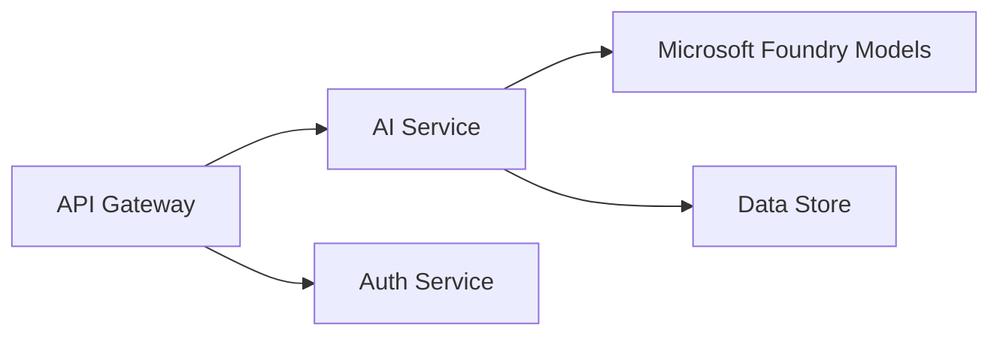
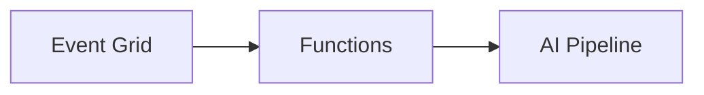

# 第8章：生產及企業模式

**📚 課程**: [AZD 初學者指南](../../README.md) | **⏱️ 時長**: 2-3 小時 | **⭐ 複雜度**: 進階

---

## 概覽

本章涵蓋企業級部署模式、安全強化、監控以及生產 AI 工作負載的成本優化。

這是一份架構參考，而非完整可部署的生產範本。範例省略了必須在你自身應用中補充及測試的整合細節；閱讀核對清單不代表已達生產準備狀態。

> **Foundry GA 更新 (2026-11-09):** 使用 `azd >= 1.37.0` 及一般可用的 `microsoft.foundry` 1.0 套件作為 Foundry 工作流程；評估工具則需另行安裝。請參閱 [版本範圍與遷移](production-ai-practices.md#recent-release-changes-and-fixes) 及 [驗證管線範例](production-ai-practices.md#cicd-pipeline-configuration)。這是文件審閱，非即時部署驗證或選用預覽功能的全面 GA 狀態。

## 學習目標

完成本章後，您將能：
- 部署多區域具韌性的應用程式
- 實作企業安全模式
- 設定完整的監控機制
- 進行規模化成本優化
- 使用 AZD 設定 CI/CD 管線

---

## 📚 課程

| # | 課程 | 說明 | 時間 |
|---|--------|-------------|------|
| 1 | [生產級 AI 實務](production-ai-practices.md) | 企業部署模式 | 90 分鐘 |

---

## 🚀 生產檢查清單

- [ ] 多區域部署以增強韌性
- [ ] 以管理身份驗證（無需密鑰）
- [ ] 使用 Application Insights 監控
- [ ] 設定成本預算與警示
- [ ] 啟用安全掃描
- [ ] 整合 CI/CD 管線
- [ ] 災難復原計劃

---

## 🏗️ 架構模式

### 模式 1：微服務 AI



### 模式 2：事件驅動 AI



---

## 🔐 安全最佳實務

```bicep
// Illustrative properties from different resources, NOT a standalone Bicep file.
// Attach identity to the application host:
identity: {
  type: 'SystemAssigned'
}

// AI account properties (also require private endpoints, DNS and app connectivity):
properties: {
  publicNetworkAccess: 'Disabled'
  networkAcls: {
    defaultAction: 'Deny'
  }
}
```

---

## 💰 成本優化

| 策略 | 主要限制 |
|----------|---------|
| 零規模擴展（Container Apps） | 需要合適的觸發器；其他服務仍需支付費用 |
| 開發環境使用消耗層級 | 比較所選服務價格與工作負載 |
| 排程式擴展 | 透過支援的基礎設施/自動化擴展 |
| 預留/配置容量 | 僅在支援時使用；承諾可能增加閒置成本 |

使用 [完整預算資源模式](production-ai-practices.md#2-cost-monitoring-and-budgets)，需有有效的起始日期、計費範圍、接收者及權限。預算會發送警示；不會限制支出。節省金額取決於實際使用情況，非保證百分比。

---

## 📊 監控設定

```bash
# Open the Application Insights logs view (requires configured monitoring)
azd monitor --logs

# Check Application Insights
azd monitor --overview

# View metrics
az monitor metrics list --resource <resource-id>
```

---

## 🔗 導覽

| 方向 | 章節 |
|-----------|---------|
| <strong>上一章</strong> | [第 7 章：除錯](../chapter-07-troubleshooting/README.md) |
| <strong>完成課程</strong> | [課程首頁](../../README.md) |

---

## 📖 相關資源

- [AI 代理人指南](../chapter-02-ai-development/agents.md)
- [Application Insights](../chapter-06-pre-deployment/application-insights.md)
- [多代理方案](../chapter-05-multi-agent/README.md)
- [微服務範例](../../examples/microservices/README.md)

---

<!-- CO-OP TRANSLATOR DISCLAIMER START -->
**免責聲明**：
本文件使用 AI 翻譯服務 [Co-op Translator](https://github.com/Azure/co-op-translator) 進行翻譯。雖然我們力求準確，但請注意，自動翻譯可能包含錯誤或不準確之處。原始文件的母語版本應被視為權威來源。對於重要資訊，建議尋求專業人工翻譯。我們不對因使用本翻譯而引起的任何誤解或曲解承擔責任。
<!-- CO-OP TRANSLATOR DISCLAIMER END -->