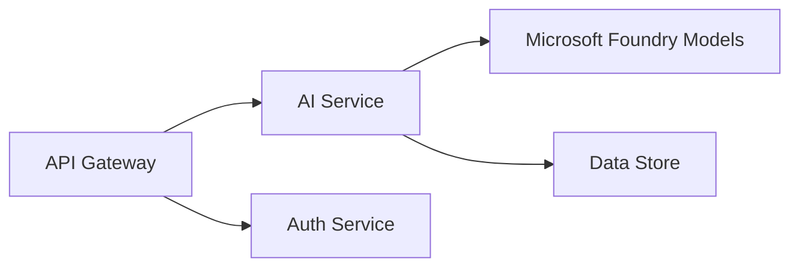
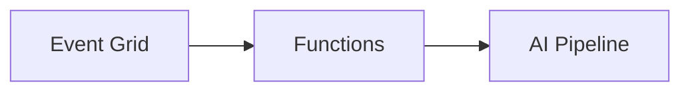

# 第8章：生產與企業模式

**📚 課程**：[AZD 入門](../../README.md) | **⏱️ 時長**：2-3 小時 | **⭐ 複雜度**：進階

---

## 概覽

本章涵蓋企業級部署模式、安全加固、監控以及生產 AI 工作負載的成本優化。

這是一個架構參考，而非完整可部署的生產範本。範例省略了必須由您的應用程式補充及測試的整合細節；閱讀清單並不代表已通過生產準備認證。

> **版本檢視 (2026-11-04)：** AI CLI 指南已與 `azd 1.37.2`、代理程式 `1.0.0-beta.23` 及評估 `1.0.0-beta.2` 文件/原始碼對照檢查。詳見[版本變更及修正](production-ai-practices.md#recent-release-changes-and-fixes) 以了解相容性要求及遷移細節；這並非線上部署驗證。

## 學習目標

完成本章後，您將能：
- 部署多區域具韌性的應用程式
- 實作企業級安全模式
- 配置全面監控
- 以規模優化成本
- 使用 AZD 設置 CI/CD 管線

---

## 📚 課程

| # | 課程 | 說明 | 時間 |
|---|--------|-------------|------|
| 1 | [生產環境 AI 實務](production-ai-practices.md) | 企業部署模式 | 90 分鐘 |

---

## 🚀 生產檢查清單

- [ ] 多區域部署以提高韌性
- [ ] 使用託管身份驗證（無金鑰）
- [ ] 使用 Application Insights 進行監控
- [ ] 配置成本預算和警報
- [ ] 啟用安全掃描
- [ ] 整合 CI/CD 管線
- [ ] 災難復原計畫

---

## 🏗️ 架構模式

### 模式 1：微服務 AI



### 模式 2：事件驅動 AI



---

## 🔐 安全最佳實務

```bicep
// Illustrative properties from different resources, NOT a standalone Bicep file.
// Attach identity to the application host:
identity: {
  type: 'SystemAssigned'
}

// AI account properties (also require private endpoints, DNS and app connectivity):
properties: {
  publicNetworkAccess: 'Disabled'
  networkAcls: {
    defaultAction: 'Deny'
  }
}
```

---

## 💰 成本優化

| 策略 | 主要限制 |
|----------|---------|
| 零規模延展 (Container Apps) | 需要適當的觸發器；其他服務仍會產生費用 |
| 使用消費層級於開發 | 比較選定服務價格及工作負載 |
| 預定擴展 | 通過受支援的基礎設施/自動化擴展 |
| 預留/預配容量 | 只在支援時使用；承諾可能會增加閒置成本 |

使用帶有效開始日期、計費範圍、接收者與權限的[完整預算資源模式](production-ai-practices.md#2-cost-monitoring-and-budgets)。預算會發送警報；不會限制支出。節省取決於測量的利用率，並非保證百分比。

---

## 📊 監控設定

```bash
# Open the Application Insights logs view (requires configured monitoring)
azd monitor --logs

# Check Application Insights
azd monitor --overview

# View metrics
az monitor metrics list --resource <resource-id>
```

---

## 🔗 導航

| 方向 | 章節 |
|-----------|---------|
| <strong>上一章</strong> | [第7章：故障排除](../chapter-07-troubleshooting/README.md) |
| <strong>課程完成</strong> | [課程首頁](../../README.md) |

---

## 📖 相關資源

- [AI 代理指南](../chapter-02-ai-development/agents.md)
- [應用程式洞察](../chapter-06-pre-deployment/application-insights.md)
- [多代理解決方案](../chapter-05-multi-agent/README.md)
- [微服務範例](../../examples/microservices/README.md)

---

<!-- CO-OP TRANSLATOR DISCLAIMER START -->
**免責聲明**：
本文件使用 AI 翻譯服務 [Co-op Translator](https://github.com/Azure/co-op-translator) 進行翻譯。雖然我們力求準確，但請注意，自動翻譯可能包含錯誤或不準確之處。原始文件的母語版本應被視為權威來源。對於重要資訊，建議尋求專業人工翻譯。我們不對因使用本翻譯而引起的任何誤解或曲解承擔責任。
<!-- CO-OP TRANSLATOR DISCLAIMER END -->