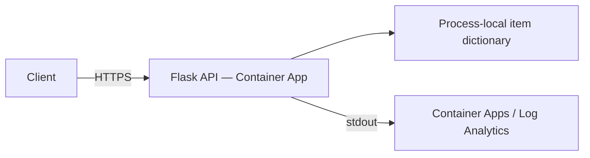

# 簡易 Flask API — Azure Container Apps

**程度：** 初學者 · **時間：** 包含設定約 30–45 分鐘

使用 Azure Developer CLI (azd) 部署 Python Flask CRUD API。包含原始碼、Dockerfile、
Bicep，及部署參數。這是個 <strong>學習範例</strong>，非生產環境使用的 API。


## 你將學習到什麼

- 透過 azd 建置並發佈容器。
- 配置輸入流量及存活/就緒探針。
- 驗證 CRUD 回應並檢查應用程式日誌。
- 理解為何記憶體資料不適用於持久化應用。



**重要：** 項目儲存在一個進程中。預設為 **一個 Gunicorn 工作程序，  
0–1 個副本**，有意避免跨工作程序/副本產生不一致的資料。  
在重新啟動、更改版本或縮減為零時，項目會遺失。增加副本數  
需要共用持久性存儲。API 沒有身份驗證或授權。  

## 前置條件  

- [目前穩定版 azd](https://learn.microsoft.com/azure/developer/azure-developer-cli/install-azd)
  （評論時間發佈版本：1.37.2）。
- 用於驗證的 [Azure CLI](https://learn.microsoft.com/cli/azure/install-azure-cli)。
- Docker 及其守護進程正在運行；默認本地映像構建需要它。
- Azure 訂閱、資源創建權限和容器應用區域配額。
- 用於以下命令的 Bash（或等效的 PowerShell）。
- 用於可選本地開發的 Python 3.11。

```bash
azd version
az version
docker info
azd auth login
az login
```

CLI 工具有獨立的登錄會話。請在兩者中使用相同的訂閱。

## 快速開始

從倉庫根目錄開始：

```bash
cd examples/container-app/simple-flask-api
azd env new flask-demo
azd up
API_URL=$(azd env get-value API_ENDPOINT)
RG_NAME=$(azd env get-value AZURE_RESOURCE_GROUP)
API_NAME=$(azd env get-value API_NAME)
curl --fail-with-body "${API_URL}/health"
```

預期：HTTP 200 和包含 `"status":"healthy"`、
`"service":"simple-flask-api"` 以及當前 UTC 時間戳的 JSON。
佈建和映像構建通常需要幾分鐘；時間會有所不同。

初始佈建使用一個公用 hello-world 映像，監聽 80 端口。
`azure.yaml` 選擇 `infra/app/api.bicep` 和其匹配的參數文件來
部署服務，這會將映像、入口和探針切換到 8000 端口。
請勿刪除這些部署參數。

## 驗證 CRUD

依次運行以下命令，只要同一副本保持活動：

```bash
# Create: HTTP 201; note the returned id (1 for a fresh process).
curl -i -X POST "${API_URL}/api/items" \
  -H "Content-Type: application/json" \
  -d '{"name":"Test Item","description":"My first item"}'

# Read list: HTTP 200, total 1 in a fresh process.
curl --fail-with-body "${API_URL}/api/items"

# Replace 1 if your create response returned another id.
curl --fail-with-body "${API_URL}/api/items/1"
curl -i -X PUT "${API_URL}/api/items/1" \
  -H "Content-Type: application/json" -d '{"name":"Updated Item"}'
curl -i -X DELETE "${API_URL}/api/items/1"
curl -i "${API_URL}/api/items/1"
```

成功：POST 201，讀取/PUT 200，DELETE 204 無正文，然後缺失項 404。
格式錯誤/非對象的 JSON 或空名稱返回 400。
如果項目在請求間消失，請檢查是否重啟或縮放至零；
這是有意的內存限制，而非持久化。

| 端點 | 方法 |
|---|---|
| `/` | GET — 服務資訊 |
| `/health` | GET — 活躍/就緒檢查 |
| `/api/items` | GET、POST |
| `/api/items/{id}` | GET、PUT、DELETE |

## 日誌和配置

```bash
az containerapp logs show --name "$API_NAME" --resource-group "$RG_NAME" --follow
```

預期：Gunicorn 啟動、請求訪問日誌和應用訊息。
`azd monitor --logs` 會打開一個門戶視圖；它不會串流到終端。
Application Insights 已佈建但<strong>此 Flask 代碼未埋點</strong>；
使用 Container Apps/Log Analytics 取得標準輸出日誌。

編輯 `infra/app/api.bicep` 來修改 CPU/內存、副本限制或擴縮規則，然後
運行 `azd up`。默認值是 0.5 vCPU，1 GiB，最小 0 / 最大 1 副本，以及
HTTP 閾值為 50 個同時請求。縮放至零可能會增加冷啟動延遲。

任意 `azd env set MAX_REPLICAS`、`API_KEY`、`LOG_LEVEL` 或
`SCALE_TO_ZERO_TIMEOUT` 值 <strong>未連接到此模板或應用</strong>。
設定值不會自動使其成為執行時環境變量。
映像明確綁定 8000 端口；如果更改端口，請一起更新 Dockerfile、Bicep 入口和探針。


```text
azure.yaml
infra/main.bicep
infra/main.parameters.json
infra/app/container-apps.bicep       # Environment, registry, monitoring
infra/app/api.bicep                  # App, ingress, probes, scale settings
infra/app/api.parameters.json        # Image and resource values for azd deploy
src/app.py
src/Dockerfile
src/requirements.txt
```

## 本地開發

從這個範例目錄開始：

```bash
python -m venv .venv
source .venv/bin/activate  # PowerShell: .\.venv\Scripts\Activate.ps1
python -m pip install -r src/requirements.txt
python src/app.py
```

在另一個終端機中，測試 `http://localhost:8000/health` 和 CRUD 端點。
或者建構並運行實際映像：

```bash
docker build -t flask-api:local ./src
docker run --rm -p 8000:8000 flask-api:local
```

對於首次部署後的純程式碼更改，執行 `azd deploy api`。
對於 Bicep 更改，執行 `azd up` 以重新配置和部署。

## 實作練習

### 1. 驗證輸入拒絕

**起點：** 已部署的 API，如上方 `API_URL`。
**目標：** 驗證 API 拒絕無效的 JSON 結構和缺少名稱的情況。

```bash
curl -i -X POST "${API_URL}/api/items" \
  -H "Content-Type: application/json" -d '[]'
curl -i -X POST "${API_URL}/api/items" \
  -H "Content-Type: application/json" -d '{"name":""}'
```

**成功標準 / 解決方案：** 兩者都返回 400 及 JSON 錯誤，不是 500。
**常見問題：** 忘記帶上 JSON content-type 標頭。

### 2. 新增唯讀版本端點

**起點：** `src/app.py`。**目標：** 擴充並重新部署 API。
在 `if __name__ == '__main__':` 區塊之前加上這段：

```python
@app.route('/version', methods=['GET'])
def version():
    return jsonify({'version': '1.0.0'})
```

執行 `azd deploy api`，然後 `curl --fail-with-body "${API_URL}/version"`。
**成功標準：** HTTP 200 與 `{"version":"1.0.0"}`。
**常見問題：** 在阻塞的 `app.run()` 呼叫之後放置路由時
使用 `python src/app.py` 進行測試。

### 知識檢查點

為甚麼一個工作程序的持久資料不足夠？因為即使是一個程序重新啟動時都會丟失
它的字典。生產版本需要持久共享存儲、
認證、授權、遷移、測試和運營監控。

## 成本與疑難排解

這並非保證 $0 部署：Basic 登記處和日誌存儲/擷取
即使應用計算為零也可能產生費用。使用
[定價計算器](https://azure.microsoft.com/pricing/calculator/) 查詢您所在地區的費率。

- **Docker 建構失敗：** 確認 `docker info`、網絡存取權限和相依性。
- **應用狀態不健康：** 檢查控制台/系統日誌，並核實映像的埠、入口，
  及探測相符。Flask 埠上不得對佔位符進行探測。
- **403/權限問題：** 確認訂閱和資源建立權限。
- **項目消失：** 重啟/縮放至零時，記憶體狀態會重置；添加資料庫
  以確保持久行為。

## 清理與下一步

```bash
azd down
```

請檢閱刪除提示，並確認專用資源群組已移除。
請勿對含有無關資料的資源群組進行破壞性清理。

[下一節：資料庫應用](../../../../../examples/database-app) · [微服務](../../../../../examples/container-app/microservices) ·
[容器概覽](../README.md) · [課程首頁](../../../README.md) ·
[回報問題](https://github.com/microsoft/AZD-for-beginners/issues)

---

<!-- CO-OP TRANSLATOR DISCLAIMER START -->
**免責聲明**：
本文件使用 AI 翻譯服務 [Co-op Translator](https://github.com/Azure/co-op-translator) 進行翻譯。雖然我們力求準確，但請注意，自動翻譯可能包含錯誤或不準確之處。原始文件的母語版本應被視為權威來源。對於重要資訊，建議尋求專業人工翻譯。我們不對因使用本翻譯而引起的任何誤解或曲解承擔責任。
<!-- CO-OP TRANSLATOR DISCLAIMER END -->