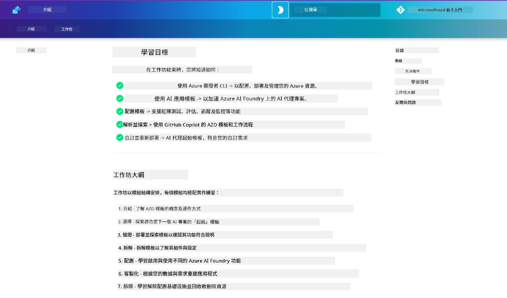

<div align="center">
  <div style="background: linear-gradient(135deg, #0078d4, #106ebe); border-radius: 10px; padding: 20px; margin: 20px 0; box-shadow: 0 4px 15px rgba(0, 120, 212, 0.3); border: 2px solid #005a9e;">
    <h2 style="color: white; margin: 0; font-size: 24px; text-shadow: 1px 1px 2px rgba(0,0,0,0.3);">
      🎯 AI 開發者專用 AZD 工作坊
    </h2>
    <p style="color: white; margin: 10px 0 0 0; font-size: 16px; text-shadow: 1px 1px 2px rgba(0,0,0,0.3);">
      <strong>使用 Azure Developer CLI 親手打造 AI 應用的實作工作坊。</strong><br>
      完成7個模組，掌握 AZD 模板及 AI 部署工作流程。
    </p>
    <div style="margin-top: 15px;">
      <span style="background: rgba(255,255,255,0.2); padding: 5px 10px; border-radius: 15px; color: white; font-size: 14px;">
        📅 來源指引審核日期：2026年11月
      </span>
    </div>
  </div>
</div>

# AI 開發者專用 AZD 工作坊

歡迎參加專注於 AI 應用部署的 Azure Developer CLI (AZD) 實作工作坊。此工作坊將引導您透過 3 步驟，實務掌握 AZD 模板：

1. <strong>探索</strong> - 找到適合您的模板。
1. <strong>部署</strong> - 部署並驗證功能。
1. <strong>客制化</strong> - 修改並持續優化成為您的專屬解決方案！

在整個工作坊過程中，您也會接觸到核心開發工具和工作流程，協助您精簡端到端的開發旅程。

<br/>

## 瀏覽器導覽指南

工作坊課程以 Markdown 呈現，您可以直接在 GitHub 上瀏覽，或如截圖所示啟動瀏覽器預覽。



若要使用此功能，請將倉庫複製至您的個人帳號，並啟動 GitHub Codespaces。啟用 VS Code 終端機後，輸入以下指令：

此瀏覽器預覽功能適用於 GitHub Codespaces、開發容器，或安裝 Python 和 MkDocs 的本地複製倉庫。

```bash title="" linenums="0"
python -m pip install -r requirements-dev.txt
python -m mkdocs serve --config-file workshop/mkdocs.yml
```

請在<strong>課程倉庫根目錄</strong>執行這些指令，而非單獨初始化的 AI 範例。保持預覽視窗於前景以便察看錯誤，停止請按 Ctrl+C。若只想檢視網站內容，請執行 `python -m mkdocs build --strict --config-file workshop/mkdocs.yml`。

數秒後，您會看到快顯對話視窗。選擇 `Open in browser` 選項，網頁導覽即會在新的瀏覽器標籤中開啟。此預覽具備以下優勢：

1. <strong>內建搜尋</strong> - 快速尋找關鍵字或課程內容。
1. <strong>複製圖示</strong> - 滑鼠移至程式碼段顯示此選項。
1. <strong>主題切換</strong> - 可在深色與淺色主題間切換。
1. <strong>求助連結</strong> - 點擊頁尾的 Discord 圖示加入社群！

<br/>

## 工作坊總覽

**時長：** 3-4 小時  
**程度：** 初學者至中階  
**先備知識：** 熟悉 Azure、AI 概念、VS Code 及指令列工具。

這是一個實作型工作坊，透過實際操作學習。完成練習後，我們建議您檢視「AZD 初學者」課程，繼續深入學習安全性與生產力最佳實務。

| 時間| 模組  | 目標 |
|:---|:---|:---|
| 15 分鐘 | [介紹](docs/instructions/0-Introduction.md) | 了解工作坊目標與背景 |
| 30 分鐘 | [選擇 AI 模板](docs/instructions/1-Select-AI-Template.md) | 探索選項並挑選入門 |
| 30 分鐘 | [驗證 AI 模板](docs/instructions/2-Validate-AI-Template.md) | 部署預設方案到 Azure |
| 30 分鐘 | [解析 AI 模板](docs/instructions/3-Deconstruct-AI-Template.md) | 探索結構及設定 |
| 30 分鐘 | [配置 AI 模板](docs/instructions/4-Configure-AI-Template.md) | 啟用並試用功能 |
| 30 分鐘 | [客製化 AI 模板](docs/instructions/5-Customize-AI-Template.md) | 調整模板符合需求 |
| 30 分鐘 | [拆卸基礎架構](docs/instructions/6-Teardown-Infrastructure.md) | 清理並釋放資源 |
| 15 分鐘 | [總結與後續步驟](docs/instructions/7-Wrap-up.md) | 提供學習資源與挑戰 |

<br/>

## 您將學習到

將 AZD 模板視為學習沙盒，探索 Microsoft Foundry 端到端開發的各項功能與工具。完成本工作坊後，您將對相關工具與概念有直覺式的理解。

| 概念  | 目標 |
|:---|:---|
| **Azure Developer CLI** | 理解工具指令與工作流程|
| **AZD 模板**| 掌握專案結構與設定|
| **Azure AI Agent**| 部署 Microsoft Foundry 專案  |
| **Azure AI Search**| 透過代理使能上下文工程 |
| <strong>可觀察性</strong>| 探索追蹤、監控與評估 |
| <strong>紅隊測試</strong>| 探索對抗性測試與緩解措施 |

<br/>

## 工作坊架構

工作坊結構帶您由模板探索開始，經部署、解析，再到客製化，採用官方的 [Getting Started with AI Agents](https://github.com/Azure-Samples/get-started-with-ai-agents) 入門模板作為基礎。

### [模組 1：選擇 AI 模板](docs/instructions/1-Select-AI-Template.md) (30 分鐘)

- 什麼是 AI 模板？
- 可以在哪裡找到 AI 模板？
- 如何開始打造 AI 代理？
- <strong>實作練習</strong>：在 Codespaces 或開發容器快速上手

### [模組 2：驗證 AI 模板](docs/instructions/2-Validate-AI-Template.md) (30 分鐘)

- AI 模板架構為何？
- 什麼是 AZD 開發工作流程？
- 如何取得 AZD 開發協助？
- <strong>實作練習</strong>：部署並驗證 AI 代理模板

### [模組 3：解析 AI 模板](docs/instructions/3-Deconstruct-AI-Template.md) (30 分鐘)

- 探索您的環境於 `.azure/` 
- 探索您的資源設定於 `infra/` 
- 探索您的 AZD 設定於 `azure.yaml`s
- <strong>實作練習</strong>：修改環境變數並重新部署

### [模組 4：配置 AI 模板](docs/instructions/4-Configure-AI-Template.md) (30 分鐘)
- 探索：Retrieval Augmented Generation
- 探索：代理評估與紅隊測試
- 探索：追蹤與監控
- <strong>實作練習</strong>：探索 AI 代理及可觀察性

### [模組 5：客製化 AI 模板](docs/instructions/5-Customize-AI-Template.md) (30 分鐘)
- 定義：帶有場景需求的 PRD
- 配置：AZD 的環境變數
- 實作：新增任務的生命週期掛勾
- <strong>實作練習</strong>：依場景客製化模板

### [模組 6：拆卸基礎架構](docs/instructions/6-Teardown-Infrastructure.md) (30 分鐘)
- 複習：什麼是 AZD 模板？
- 複習：使用 Azure Developer CLI 的理由？
- 後續步驟：嘗試不同模板！
- <strong>實作練習</strong>：解除基礎架構佈署與清理

<br/>

## 工作坊挑戰

想挑戰更多嗎？以下是一些專案建議，或歡迎分享您的想法給我們！

| 專案 | 說明 |
|:---|:---|
|1. **解析一個複雜的 AI 模板** | 利用我們所述的工作流程和工具，嘗試部署、驗證並客製化不同的 AI 解決方案模板。_您學到了什麼？_|
|2. <strong>依場景客製化</strong>  | 嘗試為另一個場景撰寫 PRD（產品需求文件）。接著在您的模板倉庫中的 Agent Model 使用 GitHub Copilot，請它生成一套客製化工作流程。_您學到了什麼？如何改進這些建議？_|
| | |

## 有任何意見回饋？

1. 在本倉庫發表議題，便於標記請用 `Workshop`。
1. 加入 Microsoft Foundry Discord 與其他夥伴交流！


| | | 
|:---|:---|
| **📚 課程首頁**| [AZD 初學者](../README.md)|
| **📖 文件** | [AI 模板入門](https://learn.microsoft.com/en-us/azure/ai-foundry/how-to/develop/ai-template-get-started)|
| **🛠️ AI 模板** | [Microsoft Foundry 模板](https://ai.azure.com/templates) |
|**🚀 後續步驟** | [開始工作坊](#workshop-overview) |
| | |

<br/>

---

**導覽：** [主課程](../README.md) | [介紹](docs/instructions/0-Introduction.md) | [模組1：選擇模板](docs/instructions/1-Select-AI-Template.md)

**準備好用 AZD 建立 AI 應用程式了嗎？**

[開始工作坊：介紹 →](docs/instructions/0-Introduction.md)

---

<!-- CO-OP TRANSLATOR DISCLAIMER START -->
**免責聲明**：
本文件使用 AI 翻譯服務 [Co-op Translator](https://github.com/Azure/co-op-translator) 進行翻譯。雖然我們力求準確，但請注意，自動翻譯可能包含錯誤或不準確之處。原始文件的母語版本應被視為權威來源。對於重要資訊，建議尋求專業人工翻譯。我們不對因使用本翻譯而引起的任何誤解或曲解承擔責任。
<!-- CO-OP TRANSLATOR DISCLAIMER END -->