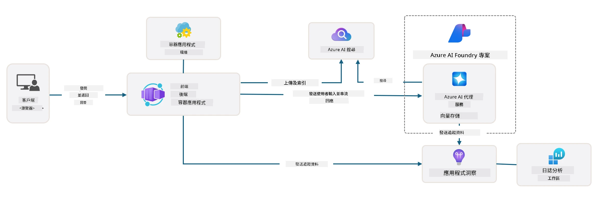

# 3. 解析範本

!!! tip "在本模組結束時，您將能夠"

    - [ ] Use GitHub Copilot and optional MCP tools for Azure documentation and read-only exploration
    - [ ] Identify the template's application, infrastructure, configuration, and test entry points
    - [ ] Verify generated explanations against actual repository files
    - [ ] **Lab 3:** Trace one request and one configuration input through the project

---

## 1. 啟用 GitHub Copilot

在 VS Code 中打開已初始化的 AI 範例並啟用 [GitHub Copilot](https://code.visualstudio.com/docs/copilot/chat/chat-agent-mode)。使用擁有合資格方案的帳戶登入；使用限制會有所不同。授權更改前，請要求 Copilot解釋該程式庫。

### 可選的 MCP 伺服器

這些服務可以提供額外工具：

- [Azure MCP 伺服器](https://learn.microsoft.com/azure/developer/azure-mcp-server/overview)
- [Microsoft Learn MCP 伺服器](https://learn.microsoft.com/training/support/mcp)

在 VS Code 中，檢閱 [MCP 配置指引](https://code.visualstudio.com/docs/copilot/chat/mcp-servers) 並如有需要，建立 `.vscode/mcp.json`：

```json
{
  "servers": {
    "Azure MCP Server": {
      "type": "stdio",
      "command": "npx",
      "args": ["-y", "@azure/mcp@latest", "server", "start"]
    },
    "microsoft.docs.mcp": {
      "type": "http",
      "url": "https://learn.microsoft.com/api/mcp"
    }
  }
}
```

`npx` 命令需要支援的 Node.js/npm 安裝，並會下載可執行代碼。檢視此套件並鎖定核准版本，以實現可再現的團隊設置。使用 VS Code 的 MCP 控制啟動伺服器，並檢查其可用工具；工具名稱可能會因版本而變。

**身份驗證是分開的。** 對於 AZD，使用 `azd auth login`。對於 Azure MCP 的工具，請遵循其記錄的身份驗證流程；僅 AZD 登入不會建立 MCP 會話。當練習或掛鉤調用 Azure CLI 時，請另行使用 `az login`。

試用只讀提示：

1. “使用 Microsoft Learn MCP 尋找 Azure 開發者 CLI 配置文件。”
2. “解釋本程式庫的 `azure.yaml`；引用實作每個掛鉤的檔案。”
3. “利用可用的 Azure MCP 工具，列出我部署的資源而不進行任何修改。”

檢查所選租戶/訂閱和每個建議的工具調用。不要僅為了探究架構而同意建立、刪除資源或存取變更。

## 2. 了解架構

該範例在 Azure Container Apps 中承載 Python FastAPI 後端和 React/TypeScript 前端。後端與 Microsoft Foundry 項目中的代理通訊。檢索和可觀察性依賴啟用的範本功能和成功的設置；僅因部署了應用程式不保證二者皆可用。



將此圖與[當前上游部署指南](https://github.com/Azure-Samples/get-started-with-ai-agents/blob/main/docs/deployment.md)及您實際的資源作比較。檢查設定的模型部署、代理工具、託管身份、角色指派，以及可選的 AI 搜尋/應用程式見解資源。

**練習：** 請求 Copilot 追蹤從前端經 API 到 Foundry 的聊天請求，附帶檔案和函式參考。開啟這些參考並驗證說明。不要僅從示意圖推測已實作的身份驗證、路由或授權。

## 3. 儲存庫結構

下列選定路徑已於 2026 年 11 月 4 日與範例比對過。您初始化的版本仍為真實依據：

```text
get-started-with-ai-agents/
  azure.yaml
  docker-compose.yaml
  requirements-dev.txt
  .devcontainer/
  infra/
    main.bicep
    main.parameters.json
    api.bicep
    core/
  src/
    Dockerfile
    pyproject.toml
    requirements.txt
    api/
      main.py
      routes.py
      search_index_manager.py
    frontend/
      package.json
      src/
    files/
  scripts/
    validate_env_vars.sh
    validate_env_vars.ps1
    postdeploy.sh
    postdeploy.ps1
  tests/
    test_evaluation.py
    test_red_teaming.py
  docs/
    deployment.md
    deploy_customization.md
    ai_search.md
    observability.md
    local_development.md
    troubleshooting.md
```

### 基礎設施與配置

`infra/main.bicep` 編排資源；`main.parameters.json` 連接範本輸入與 AZD 環境值。`azure.yaml` 選擇應用服務和生命週期掛鉤。追蹤 `USE_AZURE_AI_SEARCH_SERVICE` 等輸入，找出實際變動的檔案。

### 應用與身份

連讀 `src/api/` 和 `src/frontend/`。識別代理的創建或取得位置、指令／工具的配置處、以及每次 Azure 呼叫所用的身份。`src/files/` 下的示例檔案是示範資料，非生產用目錄或授權模型。

### 測試與可觀察性

目前的評估和紅隊入口位於 `tests/`；舊的 `evals/` 和 `airedteaming/` 目錄參考對本範例已過期。執行雲端測試前，請閱讀 `docs/observability.md` 以了解先決條件和成本。這些 Python 測試與可選的 `azure.ai.evaluations` AZD 擴充獨立。

## 4. 驗證您的發現

- 識別一個範例問題的 API 路由、代理互動和檢索代碼。
- 解釋哪個身份存取 Foundry，以及哪個配置選擇其端點。
- 找出實際的預先啟動和部署後腳本及其錯誤處理行為。
- 列出您部署中缺少的任何依賴或可選功能。

繼續至 [配置範本](4-Configure-AI-Template.md)。

---

<!-- CO-OP TRANSLATOR DISCLAIMER START -->
**免責聲明**：
本文件使用 AI 翻譯服務 [Co-op Translator](https://github.com/Azure/co-op-translator) 進行翻譯。雖然我們力求準確，但請注意，自動翻譯可能包含錯誤或不準確之處。原始文件的母語版本應被視為權威來源。對於重要資訊，建議尋求專業人工翻譯。我們不對因使用本翻譯而引起的任何誤解或曲解承擔責任。
<!-- CO-OP TRANSLATOR DISCLAIMER END -->