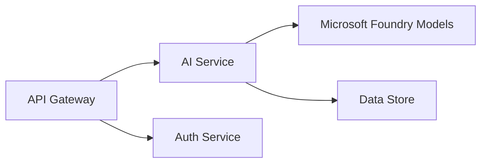
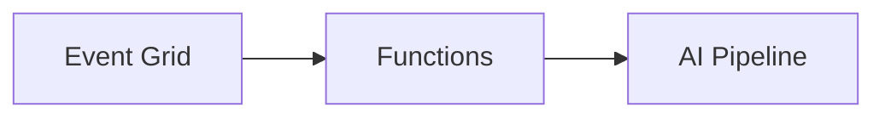

# 第八章：生產與企業模式

**📚 課程**: [AZD 入門](../../README.md) | **⏱️ 時間長度**: 2-3 小時 | **⭐ 複雜度**: 進階

---

## 概觀

本章介紹企業級部署模式、安全加固、監控以及生產環境 AI 工作負載的成本優化。

本章為架構參考範例，非完整可部署的生產範本。範例省略了必須在您應用中實作和測試的整合細節；閱讀檢查清單不代表已達生產準備狀態。

> **發行評審 (2026-11-04)：** AI CLI 指導已依據 `azd 1.37.2`、agents `1.0.0-beta.23` 以及 evaluations `1.0.0-beta.2` 文件/原始碼進行檢查。詳見 [發行變更與修正](production-ai-practices.md#recent-release-changes-and-fixes) 瞭解相容需求與遷移細節；此非即時部署驗證。

## 學習目標

完成本章後，您將能夠：
- 部署多區域高可用應用
- 實作企業安全模式
- 配置完整的監控系統
- 大規模優化成本
- 利用 AZD 設定 CI/CD 管線

---

## 📚 課程列表

| # | 課程 | 說明 | 時間 |
|---|--------|-------------|------|
| 1 | [生產 AI 實務](production-ai-practices.md) | 企業部署模式 | 90 分鐘 |

---

## 🚀 生產檢查清單

- [ ] 多區域部署以增強韌性
- [ ] 使用受控身份驗證（無需金鑰）
- [ ] 使用 Application Insights 監控
- [ ] 設定成本預算與警示
- [ ] 啟用安全掃描
- [ ] 整合 CI/CD 管線
- [ ] 制定災難復原計畫

---

## 🏗️ 架構模式

### 模式一：微服務 AI



### 模式二：事件驅動 AI



---

## 🔐 安全最佳實踐

```bicep
// Illustrative properties from different resources, NOT a standalone Bicep file.
// Attach identity to the application host:
identity: {
  type: 'SystemAssigned'
}

// AI account properties (also require private endpoints, DNS and app connectivity):
properties: {
  publicNetworkAccess: 'Disabled'
  networkAcls: {
    defaultAction: 'Deny'
  }
}
```

---

## 💰 成本優化

| 策略 | 主要限制 |
|----------|---------|
| 擴展至零（Container Apps） | 需適合的觸發條件；其他服務仍會產生成本 |
| 開發使用消費層級 | 比較所選服務價格與工作負載 |
| 排程擴展 | 透過支援的基礎設施/自動化調度擴展 |
| 預留/已配置容量 | 僅在支援時使用；承諾可增加閒置成本 |

使用 [完整預算資源模式](production-ai-practices.md#2-cost-monitoring-and-budgets) 且設置有效開始日期、計費範圍、接收者和權限。預算會發送警示，但不會限制支出。節省取決於實際利用率，且不保證百分比。

---

## 📊 監控設置

```bash
# Open the Application Insights logs view (requires configured monitoring)
azd monitor --logs

# Check Application Insights
azd monitor --overview

# View metrics
az monitor metrics list --resource <resource-id>
```

---

## 🔗 導航

| 方向 | 章節 |
|-----------|---------|
| <strong>上一章</strong> | [第七章：故障排除](../chapter-07-troubleshooting/README.md) |
| <strong>完成課程</strong> | [課程首頁](../../README.md) |

---

## 📖 相關資源

- [AI Agents 指南](../chapter-02-ai-development/agents.md)
- [Application Insights](../chapter-06-pre-deployment/application-insights.md)
- [多代理方案](../chapter-05-multi-agent/README.md)
- [微服務範例](../../examples/microservices/README.md)

---

<!-- CO-OP TRANSLATOR DISCLAIMER START -->
**免責聲明**：
此文件已使用 AI 翻譯服務 [Co-op Translator](https://github.com/Azure/co-op-translator) 進行翻譯。雖然我們努力追求準確性，但請注意自動翻譯可能包含錯誤或不準確之處。原始文件的母語版本應視為權威來源。對於關鍵資訊，建議採用專業人工翻譯。我們不對因使用此翻譯所產生的任何誤解或誤譯承擔責任。
<!-- CO-OP TRANSLATOR DISCLAIMER END -->