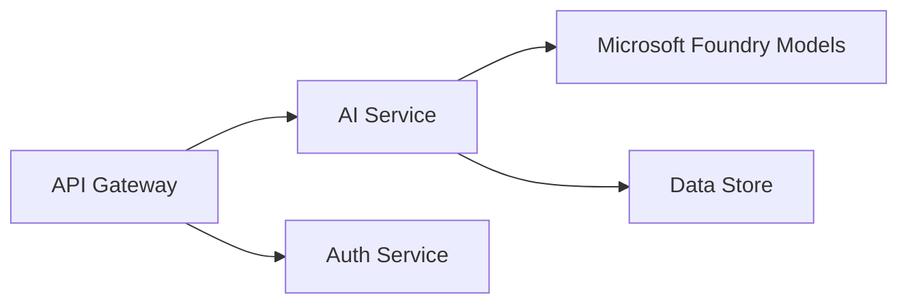
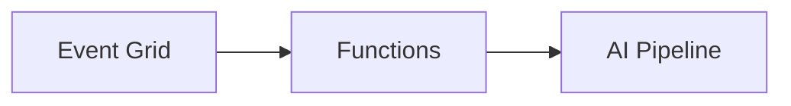

# 第8章：生產與企業模式

**📚 課程**：[AZD 新手指南](../../README.md) | **⏱️ 時長**：2-3 小時 | **⭐ 難度**：進階

---

## 概覽

本章涵蓋企業級部署模式、安全強化、監控與生產AI工作負載的成本優化。

這是架構參考，而非完整可部署的生產樣板。範例省略了必須在您自己的應用中提供與測試的整合細節；閱讀檢查清單並不代表生產準備完成。

> **Foundry GA 更新 (2026-11-09)：** 使用 `azd >= 1.37.0` 與通用可用的 `microsoft.foundry` 1.0 套件來進行 Foundry 工作流程；評估版本分開安裝。詳見 [發行範圍及遷移](production-ai-practices.md#recent-release-changes-and-fixes) 以及 [驗證管線範例](production-ai-practices.md#cicd-pipeline-configuration)。這是文件檢視，非現場部署驗證或預設全部預覽功能為 GA 狀態。

## 學習目標

完成本章後，您將能：
- 部署多區域具彈性的應用
- 實作企業安全模式
- 配置全面的監控
- 實現大規模成本優化
- 使用 AZD 設定 CI/CD 流水線

---

## 📚 課程單元

| # | 單元 | 說明 | 時間 |
|---|--------|-------------|------|
| 1 | [生產AI實務](production-ai-practices.md) | 企業部署模式 | 90 分鐘 |

---

## 🚀 生產檢查清單

- [ ] 多區域部署以提高韌性
- [ ] 使用管理身分認證（無金鑰）
- [ ] 使用 Application Insights 監控
- [ ] 配置成本預算與警示
- [ ] 啟用安全掃描
- [ ] 整合 CI/CD 流水線
- [ ] 制定災難復原計劃

---

## 🏗️ 架構模式

### 模式1：微服務AI



### 模式2：事件驅動AI



---

## 🔐 安全最佳實踐

```bicep
// Illustrative properties from different resources, NOT a standalone Bicep file.
// Attach identity to the application host:
identity: {
  type: 'SystemAssigned'
}

// AI account properties (also require private endpoints, DNS and app connectivity):
properties: {
  publicNetworkAccess: 'Disabled'
  networkAcls: {
    defaultAction: 'Deny'
  }
}
```

---

## 💰 成本優化

| 策略 | 主要限制 |
|----------|---------|
| 零規模自動擴縮（Container Apps） | 需要適當觸發機制；其他服務仍會產生費用 |
| 開發使用消耗方案 | 比較所選服務價格與工作負載 |
| 預排擴縮 | 透過支援的基礎架構/自動化進行擴縮 |
| 預訂/預置容量 | 僅限支援時使用；承諾可能增加閒置成本 |

使用 [完整預算資源模式](production-ai-practices.md#2-cost-monitoring-and-budgets) 並設定有效開始日期、計費範圍、收件人與權限。預算會發送警示；無法限制支出。節省取決於實際使用量，無保證百分比。

---

## 📊 監控設定

```bash
# Open the Application Insights logs view (requires configured monitoring)
azd monitor --logs

# Check Application Insights
azd monitor --overview

# View metrics
az monitor metrics list --resource <resource-id>
```

---

## 🔗 導覽

| 方向 | 章節 |
|-----------|---------|
| <strong>上一章</strong> | [第7章：疑難排解](../chapter-07-troubleshooting/README.md) |
| <strong>完成課程</strong> | [課程首頁](../../README.md) |

---

## 📖 相關資源

- [AI Agents 指南](../chapter-02-ai-development/agents.md)
- [Application Insights](../chapter-06-pre-deployment/application-insights.md)
- [多代理方案](../chapter-05-multi-agent/README.md)
- [微服務範例](../../examples/microservices/README.md)

---

<!-- CO-OP TRANSLATOR DISCLAIMER START -->
**免責聲明**：
此文件已使用 AI 翻譯服務 [Co-op Translator](https://github.com/Azure/co-op-translator) 進行翻譯。雖然我們努力追求準確性，但請注意自動翻譯可能包含錯誤或不準確之處。原始文件的母語版本應視為權威來源。對於關鍵資訊，建議採用專業人工翻譯。我們不對因使用此翻譯所產生的任何誤解或誤譯承擔責任。
<!-- CO-OP TRANSLATOR DISCLAIMER END -->