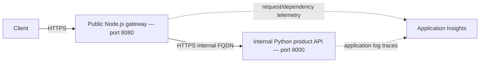

# 兩服務微服務 — Azure 容器應用程式

**等級：** 中階 · **時間：** 包括設定在內約 45–60 分鐘

此學習範例實作了一個 **Node.js API 閘道** 和一個 **只讀 Python 產品服務**。包含原始碼、Dockerfiles、Bicep 及 azd 配置。

這不是一個適合生產環境的系統。

## 您將學到的內容

- 獨立部署兩個服務。
- 使用內部後端 FQDN 的 HTTPS。
- 驗證成功、找不到及服務不可用的回應。
- 了解遙測與獨立擴展界限。



產品目錄包含記憶體中的五個固定產品。沒有 **POST、  
PUT 或 DELETE 處理程序**、資料庫、服務匯流排、訂單/用戶/通知服務、  
C# 或 Go 程式碼。這些是未來的開發構想，並非包含的功能。  
網關不會驗證用戶身份；內部入口並不能替代  
應用程式授權。  

## 先決條件  

請先完成 [single Flask API](../../../../../examples/container-app/simple-flask-api)。
安裝目前穩定版本的 azd（審查時已發佈版本：1.37.2）、Azure CLI，
及執行中之 Docker 守護程序。您需要有 Azure 訂閱、資源
建立權限，以及 Container Apps 區域配額。

```bash
azd version
az version
docker info
azd auth login
az login
```

兩個 CLI 工具使用相同訂閱。以下指令使用 Bash。

## 部署並驗證

於版本庫根目錄：

```bash
cd examples/container-app/microservices
azd env new microservices-demo
azd up
GATEWAY_URL=$(azd env get-value API_GATEWAY_URL)
RG_NAME=$(azd env get-value AZURE_RESOURCE_GROUP)
GATEWAY_NAME=$(azd env get-value API_GATEWAY_NAME)
PRODUCT_NAME=$(azd env get-value PRODUCT_SERVICE_NAME)

curl --fail-with-body "${GATEWAY_URL}/health"
curl --fail-with-body "${GATEWAY_URL}/api/products"
curl --fail-with-body "${GATEWAY_URL}/api/products/1"
curl -i "${GATEWAY_URL}/api/products/999"
```

**成功：** health 回應 200；list 回應 200，含 <strong>五個</strong> 產品；產品 1 是售價 999.99、庫存 50 的筆記型電腦
；未知產品回傳 404。
回應中包含說明文字；時間戳不同。

初始佈建使用公共 hello-world 映像於 port 80，以避免嘗試
從空的註冊表拉取不存在的映像。服務專用的 Bicep 模組
並且參數檔會被已建置的映像和應用程式的埠/探針取代，期間
`azd deploy`。主要參數保留已發佈的映像名稱以便後續配置。

## 服務與網路

| 服務 | 開放端點 | 預設資源 |
|---|---|---|
| Gateway | GET `/`、`/health`、`/api/products`、`/api/products/:id` | 1 vCPU、2 GiB、2–20 副本 |
| Product | GET `/`、`/health`、`/products`、`/products/<id>` | 0.5 vCPU、1 GiB、1–10 副本 |

Product ingress 有 `external: false` 和 `allowInsecure: false`。Bicep 注入
`PRODUCT_SERVICE_URL=https://<actual-internal-fqdn>` 至 Gateway。HTTP 會
轉址；HTTPS 符合設定的 ingress。短的 DNS 名稱必須符合
**實際的 Container App 名稱**，而非邏輯服務鍵 `product-service`。
不要嘗試直接從你的筆電呼叫內部 URL。

Gateway 對 Product 呼叫有五秒超時。缺少 Product ID
會傳播為 404；傳輸失敗或其他後端錯誤則回傳 503。Gateway
`/health` 只檢查 Gateway，而非後端可用性。

## 檔案與設定

```text
azure.yaml
infra/main.bicep
infra/main.parameters.json
infra/abbreviations.json
infra/core/container-apps-environment.bicep
infra/core/monitor.bicep
infra/app/api-gateway.bicep
infra/app/api-gateway.parameters.json
infra/app/product-service.bicep
infra/app/product-service.parameters.json
src/api-gateway/{app.js,package.json,Dockerfile}
src/product-service/{main.py,requirements.txt,Dockerfile}
```

縮放、CPU／記憶體、埠和探測設定在 `infra/app/*.bicep`。更改這些
檔案後執行 `azd up` 以應用基礎設施並重新部署。此範例沒有
`GATEWAY_MAX_REPLICAS` 環境變數參數。

僅限程式碼更改時：

```bash
azd deploy product-service
azd deploy api-gateway
```

Node 映像使用 Node 22；Python 映像使用 Python 3.11。兩者皆綁定至
`0.0.0.0`。Ingress/探針分別使用埠號 8080 (gateway) 和 8000 (product)。

## 使用 Docker 進行本地開發

從此範例目錄執行。使用用戶自訂的網路，**不是 `localhost`
從一個容器連接到另一個容器**：

```bash
docker network create azd-microservices-demo
docker build -t local-product ./src/product-service
docker build -t local-gateway ./src/api-gateway
docker run -d --name azd-product --network azd-microservices-demo local-product
docker run -d --name azd-gateway --network azd-microservices-demo \
  -p 8080:8080 -e PRODUCT_SERVICE_URL=http://azd-product:8000 local-gateway
curl --fail-with-body http://localhost:8080/api/products
```

預期：五個產品。HTTP 僅用於此本地 Docker 網路。

```bash
docker stop azd-product azd-gateway
docker rm azd-product azd-gateway
docker network rm azd-microservices-demo
```

## 監控

```bash
az containerapp logs show --name "$GATEWAY_NAME" --resource-group "$RG_NAME" --follow
# In a separate terminal:
az containerapp logs show --name "$PRODUCT_NAME" --resource-group "$RG_NAME" --tail 100
```

`azd monitor --logs` 開啟一個入口視圖；它不會串流終端機日誌。
Node SDK 收集 gateway 請求/依賴。Python 的 `AzureLogHandler`
匯出<strong>日誌追蹤</strong>，不包含自動的 Flask 請求、SQL 依賴或完整
的分散式追蹤。OpenCensus 是一個舊版 SDK；擴充此範例時，建議使用 Azure Monitor OpenTelemetry。


在 Application Insights 日誌中，產生請求並檢查：

```kusto
requests
| where timestamp > ago(1h)
| where name contains "products"
| summarize RequestCount=count(), AvgDuration=avg(duration) by bin(timestamp, 5m)
```

對於 Python 應用程式訊息：

```kusto
traces
| where timestamp > ago(1h)
| where message contains "products"
| project timestamp, message, severityLevel
```

允許攝取延遲和抽樣；不要求精確的請求數量或保證的延遲時間。不配置自訂警示或儀表板。


## 實務練習

### 練習 1：修改目錄

**起點：** `src/product-service/main.py`。
**目標：** 驗證獨立服務部署。
將固定 `products` 清單中筆記型電腦的庫存從 50 改為 49，執行
`azd deploy product-service`，然後請求 `${GATEWAY_URL}/api/products/1`。

**成功標準 / 解決方案：** HTTP 200 且包含 `"stock":49`。恢復為 50 並重新部署。
**常見問題：** 編輯閘道而非擁有目錄的服務。
這會更改原始資料，而非持久化庫存資料庫。

### 練習 2：驗證副本配置

**起點：** `infra/app/product-service.bicep`。
**目標：** 觀察基礎架構變更，而不是猜測自動調整規模。
將 `minReplicas: 1` 改為 `minReplicas: 2`，執行 `azd up`，然後：

```bash
az containerapp show --name "$PRODUCT_NAME" --resource-group "$RG_NAME" \
  --query properties.template.scale -o json
```

**成功標準：** 配置的最小值為 2，最大值保持 10。
恢復最小為 1 並執行 `azd up`。
**常見問題：** 僅 `azd deploy` 不會將變更套用到無關的共用
基礎架構。不要將 `maxReplicas` 設成零來模擬失敗。
這是在驗證配置，而不是負載測試或保證副本數即時變更。

### 練習 3：本地測試 unavailable-service 處理

**起點：** 以上兩個本地 Docker 容器皆在執行中。
**目標：** 區分後端失敗與缺少產品。
僅停止產品容器：

```bash
docker stop azd-product
curl -i http://localhost:8080/api/products
docker start azd-product
curl --fail-with-body http://localhost:8080/api/products
```

**成功標準：** 停止期間，閘道返回 503 並帶有
`"error":"Product service unavailable"`；重啟後列表返回 200。
如有必要，延遲啟動後重試。
**常見問題：** 停止閘道是測試不同的失敗（無 HTTP 回應）。

## 成本與生產差距

預設的最小副本持續讓計算資源運行。註冊表與監控也會產生
費用。目前沒有驗證過的固定每月總費用 50 美元：請估算區域 CPU/記憶體、
副本小時數、請求、註冊表及日誌保留時間，請用
[Azure 價格計算器](https://azure.microsoft.com/pricing/calculator/)。
請立即刪除學習資源。

生產工作包含身份驗證/授權、範圍管理身分識別、
持久性資料、輸入/回應驗證、支援的觀察性儀表、
負載/失敗測試、CI/CD、警報及回復流程。新增訂單
服務、佇列或資料庫是額外實作任務，而非此處的完成
練習或已具備功能。

## 疑難排解與清理

- **首次部署找不到映像檔：** 啟動應使用公共映像檔；
  驗證主要映像參數預設值及部署模組映射。
- **產品 503：** 檢查產品日誌、映像修訂及灌入的內部 HTTPS URL。
- **404 非預期路徑：** 產品 API 是唯讀；請確認路由，而非不存在的 CRUD 處理程式。
- **無遙測資料：** 檢查執行時連接字串但不外洩並
  允許擷取延遲。Python 請求表格沒有被其日誌處理程式填充。

自此範例目錄：

```bash
azd down
```

查看刪除提示並確認專用資源群組被移除。

[上一篇：Flask API](../../../../../examples/container-app/simple-flask-api) · [下一篇：Database app](../../../../../examples/database-app) ·
[AI 開發](../../../docs/chapter-02-ai-development/README.md) ·
[課程首頁](../../../README.md) · [回報問題](https://github.com/microsoft/AZD-for-beginners/issues)

---

<!-- CO-OP TRANSLATOR DISCLAIMER START -->
**免責聲明**：
此文件已使用 AI 翻譯服務 [Co-op Translator](https://github.com/Azure/co-op-translator) 進行翻譯。雖然我們努力追求準確性，但請注意自動翻譯可能包含錯誤或不準確之處。原始文件的母語版本應視為權威來源。對於關鍵資訊，建議採用專業人工翻譯。我們不對因使用此翻譯所產生的任何誤解或誤譯承擔責任。
<!-- CO-OP TRANSLATOR DISCLAIMER END -->