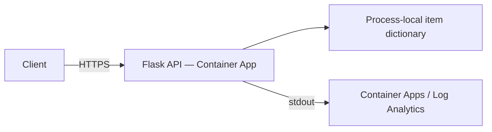

# 簡易 Flask API — Azure Container Apps

**程度：** 初學者 · **時間：** 包含設定約 30–45 分鐘

使用 Azure Developer CLI (azd) 部署 Python Flask CRUD API。包含原始碼、Dockerfile、
Bicep 以及部署參數。這是 <strong>學習範例</strong>，並非
生產環境準備好的 API。

## 您將學到

- 透過 azd 建構與發佈容器。
- 配置入口流量和存活/就緒探測。
- 驗證 CRUD 回應並檢視應用程式日誌。
- 了解為什麼記憶體資料不適用於持久化應用程式。



**重要：** 項目保存在單一程序。預設為 **一個 Gunicorn 工作程序，
0–1 副本**，故意避免工作程序/副本間的資料不一致。
重新啟動、版本變更或縮減到零時會遺失項目。增加副本數
需共享持久性儲存。此 API 無身份驗證或授權。

## 先決條件

- [目前穩定版 azd](https://learn.microsoft.com/azure/developer/azure-developer-cli/install-azd)
  (審查時發布版本：1.37.2)。
- [Azure CLI](https://learn.microsoft.com/cli/azure/install-azure-cli) 用於驗證。
- Docker 及其守護程序運行中；為預設本地映像建構所需。
- Azure 訂閱、資源建立權限，以及 Container Apps 區域配額。
- 用於以下指令的 Bash（或相等的是 PowerShell）。
- 選用本地開發的 Python 3.11。

```bash
azd version
az version
docker info
azd auth login
az login
```

CLI 工具擁有獨立登入，請兩者使用相同訂閱。

## 快速開始

從儲存庫根目錄開始：

```bash
cd examples/container-app/simple-flask-api
azd env new flask-demo
azd up
API_URL=$(azd env get-value API_ENDPOINT)
RG_NAME=$(azd env get-value AZURE_RESOURCE_GROUP)
API_NAME=$(azd env get-value API_NAME)
curl --fail-with-body "${API_URL}/health"
```

預期：HTTP 200 及包含 `"status":"healthy"`、
`"service":"simple-flask-api"` 與當前 UTC 時戳的 JSON 回應。
建置和映像建構通常需數分鐘；時間有異。

初始部署使用一個公共 hello-world 映像，監聽 80 埠。
`azure.yaml` 選擇 `infra/app/api.bicep` 及其對應參數檔
進行服務部署，切換映像、入口與探測為 8000 埠。
請勿刪除這些部署參數。

## 驗證 CRUD

在相同副本持續運作時，依序執行下列指令：

```bash
# Create: HTTP 201; note the returned id (1 for a fresh process).
curl -i -X POST "${API_URL}/api/items" \
  -H "Content-Type: application/json" \
  -d '{"name":"Test Item","description":"My first item"}'

# Read list: HTTP 200, total 1 in a fresh process.
curl --fail-with-body "${API_URL}/api/items"

# Replace 1 if your create response returned another id.
curl --fail-with-body "${API_URL}/api/items/1"
curl -i -X PUT "${API_URL}/api/items/1" \
  -H "Content-Type: application/json" -d '{"name":"Updated Item"}'
curl -i -X DELETE "${API_URL}/api/items/1"
curl -i "${API_URL}/api/items/1"
```

成功：POST 201，讀取/PUT 200，DELETE 204 無內容，接著缺少項目回傳 404。
格式錯誤/非物件 JSON 或空名稱回傳 400。
若項目於請求間消失，請檢查是否重新啟動或縮減至零；
此為刻意的記憶體限制，非持久化行為。

| 端點 | 方法 |
|---|---|
| `/` | GET — 服務資訊 |
| `/health` | GET — 存活/就緒檢查 |
| `/api/items` | GET, POST |
| `/api/items/{id}` | GET, PUT, DELETE |

## 日誌與設定

```bash
az containerapp logs show --name "$API_NAME" --resource-group "$RG_NAME" --follow
```

預期：Gunicorn 啟動、請求存取日誌及應用程式訊息。
`azd monitor --logs` 開啟入口網站檢視；不會在終端機串流輸出。
已配置 Application Insights，但 **此 Flask 程式碼無接入指標**；
請使用 Container Apps/Log Analytics 取得標準輸出日誌。

編輯 `infra/app/api.bicep` 以調整 CPU/記憶體、副本限制或擴縮規則，然後
執行 `azd up`。預設值為 0.5 vCPU，1 GiB，最小 0 / 最大 1 副本，
HTTP 閾值為 50 同時請求。縮減至零可能增加冷啟動延遲。

任意 `azd env set MAX_REPLICAS`、`API_KEY`、`LOG_LEVEL` 或
`SCALE_TO_ZERO_TIMEOUT` 值 <strong>不與此範本或應用綁定</strong>。
設定值不會自動作為執行時環境變數。
映像明確綁定 8000 埠，若改變埠號須同時更新 Dockerfile、Bicep 入口與探測。


## 檔案

```text
azure.yaml
infra/main.bicep
infra/main.parameters.json
infra/app/container-apps.bicep       # Environment, registry, monitoring
infra/app/api.bicep                  # App, ingress, probes, scale settings
infra/app/api.parameters.json        # Image and resource values for azd deploy
src/app.py
src/Dockerfile
src/requirements.txt
```

## 本地開發

從此範例目錄開始：

```bash
python -m venv .venv
source .venv/bin/activate  # PowerShell: .\.venv\Scripts\Activate.ps1
python -m pip install -r src/requirements.txt
python src/app.py
```

在另一個終端測試 `http://localhost:8000/health` 和 CRUD 端點。
或構建並執行實際映像：

```bash
docker build -t flask-api:local ./src
docker run --rm -p 8000:8000 flask-api:local
```

在首次部署後，僅對代碼變更執行 `azd deploy api`。
對 Bicep 變更，執行 `azd up` 重新佈建並部署。

## 實作練習

### 1. 驗證輸入拒絕

**起點：** 已部署 API，如上方 `API_URL`。
**目標：** 驗證 API 拒絕無效的 JSON 結構和缺少名稱。

```bash
curl -i -X POST "${API_URL}/api/items" \
  -H "Content-Type: application/json" -d '[]'
curl -i -X POST "${API_URL}/api/items" \
  -H "Content-Type: application/json" -d '{"name":""}'
```

**成功標準 / 解決方案：** 兩者皆返回 400 和 JSON 錯誤，而非 500。
**常見問題：** 忘記帶上 JSON 內容類型標頭。

### 2. 新增唯讀版本端點

**起點：** `src/app.py`。**目標：** 擴充並重新部署 API。
在 `if __name__ == '__main__':` 區塊前新增此內容：

```python
@app.route('/version', methods=['GET'])
def version():
    return jsonify({'version': '1.0.0'})
```

執行 `azd deploy api`，然後 `curl --fail-with-body "${API_URL}/version"`。
**成功標準：** HTTP 200 與 `{"version":"1.0.0"}`。
**常見問題：** 在阻塞的 `app.run()` 調用之後放置路由時
使用 `python src/app.py` 測試。

### 知識檢測點

為什麼只有一個工作程序不足以保存持久數據？因為即使是一個進程在重新啟動時也會丟失其字典。
生產版本需要持久的共享存儲、身份驗證、授權、遷移、測試和運維監控。


## 成本與故障排除

這並不是保證零成本的部署：基本登錄和日誌存儲/攝取即使在應用計算為零時也可能產生費用。
使用
[計價計算器](https://azure.microsoft.com/pricing/calculator/) 根據您的區域。

- **Docker 建置失敗：** 確認 `docker info`、網路存取和依賴項。
- **應用程式不健康：** 檢查控制台/系統日誌並驗證映像埠、入口，以及探測設定是否一致。Flask 埠上不應探測到佔位符。
  和探測設定是否一致。Flask 埠上不應探測到佔位符。
- **403/權限：** 確認訂閱和資源建立權限。
- **項目消失：** 記憶體中的狀態於重啟/縮放至零時重置；新增資料庫以實現持久行為。
  為持久化行為新增資料庫。

## 清理與後續步驟

```bash
azd down
```

請檢視刪除提示，並確認專用資源群組已被移除。
請勿對包含無關資料的資源群組使用破壞性清理。

[下一節：資料庫應用程式](../../../../../examples/database-app) · [微服務](../../../../../examples/container-app/microservices) ·
[容器概覽](../README.md) · [課程首頁](../../../README.md) ·
[回報問題](https://github.com/microsoft/AZD-for-beginners/issues)

---

<!-- CO-OP TRANSLATOR DISCLAIMER START -->
**免責聲明**：
此文件已使用 AI 翻譯服務 [Co-op Translator](https://github.com/Azure/co-op-translator) 進行翻譯。雖然我們努力追求準確性，但請注意自動翻譯可能包含錯誤或不準確之處。原始文件的母語版本應視為權威來源。對於關鍵資訊，建議採用專業人工翻譯。我們不對因使用此翻譯所產生的任何誤解或誤譯承擔責任。
<!-- CO-OP TRANSLATOR DISCLAIMER END -->