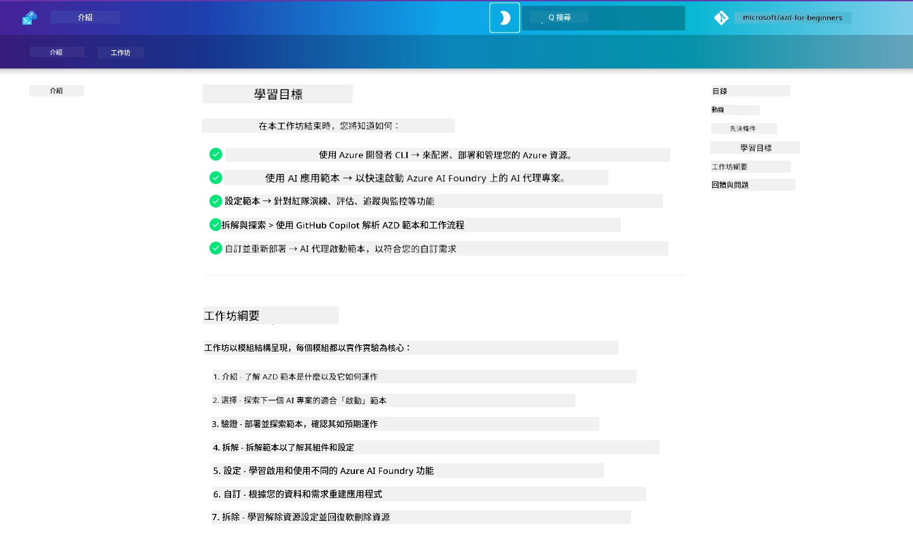

<div align="center">
  <div style="background: linear-gradient(135deg, #0078d4, #106ebe); border-radius: 10px; padding: 20px; margin: 20px 0; box-shadow: 0 4px 15px rgba(0, 120, 212, 0.3); border: 2px solid #005a9e;">
    <h2 style="color: white; margin: 0; font-size: 24px; text-shadow: 1px 1px 2px rgba(0,0,0,0.3);">
      🎯 AZD AI 開發者工作坊
    </h2>
    <p style="color: white; margin: 10px 0 0 0; font-size: 16px; text-shadow: 1px 1px 2px rgba(0,0,0,0.3);">
      <strong>使用 Azure Developer CLI 建構 AI 應用程式的實作工作坊。</strong><br>
      完成 7 個模組，精通 AZD 範本與 AI 部署工作流程。
    </p>
    <div style="margin-top: 15px;">
      <span style="background: rgba(255,255,255,0.2); padding: 5px 10px; border-radius: 15px; color: white; font-size: 14px;">
        📅 資訊參考日期：2026 年 11 月
      </span>
    </div>
  </div>
</div>

# AZD AI 開發者工作坊

歡迎參加聚焦於 AI 應用部署的 Azure Developer CLI (AZD) 實作工作坊。本工作坊協助你透過三個步驟，深入了解 AZD 範本的實際應用：

1. <strong>探索</strong> - 找到適合你的範本。
1. <strong>部署</strong> - 部署並驗證功能。
1. <strong>自訂</strong> - 修改並反覆調整成為你的專屬方案！

在課程進行中，你也會接觸到核心開發工具與工作流程，協助你優化端到端的開發歷程。

<br/>

## 瀏覽器導覽

工作坊課程以 Markdown 格式呈現。你可以直接在 GitHub 上瀏覽它們，或如下面截圖所示，啟動瀏覽器預覽。



若要使用此選項，請將此資料庫分叉至你的個人帳戶，並啟動 GitHub Codespaces。當 VS Code 終端機啟動後，輸入以下指令：

此瀏覽器預覽可在 GitHub Codespaces、開發容器或已安裝 Python 及 MkDocs 的本地複製環境中使用。

```bash title="" linenums="0"
python -m pip install -r requirements-dev.txt
python -m mkdocs serve --config-file workshop/mkdocs.yml
```

請在 <strong>課程資料庫根目錄</strong> 執行這些指令，而非單獨初始化的 AI 範例資料夾。保持預覽視窗在前景，以便錯誤訊息持續可見；可用 Ctrl+C 停止。若只想檢查網站而不啟動伺服器，請執行 `python -m mkdocs build --strict --config-file workshop/mkdocs.yml`。

幾秒鐘後，你會看到跳出視窗。請選擇 `Open in browser` 選項。網頁指南將會在新分頁中開啟。此預覽的幾項優勢：

1. <strong>內建搜尋</strong> - 快速查找關鍵字或課程內容。
1. <strong>複製圖示</strong> - 滑鼠移至程式碼區塊即顯示。
1. <strong>主題切換</strong> - 可在明暗主題間切換。
1. <strong>獲得協助</strong> - 點擊頁尾的 Discord 圖示加入交流！

<br/>

## 工作坊概覽

**時長：** 3-4 小時  
**程度：** 初學者到中階  
**先備知識：** 熟悉 Azure、AI 概念、VS Code 與指令列工具。

這是一個強調實作的工作坊，透過動手操作學習。完成所有練習後，建議瀏覽 AZD 初學者課程，繼續學習安全與生產力最佳實務。

| 時間| 模組  | 目標 |
|:---|:---|:---|
| 15 分鐘 | [介紹](docs/instructions/0-Introduction.md) | 建立背景與瞭解目標 |
| 30 分鐘 | [選擇 AI 範本](docs/instructions/1-Select-AI-Template.md) | 探索選項並挑選入門 |
| 30 分鐘 | [驗證 AI 範本](docs/instructions/2-Validate-AI-Template.md) | 部署預設解決方案到 Azure |
| 30 分鐘 | [拆解 AI 範本](docs/instructions/3-Deconstruct-AI-Template.md) | 探索結構與設定 |
| 30 分鐘 | [配置 AI 範本](docs/instructions/4-Configure-AI-Template.md) | 啟用並嘗試可用功能 |
| 30 分鐘 | [自訂 AI 範本](docs/instructions/5-Customize-AI-Template.md) | 調整範本以符合需求 |
| 30 分鐘 | [拆卸基礎架構](docs/instructions/6-Teardown-Infrastructure.md) | 清理並釋放資源 |
| 15 分鐘 | [結語與後續步驟](docs/instructions/7-Wrap-up.md) | 學習資源與工作坊挑戰 |

<br/>

## 你將學到的項目

把 AZD 範本想像成一個學習沙盒，讓你探索 Microsoft Foundry 端到端開發的各種能力與工具。完成本工作坊後，你應該能直覺掌握在此情境中各種工具與概念。

| 概念  | 目標 |
|:---|:---|
| **Azure Developer CLI** | 理解工具指令與工作流程 |
| **AZD 範本**| 理解專案結構與設定 |
| **Azure AI Agent**| 設置與部署 Microsoft Foundry 專案 |
| **Azure AI Search**| 啟用代理的上下文工程 |
| <strong>可觀察性</strong>| 探索追蹤、監控與評估 |
| <strong>紅隊測試</strong>| 探索對抗性測試與緩解方法 |

<br/>

## 工作坊架構

本工作坊結構引導你從範本探索、部署、拆解，再到自訂，並以官方 [Getting Started with AI Agents](https://github.com/Azure-Samples/get-started-with-ai-agents) 入門範本為基礎。

### [模組 1：選擇 AI 範本](docs/instructions/1-Select-AI-Template.md) (30 分鐘)

- 什麼是 AI 範本？
- 哪裡可以找到 AI 範本？
- 如何開始建構 AI 代理？
- <strong>實作練習</strong>：在 Codespaces 或開發容器中快速開始

### [模組 2：驗證 AI 範本](docs/instructions/2-Validate-AI-Template.md) (30 分鐘)

- 什麼是 AI 範本架構？
- 什麼是 AZD 開發工作流程？
- 如何取得 AZD 開發協助？
- <strong>實作練習</strong>：部署並驗證 AI 代理範本

### [模組 3：拆解 AI 範本](docs/instructions/3-Deconstruct-AI-Template.md) (30 分鐘)

- 在 `.azure/` 探索你的環境
- 在 `infra/` 探索你的資源設定
- 探索 `azure.yaml` 中的 AZD 配置
- <strong>實作練習</strong>：修改環境變數並重新部署

### [模組 4：配置 AI 範本](docs/instructions/4-Configure-AI-Template.md) (30 分鐘)
- 探索：檢索增強生成（Retrieval Augmented Generation）
- 探索：代理評估與紅隊測試
- 探索：追蹤與監控
- <strong>實作練習</strong>：探索 AI 代理與可觀察性

### [模組 5：自訂 AI 範本](docs/instructions/5-Customize-AI-Template.md) (30 分鐘)
- 定義：根據場景需求撰寫產品需求文件（PRD）
- 設定：AZD 的環境變數
- 實作：增加工作流程的生命週期掛勾
- <strong>實作練習</strong>：根據我的場景自訂範本

### [模組 6：拆卸基礎架構](docs/instructions/6-Teardown-Infrastructure.md) (30 分鐘)
- 回顧：什麼是 AZD 範本？
- 回顧：為何要使用 Azure Developer CLI？
- 後續步驟：嘗試其他範本！
- <strong>實作練習</strong>：撤銷基礎架構並清理

<br/>

## 工作坊挑戰

想挑戰更多嗎？以下是一些專案提案，或歡迎分享你的想法！

| 專案 | 說明 |
|:---|:---|
|1. **拆解複雜的 AI 範本** | 運用本課示範的工作流程及工具，嘗試部署、驗證及自訂另一個 AI 解決方案範本。_你學到了什麼？_|
|2. <strong>根據你的場景自訂</strong> | 嘗試撰寫另外一個場景的產品需求文件（PRD）。然後，在你的範本資源庫中使用 GitHub Copilot 的 Agent Model，請它生成一個自訂工作流程。_你學到了什麼？你如何改進這些建議？_|
| | |

## 有意見反饋嗎？

1. 在此倉庫發佈 issue，標註 `Workshop` 以便追蹤。
1. 加入 Microsoft Foundry 的 Discord，與夥伴交流！


| | | 
|:---|:---|
| **📚 課程首頁**| [AZD 初學者](../README.md)|
| **📖 文件** | [開始使用 AI 範本](https://learn.microsoft.com/en-us/azure/ai-foundry/how-to/develop/ai-template-get-started)|
| **🛠️AI 範本** | [Microsoft Foundry 範本](https://ai.azure.com/templates) |
|**🚀 後續步驟** | [開始工作坊](#workshop-overview) |
| | |

<br/>

---

**導覽：** [主課程](../README.md) | [介紹](docs/instructions/0-Introduction.md) | [模組 1：選擇範本](docs/instructions/1-Select-AI-Template.md)

**準備開始用 AZD 架構 AI 應用程式了嗎？**

[開始工作坊：介紹 →](docs/instructions/0-Introduction.md)

---

<!-- CO-OP TRANSLATOR DISCLAIMER START -->
**免責聲明**：
此文件已使用 AI 翻譯服務 [Co-op Translator](https://github.com/Azure/co-op-translator) 進行翻譯。雖然我們努力追求準確性，但請注意自動翻譯可能包含錯誤或不準確之處。原始文件的母語版本應視為權威來源。對於關鍵資訊，建議採用專業人工翻譯。我們不對因使用此翻譯所產生的任何誤解或誤譯承擔責任。
<!-- CO-OP TRANSLATOR DISCLAIMER END -->