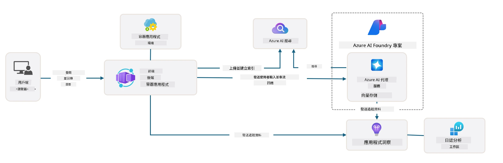

# 3. 拆解範本

!!! tip "在本單元結束時，您將能夠"

    - [ ] Use GitHub Copilot and optional MCP tools for Azure documentation and read-only exploration
    - [ ] Identify the template's application, infrastructure, configuration, and test entry points
    - [ ] Verify generated explanations against actual repository files
    - [ ] **Lab 3:** Trace one request and one configuration input through the project

---

## 1. 啟用 GitHub Copilot

在 VS Code 中開啟已初始化的 AI 範例並啟用 [GitHub Copilot](https://code.visualstudio.com/docs/copilot/chat/chat-agent-mode)。使用擁有合資格方案的帳戶登入；使用限制會有所不同。請求 Copilot 在授權變更前解釋此儲存庫。

### 可選的 MCP 伺服器

這些服務可以提供額外工具：

- [Azure MCP 伺服器](https://learn.microsoft.com/azure/developer/azure-mcp-server/overview)
- [Microsoft Learn MCP 伺服器](https://learn.microsoft.com/training/support/mcp)

在 VS Code 中，請檢視 [MCP 配置指南](https://code.visualstudio.com/docs/copilot/chat/mcp-servers) 並在需要時建立 `.vscode/mcp.json`：

```json
{
  "servers": {
    "Azure MCP Server": {
      "type": "stdio",
      "command": "npx",
      "args": ["-y", "@azure/mcp@latest", "server", "start"]
    },
    "microsoft.docs.mcp": {
      "type": "http",
      "url": "https://learn.microsoft.com/api/mcp"
    }
  }
}
```

`npx` 命令需要受支援的 Node.js/npm 安裝，並會下載可執行程式碼。請檢查套件並固定核准的版本，以利團隊可重現的設定。使用 VS Code 的 MCP 控制啟動伺服器並檢查其可用工具；名稱版本間可能會變。

**認證是分開的。** 使用 `azd auth login` 進行 AZD 認證。請依 Azure MCP 文件操作其工具的認證流程；僅 AZD 登入無法建立 MCP 連線。當練習或掛勾執行 Azure CLI 時，請另行使用 `az login`。

嘗試只讀提示：

1.「使用 Microsoft Learn MCP 查找 Azure Developer CLI 配置文件。」
2.「解釋此儲存庫的 `azure.yaml`；列出實作每個掛勾的檔案。」
3.「利用可用的 Azure MCP 工具，列出我的部署資源但不修改任何內容。」

檢查所選租戶/訂閱和每個建議的工具呼叫。不要僅為了探索架構而核准建立、刪除或變更資源存取。

## 2. 理解架構

該範例在 Azure Container Apps 中託管 Python FastAPI 後端及 React/TypeScript 前端。後端與 Microsoft Foundry 專案中的代理程式通訊。資料擷取與可觀察性依賴啟用的範本功能和成功設定；僅憑應用部署並無保證。



將本圖與 [最新上游部署指南](https://github.com/Azure-Samples/get-started-with-ai-agents/blob/main/docs/deployment.md) 及您實際資源比較。檢查已配置的模型部署、代理工具、管理身份、角色指派以及選用的 AI 搜尋/應用洞察資源。

**練習:** 請 Copilot 追蹤一次從前端透過 API 到 Foundry 的聊天請求，並附上檔案與函式參考。開啟那些參考並驗證解說。請勿只憑圖示推斷已實作的認證、路由或授權。

## 3. 儲存庫結構

以下挑選的路徑已於 2026 年 11 月 4 日與範例核對。您所初始化的修訂版本仍為真實資料來源：

```text
get-started-with-ai-agents/
  azure.yaml
  docker-compose.yaml
  requirements-dev.txt
  .devcontainer/
  infra/
    main.bicep
    main.parameters.json
    api.bicep
    core/
  src/
    Dockerfile
    pyproject.toml
    requirements.txt
    api/
      main.py
      routes.py
      search_index_manager.py
    frontend/
      package.json
      src/
    files/
  scripts/
    validate_env_vars.sh
    validate_env_vars.ps1
    postdeploy.sh
    postdeploy.ps1
  tests/
    test_evaluation.py
    test_red_teaming.py
  docs/
    deployment.md
    deploy_customization.md
    ai_search.md
    observability.md
    local_development.md
    troubleshooting.md
```

### 基礎建設與配置

`infra/main.bicep` 負責協調資源；`main.parameters.json` 將範本輸入連接至 AZD 環境值。`azure.yaml` 選擇應用服務與生命週期掛勾。追蹤 `USE_AZURE_AI_SEARCH_SERVICE` 等輸入在這些檔案中到底改變什麼。

### 應用與身份

同時閱讀 `src/api/` 和 `src/frontend/`。找出代理在哪裡建立或擷取、指令/工具如何配置，以及每個 Azure 呼叫使用哪個身份。`src/files/` 下的示範檔案為展示資料，不是生產目錄或授權模型。

### 測試與可觀察性

目前評估與紅隊的切入點在 `tests/`；較舊的 `evals/` 和 `airedteaming/` 目錄參考對這個範例而言已過時。請閱讀 `docs/observability.md` 了解嚮往執行雲端測試的先決條件與花費。這些 Python 測試與選用的 `azure.ai.evaluations` AZD 擴充不同。

## 4. 驗證您的發現

- 確認一個範例問題的 API 路由、代理互動與擷取程式碼。
- 解釋哪個身份存取 Foundry，且哪個設定選擇其端點。
- 找出實際的部署前和部署後指令碼及其錯誤處理行為。
- 列出任何在您的部署中缺少的相依項或選用功能。

繼續前往 [配置範本](4-Configure-AI-Template.md)。

---

<!-- CO-OP TRANSLATOR DISCLAIMER START -->
**免責聲明**：
此文件已使用 AI 翻譯服務 [Co-op Translator](https://github.com/Azure/co-op-translator) 進行翻譯。雖然我們努力追求準確性，但請注意自動翻譯可能包含錯誤或不準確之處。原始文件的母語版本應視為權威來源。對於關鍵資訊，建議採用專業人工翻譯。我們不對因使用此翻譯所產生的任何誤解或誤譯承擔責任。
<!-- CO-OP TRANSLATOR DISCLAIMER END -->